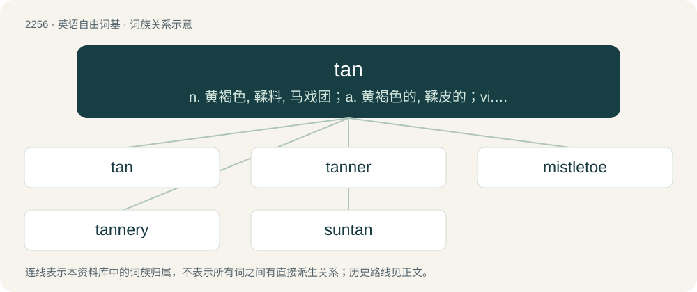

# 2358 · tan — n. 黄褐色, 鞣料, 马戏团；a. 黄褐色的, 鞣皮的；vi. 晒成棕褐色

[总目录](../00_总目录_按常用程度.md)

**类型**：英语自由词基　｜　**来源语言**：见词源记录

## 核心含义与来源

- 核心含义：n. 黄褐色, 鞣料, 马戏团；a. 黄褐色的, 鞣皮的；vi. 晒成棕褐色
- 英文含义：A light, brown-like colour.
- 词形：tan

**多个词源／构词路径**：同一拼写可能有不同来源；以下按词性和含义分别列出。

**来源记录 1**（名词；A light, brown-like colour.）

From Middle English tan, from Old French tan (“tanbark”), from Gaulish \*tannos (“green oak”) – compare Breton tann (“red oak”), Old Cornish tannen –, from Proto-Celtic \*tannos (“green oak”), of uncertain origin, but perhaps from Proto-Indo-European \*(s)dʰonu (“fir”). Per this hypothesis, related to Hittite \[script needed\] (tanau, “fir”), Latin femur, genitive feminis (“thigh”), German Tann (“woods”), Tanne (“fir”), Albanian thanë (“cranberry bush”), Ancient Greek θάμνος (thámnos, “thicket”), Avestan 𐬚𐬀𐬥𐬎𐬎𐬀𐬭𐬆 (θanuuar^ə), Sanskrit धनु (dhánu).

**来源记录 2**（动词；To change to a tan colour due to exposure to the sun.）

As a verb, from Middle English tannen, from late Old English tannian (“to tan a hide”), from Latin tannare.

**来源记录 3**（数词；The second cardinal number two, formerly used in Celtic areas, especially Cumbria and parts of Yorkshire, for counting sheep, and stitches in knitting.）

From a Brythonic language; influenced in form by yan (“one”) in the same series.

**来源记录 4**（名词；An Armenian drink made of yoghurt and water similar to airan and doogh）

Borrowed from Armenian թան (tʻan).

**来源记录 5**（名词；Synonym of picul, particularly in Cantonese contexts.）

Borrowed from Cantonese 擔／担 (daam3).

**来源记录 6**（名词；A twig or small switch.）

From Middle English \*tan, from Old English tān (“twig, shoot, switch”), from Proto-West Germanic \*tain, from Proto-Germanic \*tainaz (“rod, twig, straw, lot”).

**来源记录 7**（动词；To kill by gun, to shoot.）

It may either be a figurative use of the usual verb tan (“to cause to acquire a brownish colour”) or a Jamaican Creole pronunciation of turn, compare bun (“to kill particularly by gunshot”).

## 词族图

## 单词速览（常用到不常用）

| 单词 | 音标 | 释义 |
|---|---|---|
| [tan](#w-1) | 英 /tæn/ | n. 黄褐色, 鞣料, 马戏团；a. 黄褐色的, 鞣皮的；vi. 晒成棕褐色 |
| [tanner](#w-2) | 美 /ˈtænɚ/ | n. 制革工人, 硝皮匠, 六便士 |
| [mistletoe](#w-3) | 英 /ˈmɪs(ə)ltəʊ/；美 /ˈmɪsəlˌtoʊ/ | n. 槲寄生属植物；\[医\] 槲寄生(跗寄生属植物通称) |
| [tannery](#w-4) | /ˈtænəɹi/ | n. 制革厂, 硝皮厂；\[化\] 鞣革厂; 皮革厂 |
| [suntan](#w-5) | /ˈsʌnˌtæn/ | n. 晒黑, 土黄色军服 |

## 逐词详解

### 1. tan

**词性**：名词　｜　**音标**：英 /tæn/

**中文释义**：n. 黄褐色, 鞣料, 马戏团；a. 黄褐色的, 鞣皮的；vi. 晒成棕褐色

**英文义项**：A light, brown-like colour. / A darkening of the skin resulting from exposure to sunlight or similar light sources.

**词源与演化**：

From Middle English tan, from Old French tan (“tanbark”), from Gaulish \*tannos (“green oak”) – compare Breton tann (“red oak”), Old Cornish tannen –, from Proto-Celtic \*tannos (“green oak”), of uncertain origin, but perhaps from Proto-Indo-European \*(s)dʰonu (“fir”). Per this hypothesis, related to Hittite \[script needed\] (tanau, “fir”), Latin femur, genitive feminis (“thigh”), German Tann (“woods”), Tanne (“fir”), Albanian thanë (“cranberry bush”), Ancient Greek θάμνος (thámnos, “thicket”), Avestan 𐬚𐬀𐬥𐬎𐬎𐬀𐬭𐬆 (θanuuar^ə), Sanskrit धनु (dhánu).

**例句**：

> I'm hoping to get a tan this weekend at the beach.

该用例对应义项：A darkening of the skin resulting from exposure to sunlight or similar light sources.

### 2. tanner

**词性**：名词　｜　**音标**：美 /ˈtænɚ/

**中文释义**：n. 制革工人, 硝皮匠, 六便士

**英文义项**：A person whose occupation is to tan hides, or convert them into leather by the use of tan. / A person who applies a tan (especially a spray tan) on someone's skin.

**构词拆分**：tan + -er

**词源与演化**：

From Middle English tannere, from Old English tannere; and Old French tannour, equivalent to tan + -er.

### 3. mistletoe

**词性**：名词　｜　**音标**：英 /ˈmɪs(ə)ltəʊ/；美 /ˈmɪsəlˌtoʊ/

**中文释义**：n. 槲寄生属植物；\[医\] 槲寄生(跗寄生属植物通称)

**英文义项**：Any of numerous hemiparasitic evergreen plants of the order Santalales with white berries that grow in the crowns of apple trees, oaks, and other trees, such as the European mistletoe (Viscum album) and American mistletoe or eastern mistletoe (Phoradendron leucarpum). / A sprig of one such plant used as a Christmas decoration, associated with the custom that a man may kiss any woman standing beneath it.

**构词拆分**：mistle + tan (“twig”)

**词源与演化**：

From Middle English mistelto, mistilto (“European mistletoe”), from Old English misteltān (“mistletoe”), from mistel (“mistletoe; basil; birdlime”) + tān (“sprig, shoot, twig”), possibly as a calque of Old Norse mistilteinn; equivalent to mistle + tan (“twig”). This was mistaken for the plural of tā (“toe”). Cognate with Danish mistelten (“mistletoe”), Norwegian misteltein (“mistletoe”), Icelandic mistilteinn (“mistletoe”). Compare also the simplex form West Frisian mistel (“mistletoe”), Dutch mistel (“mistletoe”), German Mistel (“mistletoe”), Swedish mistel (“mistletoe”).

**例句**：

> I used the mistletoe as an excuse to kiss him.

### 4. tannery

**词性**：名词　｜　**音标**：/ˈtænəɹi/

**中文释义**：n. 制革厂, 硝皮厂；\[化\] 鞣革厂; 皮革厂

**英文义项**：A place where people tan hides to make leather. / The business of a tanner.

**构词拆分**：tan + -ery

**词源与演化**：

From tan + -ery; compare Old French tannerie.

**例句**：

> The tannery used to discharge effluent straight into the river.

### 5. suntan

**词性**：名词　｜　**音标**：/ˈsʌnˌtæn/

**中文释义**：n. 晒黑, 土黄色军服

**英文义项**：A darkening of the skin resulting from exposure to sunlight or similar light sources.

**构词拆分**：sun + tan

**词源与演化**：

From sun + tan.

**例句**：

> Mary wanted Tom to put suntan lotion on her back.
