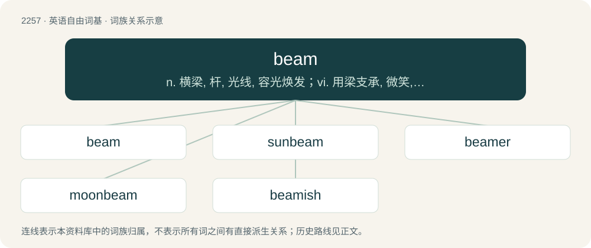

# 2359 · beam — n. 横梁, 杆, 光线, 容光焕发；vi. 用梁支承, 微笑, 射出光线；vt. 照耀, 感到欣喜

[总目录](../00_总目录_按常用程度.md)

**类型**：英语自由词基　｜　**来源语言**：见词源记录

## 核心含义与来源

- 核心含义：n. 横梁, 杆, 光线, 容光焕发；vi. 用梁支承, 微笑, 射出光线；vt. 照耀, 感到欣喜
- 英文含义：Any large piece of timber or iron long in proportion to its thickness, and prepared for use.
- 词形：beam

**来源记录 1**（名词；Any large piece of timber or iron long in proportion to its thickness, and prepared for use.）

From Middle English bem, beem, from Old English bēam (“tree, cross, gallows, column, pillar, wood, beam, splint, post, stock, rafter, piece of wood”), from Proto-West Germanic \*baum, from Proto-Germanic \*baumaz (“tree, beam, balk”), from Proto-Indo-European \*bʰew- (“to grow, swell”). Cognate with North Frisian Boom, buum (“tree”), Saterland Frisian Boom (“tree”), West Frisian beam (“tree”), Cimbrian pome, póom, puam (“tree”), Dutch boom (“tree”), German Low German Boom (“tree”), German Baum (“tree”), Luxembourgish Bam (“tree”), Mòcheno pa'm (“tree”), Vilamovian baojm (“tree”), Yiddish בוים (boym, “tree”), Danish, Norwegian Bokmål, Norwegian Nynorsk, and Swedish bom (“beam”), Icelandic baðmur (“tree”), Gothic 𐌱𐌰𐌲𐌼𐍃 (bagms, “tree”), Albanian bimë (“a plant”). Doublet of boom. The original English meaning of beam ("tree") is preserved in some compound words such as quickbeam. The verb is from Middle English bemen, from Old English bēamian (“to shine, to cast forth rays or beams of light”), from the noun.

## 词族图

## 单词速览（常用到不常用）

| 单词 | 音标 | 释义 |
|---|---|---|
| [beam](#w-1) | /ˈbiːm/ | n. 横梁, 杆, 光线, 容光焕发；vi. 用梁支承, 微笑, 射出光线；vt. 照耀, 感到欣喜 |
| [sunbeam](#w-2) | /ˈsʌnbiːm/ | n. 阳光 |
| [beamer](#w-3) | 英 /ˈbiːmə(ɹ)/；美 /ˈbimɚ/ | n. 投影机, 整经机 |
| [moonbeam](#w-4) | 美 /ˈmun.bim/ | n. 月光 |
| [beamish](#w-5) | /ˈbiːmɪʃ/ | a. 春风得意的 |

## 逐词详解

### 1. beam

**词性**：名词　｜　**音标**：/ˈbiːm/

**中文释义**：n. 横梁, 杆, 光线, 容光焕发；vi. 用梁支承, 微笑, 射出光线；vt. 照耀, 感到欣喜

**英文义项**：Any large piece of timber or iron long in proportion to its thickness, and prepared for use. / One of the principal horizontal structural members, usually of steel, timber, or concrete, of a building.

**词源与演化**：

From Middle English bem, beem, from Old English bēam (“tree, cross, gallows, column, pillar, wood, beam, splint, post, stock, rafter, piece of wood”), from Proto-West Germanic \*baum, from Proto-Germanic \*baumaz (“tree, beam, balk”), from Proto-Indo-European \*bʰew- (“to grow, swell”). Cognate with North Frisian Boom, buum (“tree”), Saterland Frisian Boom (“tree”), West Frisian beam (“tree”), Cimbrian pome, póom, puam (“tree”), Dutch boom (“tree”), German Low German Boom (“tree”), German Baum (“tree”), Luxembourgish Bam (“tree”), Mòcheno pa'm (“tree”), Vilamovian baojm (“tree”), Yiddish בוים (boym, “tree”), Danish, Norwegian Bokmål, Norwegian Nynorsk, and Swedish bom (“beam”), Icelandic baðmur (“tree”), Gothic 𐌱𐌰𐌲𐌼𐍃 (bagms, “tree”), Albanian bimë (“a plant”). Doublet of boom. The original English meaning of beam ("tree") is preserved in some compound words such as quickbeam. The verb is from Middle English bemen, from Old English bēamian (“to shine, to cast forth rays or beams of light”), from the noun.

**例句**：

> This ship has more beam than that one.

该用例对应义项：The maximum width of a vessel (note that a vessel with a beam of 15 foot can also be said to be 15 foot abeam).

### 2. sunbeam

**词性**：名词　｜　**音标**：/ˈsʌnbiːm/

**中文释义**：n. 阳光

**英文义项**：A ray of sunlight; especially, a demarcated, narrow, and intense (relative to ambient light) ray of sunlight (as revealed by, for example, its diffraction among dust particles). / Any of various lycaenid butterflies of the genus Curetis.

**构词拆分**：sun + beam

**词源与演化**：

From Middle English sonnebem, sonnebeem, from Old English sunnbēam, sunnebēam (“sunbeam”), equivalent to sun + beam.

**例句**：

> The first sunbeam, she knew, would be her death.

### 3. beamer

**词性**：名词　｜　**音标**：英 /ˈbiːmə(ɹ)/；美 /ˈbimɚ/

**中文释义**：n. 投影机, 整经机

**英文义项**：A gymnast proficient with or specializing in the balance beam.

**构词拆分**：beam + -er

**词源与演化**：

From beam (“balance beam”) + -er.

**例句**：

> Sami saw a black Beamer in his driveway.

### 4. moonbeam

**词性**：名词　｜　**音标**：美 /ˈmun.bim/

**中文释义**：n. 月光

**英文义项**：A ray or shaft of moonlight. / Any of various Australasian lycaenid butterflies of the genus Philiris.

**构词拆分**：moon + beam

**词源与演化**：

Compound of moon + beam.

### 5. beamish

**词性**：形容词　｜　**音标**：/ˈbiːmɪʃ/

**中文释义**：a. 春风得意的

**英文义项**：Radiantly beaming; happy; cheerful.

**构词拆分**：beam + -ish

**词源与演化**：

From beam + -ish.
