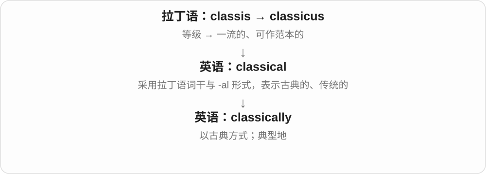
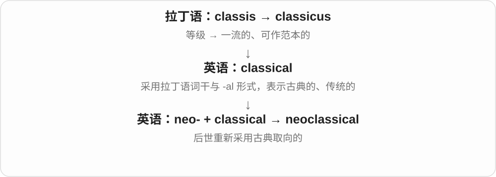

# 2361 · classical — 古典；古典传统的

[逐词精讲目录](../00_逐词精讲目录.md) · [总目录](../00_总目录_按常用程度.md)

## 核心词根与来源

classical 接 classicus 一支及相应形容词形式；classically 是相关副词。neoclassical 加 neo- 新，表示对古典传统的新发展或复兴，具体学科各有含义。

**CLASSICAL：属于一种被建立起来的经典传统**

可以是古希腊罗马学问，也可以是音乐、艺术或科学的一个分类。

- **传统与方式**：classical · classically
- **新的古典传统**：neoclassical

## 词形与演化规律

classical music、classical physics、neoclassical architecture 的分类标准不同，不能只用年代老来统一解释。

## 单词速览（按词族由简到繁）

同一基础词的相关扩展放在一起，先读基础形式，再读扩展；各组之间优先读常用的。具体词源关系见各词讲解。

| 单词 | 音标 | 核心意思 |
|---|---|---|
| [classical](#w-1) | 英、美 /ˈklæsɪkəl/ | 古典的；古希腊罗马的；传统体系的 |
| [classically](#w-2) | 英、美 /ˈklæsɪkəli/ | 按古典传统；典型地 |
| [neoclassical](#w-3) | 英 /ˌniːəʊˈklæsɪkəl/；美 /ˌniːoʊˈklæsɪkəl/ | 新古典主义的；新古典学派的 |

## 逐词讲解

### 1. classical — 古典的；古希腊罗马的；传统体系的

**音标**：英、美 /ˈklæsɪkəl/

**先抓住这个画面**

它常给事物标出所属传统：古希腊罗马文化、古典音乐，或相对现代新理论而言的传统方法。

**怎么拆**

以拉丁语 classicus 的词干形成 -al 形容词；现代可联系 classic + -al。不同词典对英语早期造词细节有不同处理，不必假设现代 classic 一定先出现。

**怎么变成今天的意思**

classical music 日常可统称西方古典音乐，也可在音乐史中特指古典主义时期。classical physics 通常与量子物理相对；谈 classical mechanics 时常指牛顿力学体系，具体范围看语境。

**常见搭配与例句**

classical music；classical architecture；classical mechanics。

> She plays classical music but also enjoys jazz.

她演奏古典音乐，也喜欢爵士乐。

> The museum has a gallery devoted to classical sculpture.

博物馆有一间专门展示古希腊罗马雕塑的展厅。

**别混淆**

a classic song 是一首经典歌曲，可能是摇滚；classical music 才是古典音乐这一传统。

### 2. classically — 按古典传统；典型地

**音标**：英、美 /ˈklæsɪkəli/

**先抓住这个画面**

看训练或风格是不是沿着古典传统走；也可以说某个特征正是人们通常想到的样子。

**怎么拆**

classical + -ly。

**怎么变成今天的意思**

classically trained 常形容接受过系统古典训练的音乐家、演员等；不是说这个人只能演旧作品。

**常见搭配与例句**

classically trained；classically proportioned；classically elegant。

> The singer is classically trained but performs mainly pop songs.

这位歌手受过古典声乐训练，但主要演唱流行歌曲。

> The building has a classically proportioned façade.

这栋建筑的正面采用了古典式的协调比例。

**别混淆**

classically trained 说明训练背景；naturally talented 说明天赋，二者可以同时成立。

### 3. neoclassical — 新古典主义的；新古典学派的

**音标**：英 /ˌniːəʊˈklæsɪkəl/；美 /ˌniːoʊˈklæsɪkəl/

**先抓住这个画面**

不是第一次出现古典形式，而是在后来的时代重新取用、改造它。

**怎么拆**

neo-“新的、复兴的” + classical。

**怎么变成今天的意思**

艺术里常指重新重视古典形式的风格；neoclassical economics 则是经济学中另有特定含义的学派名称，不能按建筑风格去理解。

**常见搭配与例句**

neoclassical architecture；a neoclassical façade；neoclassical economics。

> The museum occupies a neoclassical building with tall columns.

博物馆坐落在一栋有高大立柱的新古典主义建筑中。

> The course introduces the basic assumptions of neoclassical economics.

课程介绍新古典经济学的基本假设。

**别混淆**

classical 可指古典传统本身；neoclassical 强调后世的再采用或特定新学派。

## 这一组要分清什么

classic 是经典、典型，classical 多见固定的古典分类；neoclassical 在艺术与经济学中也不是同一个流派。

## 串起来练习

The building combines classical details with a neoclassical design.

建筑把古典细节与新古典设计结合起来。
