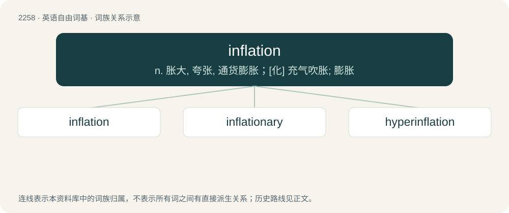

# 2361 · inflation — n. 胀大, 夸张, 通货膨胀；\[化\] 充气吹胀; 膨胀

[总目录](../00_总目录_按常用程度.md)

**类型**：英语自由词基　｜　**来源语言**：见词源记录

## 核心含义与来源

- 核心含义：n. 胀大, 夸张, 通货膨胀；\[化\] 充气吹胀; 膨胀
- 英文含义：An act, instance of, or state of expansion or increase in size, especially by injection of a gas or liquid.
- 词形：inflation

**来源记录 1**（名词；An act, instance of, or state of expansion or increase in size, especially by injection of a gas or liquid.）

From Middle English, borrowed from Old French inflation (“swelling”), from Latin īnflātiō (“expansion", "blowing up”), from īnflātus, the perfect passive participle of īnflō (“blow into, expand”), from in (“into”) + flō (“blow”). By surface analysis, inflate + -ion.

## 词族图

## 单词速览（常用到不常用）

| 单词 | 音标 | 释义 |
|---|---|---|
| [inflation](#w-1) | 英 /ɪnˈfleɪ.ʃn̩/；美 /ɪnˈfleɪ.ʃən/ | n. 胀大, 夸张, 通货膨胀；\[化\] 充气吹胀; 膨胀 |
| [inflationary](#w-2) | /inˈfleiʃənəri/ | a. 通货膨胀的, 通货膨胀倾向的 |
| [hyperinflation](#w-3) | /ˌhaɪpəɹɪnˈfleɪʃən/ | n. 恶性通货膨胀 |

## 逐词详解

### 1. inflation

**词性**：名词　｜　**音标**：英 /ɪnˈfleɪ.ʃn̩/；美 /ɪnˈfleɪ.ʃən/

**中文释义**：n. 胀大, 夸张, 通货膨胀；\[化\] 充气吹胀; 膨胀

**英文义项**：An act, instance of, or state of expansion or increase in size, especially by injection of a gas or liquid. / An increase in the quantity of money, leading to a devaluation of existing money, adjusted for by way of higher nominal values.

**词源与演化**：

From Middle English, borrowed from Old French inflation (“swelling”), from Latin īnflātiō (“expansion", "blowing up”), from īnflātus, the perfect passive participle of īnflō (“blow into, expand”), from in (“into”) + flō (“blow”). By surface analysis, inflate + -ion.

**例句**：

> Due to inflation, the monthly gym fee is rising by 10% from January.

该用例对应义项：An increase in the quantity of money, leading to a devaluation of existing money, adjusted for by way of higher nominal values.

### 2. inflationary

**词性**：形容词　｜　**音标**：/inˈfleiʃənəri/

**中文释义**：a. 通货膨胀的, 通货膨胀倾向的

**英文义项**：Causing or liable to cause inflation. / Of or relating to inflation.

**构词拆分**：inflation + -ary

**词源与演化**：

From inflation + -ary.

**例句**：

> The rapid influx of precious metals from the new mines had an inflationary effect on the specie based economy.

该用例对应义项：Causing or liable to cause inflation.

### 3. hyperinflation

**词性**：名词　｜　**音标**：/ˌhaɪpəɹɪnˈfleɪʃən/

**中文释义**：n. 恶性通货膨胀

**英文义项**：Excessive inflation. / A very high rate of inflation.

**构词拆分**：hyper- + inflation

**词源与演化**：

From hyper- + inflation.

**用法示例／搭配（非完整句）**：

> hyperinflation of the lungs

该用例对应义项：Excessive inflation.
