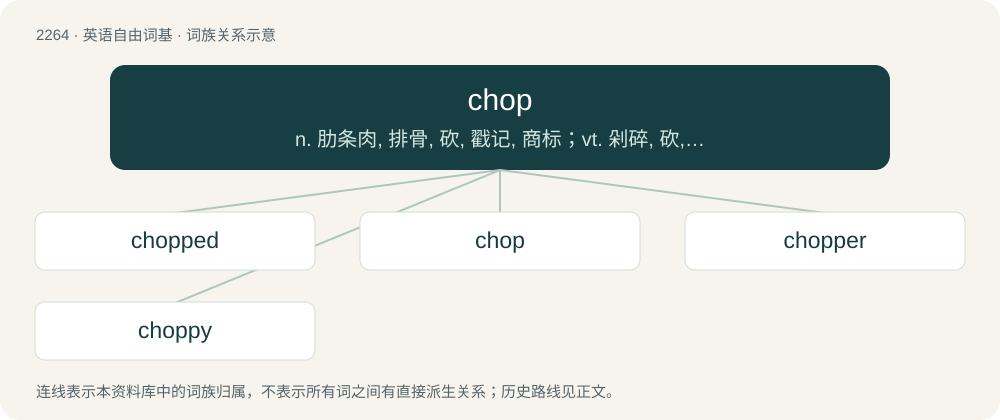

# 2367 · chop — n. 肋条肉, 排骨, 砍, 戳记, 商标；vt. 剁碎, 砍, 切击, 割断；vi. 砍, 突然转向

[总目录](../00_总目录_按常用程度.md)

**类型**：英语自由词基　｜　**来源语言**：见词源记录

## 核心含义与来源

- 核心含义：n. 肋条肉, 排骨, 砍, 戳记, 商标；vt. 剁碎, 砍, 切击, 割断；vi. 砍, 突然转向
- 英文含义：A cut of meat, often containing a section of a rib.
- 词形：chop

**多个词源／构词路径**：同一拼写可能有不同来源；以下按词性和含义分别列出。

**来源记录 1**（名词；A cut of meat, often containing a section of a rib.）

From Middle English choppen, chappen (“to chop”), of uncertain origin, possibly onomatopoeic (cf. Swedish tjoff), or a variant of chap (“to become cracked”). Cognate with Scots chap (“to chop”). Compare also Saterland Frisian kappe, kapje (“to hack; chop; lop off”), Dutch kappen (“to chop, cut, hew”), German Low German kappen (“to cut off; clip”), German kappen (“to cut; clip”), German dialectal chapfen, kchapfen (“to chop into small pieces”), Albanian copë (“piece, chunk”), Old English \*ċippian (in forċippian (“to cut off”)). Perhaps related to chip. Compare French couper (“to chop”), Ancient Greek κόπτω (kóptō, “to strike, cut”), Swedish and Norwegian kapa, kappa, kabba (“to chop/cut (off)”).

**来源记录 2**（动词；To chap or crack.）

Uncertain, perhaps a variant of chap (“cheap”). Compare Middle English copen (“to buy”), Dutch kopen (“to buy”).

**来源记录 3**（名词；A jaw of an animal.）

From Middle English choppe (“jaw, jawbone”), related to Middle English cheppe (“one side of the jaw, chap”). Perhaps ultimately related to Etymology 1 above.

**来源记录 4**（名词；A stamp or seal; a mark, imprint or impression on a document (or other object or material) made by stamping or sealing a design with ink or wax, respectively, or by other methods.）

Borrowed from Hindi छाप (chāp, “stamp”). Closely related to the similarly descended Malay word cap, which likely reinforced the English usage within the Malay world.

**来源记录 5**（名词；An IRC channel operator.）

Shortening.

**来源记录 6**（动词；To fly a helicopter or be flown in a helicopter.）

Shortening of chopper.

## 词族图

## 单词速览（常用到不常用）

| 单词 | 音标 | 释义 |
|---|---|---|
| [chopped](#w-1) | 英 /t͡ʃɒpt/；美 /t͡ʃɑpt/ | v. 砍；斩碎；大量削减（chop的过去分词） |
| [chop](#w-2) | 英 /t͡ʃɒp/；美 /t͡ʃɑp/ | n. 肋条肉, 排骨, 砍, 戳记, 商标；vt. 剁碎, 砍, 切击, 割断；vi. 砍, 突然转向 |
| [chopper](#w-3) | 英 /ˈtʃɒp.ə/；美 /ˈt͡ʃɑ.pɚ/ | n. 切物之人, 斧头, 切肉大刀；\[化\] 切碎机; 切...机; 断裂剂(热原子化学); 断路器; 斩波器; 断续器 |
| [choppy](#w-4) | 英 /ˈt͡ʃɒ.pi/；美 /ˈt͡ʃɑ.pi/ | a. 猛地一动一停的, 突变的；\[经\] 震荡的 |

## 逐词详解

### 1. chopped

**词性**：形容词　｜　**音标**：英 /t͡ʃɒpt/；美 /t͡ʃɑpt/

**中文释义**：v. 砍；斩碎；大量削减（chop的过去分词）

**英文义项**：Cut or diced into small pieces. / Ground, having been processed by grinding.

**构词拆分**：chop + -ed

**词源与演化**：

Equivalent to chop + -ed.

**例句**：

> Cook the peeled and chopped potatoes for 20 minutes in boiling water.

### 2. chop

**词性**：名词　｜　**音标**：英 /t͡ʃɒp/；美 /t͡ʃɑp/

**中文释义**：n. 肋条肉, 排骨, 砍, 戳记, 商标；vt. 剁碎, 砍, 切击, 割断；vi. 砍, 突然转向

**英文义项**：A cut of meat, often containing a section of a rib. / A blow with an axe, cleaver, or similar implement.

**词源与演化**：

From Middle English choppen, chappen (“to chop”), of uncertain origin, possibly onomatopoeic (cf. Swedish tjoff), or a variant of chap (“to become cracked”). Cognate with Scots chap (“to chop”). Compare also Saterland Frisian kappe, kapje (“to hack; chop; lop off”), Dutch kappen (“to chop, cut, hew”), German Low German kappen (“to cut off; clip”), German kappen (“to cut; clip”), German dialectal chapfen, kchapfen (“to chop into small pieces”), Albanian copë (“piece, chunk”), Old English \*ċippian (in forċippian (“to cut off”)). Perhaps related to chip. Compare French couper (“to chop”), Ancient Greek κόπτω (kóptō, “to strike, cut”), Swedish and Norwegian kapa, kappa, kabba (“to chop/cut (off)”).

**例句**：

> With both players having an ace-high straight, the pot was a chop.

该用例对应义项：A hand where two or more players have an equal-valued hand, resulting in the chips being shared equally between them.

### 3. chopper

**词性**：名词　｜　**音标**：英 /ˈtʃɒp.ə/；美 /ˈt͡ʃɑ.pɚ/

**中文释义**：n. 切物之人, 斧头, 切肉大刀；\[化\] 切碎机; 切...机; 断裂剂(热原子化学); 断路器; 斩波器; 断续器

**英文义项**：A tool for chopping wood; an axe/ax. / A knife for chopping food, especially one with a large oblong blade.

**构词拆分**：chop + -er

**词源与演化**：

From chop + -er.

**例句**：

> Some sicko chopper fucked up a lot of his friends.

### 4. choppy

**词性**：形容词　｜　**音标**：英 /ˈt͡ʃɒ.pi/；美 /ˈt͡ʃɑ.pi/

**中文释义**：a. 猛地一动一停的, 突变的；\[经\] 震荡的

**英文义项**：Having many small, rough waves. / Discontinuous, intermittent.

**构词拆分**：chop + -y

**词源与演化**：

From chop + -y.

**例句**：

> The sound is choppy in this video.

该用例对应义项：Discontinuous, intermittent.
