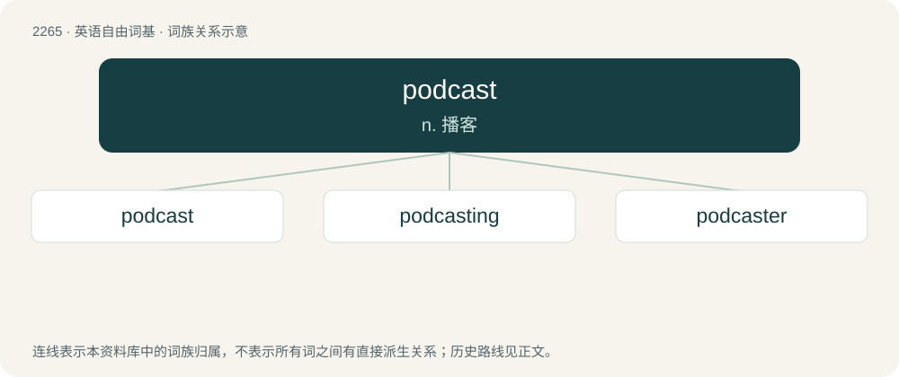

# 2368 · podcast — n. 播客

[总目录](../00_总目录_按常用程度.md)

**类型**：英语自由词基　｜　**来源语言**：见词源记录

## 核心含义与来源

- 核心含义：n. 播客
- 英文含义：A program, especially an audio program, produced on a regular basis, delivered over the Internet in a compressed digital format and designed for playback on computers or portable devices such as mobile phones.
- 词形：podcast

**来源记录 1**（名词；A program, especially an audio program, produced on a regular basis, delivered over the Internet in a compressed digital format and designed for playback on computers or portable devices such as mobile phones.）

Blend of iPod (“portable music player made by Apple”) + broadcast, probably coined by the British technologist and broadcaster Ben Hammersley (born 1976) who proposed the word podcasting in 2004.

## 词族图

## 单词速览（常用到不常用）

| 单词 | 音标 | 释义 |
|---|---|---|
| [podcast](#w-1) | 英 /ˈpɒdˌkɑːst/；美 /ˈpɑdˌkæst/ | n. 播客 |
| [podcasting](#w-2) |  | n. 播客：由iPod（苹果MP3播放器）和broadcasting（广播）组合而成。它是一种新的技术; 是Rss技术与MP3播放器结合的产物; 简单地说; 就是把预先录制的MP3音频文件发布在Blog上 |
| [podcaster](#w-3) |  | 搏客 |

## 逐词详解

### 1. podcast

**词性**：名词　｜　**音标**：英 /ˈpɒdˌkɑːst/；美 /ˈpɑdˌkæst/

**中文释义**：n. 播客

**英文义项**：A program, especially an audio program, produced on a regular basis, delivered over the Internet in a compressed digital format and designed for playback on computers or portable devices such as mobile phones. / An individual episode of such a program.

**词源与演化**：

Blend of iPod (“portable music player made by Apple”) + broadcast, probably coined by the British technologist and broadcaster Ben Hammersley (born 1976) who proposed the word podcasting in 2004.

**例句**：

> Life's too short to spend the next hour listening to this podcast.

### 2. podcasting

**词性**：名词

**中文释义**：n. 播客：由iPod（苹果MP3播放器）和broadcasting（广播）组合而成。它是一种新的技术; 是Rss技术与MP3播放器结合的产物; 简单地说; 就是把预先录制的MP3音频文件发布在Blog上

**英文义项**：The distribution of multimedia files over the Internet for playback on a mobile device, often in MP3 format.

**构词拆分**：podcast + -ing

**词源与演化**：

From podcast + -ing.

### 3. podcaster

**词性**：名词

**中文释义**：搏客

**英文义项**：One who podcasts.

**构词拆分**：podcast + -er

**词源与演化**：

From podcast + -er.

**例句**：

> Do you know Majid Oukacha, the French podcaster who dared to criticize Islam and who is threatened now?
