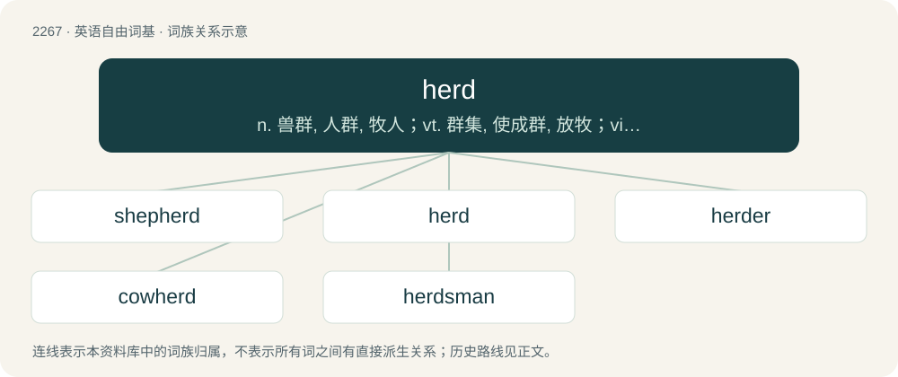

# 2372 · herd — n. 兽群, 人群, 牧人；vt. 群集, 使成群, 放牧；vi. 聚在一起

[总目录](../00_总目录_按常用程度.md)

**类型**：英语自由词基　｜　**来源语言**：见词源记录

## 核心含义与来源

- 核心含义：n. 兽群, 人群, 牧人；vt. 群集, 使成群, 放牧；vi. 聚在一起
- 英文含义：A number of domestic animals assembled together under the watch or ownership of a keeper.
- 词形：herd

**多个词源／构词路径**：同一拼写可能有不同来源；以下按词性和含义分别列出。

**来源记录 1**（名词；A number of domestic animals assembled together under the watch or ownership of a keeper.）

From Middle English herde, heerde, heorde, from Old English hierd, heord (“herd, flock; keeping, care, custody”), from Proto-West Germanic \*herdu, from Proto-Germanic \*herdō (“herd”), from Proto-Indo-European \*(s)kerdʰ- (“file, row, herd”). Cognate with German Herde, Danish hjord, Swedish hjord. Non-Germanic cognates include Albanian herdhe (“nest”) and Serbo-Croatian krdo.

**来源记录 2**（动词；To act as a herdsman or a shepherd.）

From Middle English herde, from Old English hirde, hierde, from Proto-West Germanic \*hirdī, from Proto-Germanic \*hirdijaz. Cognate with German Hirte, Swedish herde, Danish hyrde.

## 词族图

## 单词速览（常用到不常用）

| 单词 | 音标 | 释义 |
|---|---|---|
| [shepherd](#w-1) | 英 /ˈʃɛpəd/；美 /ˈʃɛpəɹd/ | n. 牧羊人, 牧羊犬, 牧师, 保护者；vt. 看守, 领导, 指导, 牧羊 |
| [herd](#w-2) | 英 /hɜːd/；美 /hɝd/ | n. 兽群, 人群, 牧人；vt. 群集, 使成群, 放牧；vi. 聚在一起 |
| [herder](#w-3) | 英 /ˈhɜːdə/；美 /ˈhɝːdɚ/ | n. 牧人, (美)(非正式)监狱看守；\[计\] 首部, 首标, 标题, 头标, 报头, 管座, 端板 |
| [cowherd](#w-4) | /ˈkauhəːd/ | n. 牧牛者 |
| [herdsman](#w-5) | /ˈhəːdzmən/ | n. 牧人, 牧主 |

## 逐词详解

### 1. shepherd

**词性**：名词　｜　**音标**：英 /ˈʃɛpəd/；美 /ˈʃɛpəɹd/

**中文释义**：n. 牧羊人, 牧羊犬, 牧师, 保护者；vt. 看守, 领导, 指导, 牧羊

**英文义项**：A person who tends sheep, especially a grazing flock. / A male sheep tender

**构词拆分**：sheep + herd (“herder”)

**词源与演化**：

From Middle English schepherde, from Old English sċēaphierde, a compound of sċēap (“sheep”) and hierde (“herdsman”), equivalent to modern sheep + herd (“herder”).

**例句**：

> Later that night, the shepherd herded his sheep and went to bed.

### 2. herd

**词性**：名词　｜　**音标**：英 /hɜːd/；美 /hɝd/

**中文释义**：n. 兽群, 人群, 牧人；vt. 群集, 使成群, 放牧；vi. 聚在一起

**英文义项**：A number of domestic animals assembled together under the watch or ownership of a keeper. / Any collection of animals gathered or travelling in a company.

**词源与演化**：

From Middle English herde, heerde, heorde, from Old English hierd, heord (“herd, flock; keeping, care, custody”), from Proto-West Germanic \*herdu, from Proto-Germanic \*herdō (“herd”), from Proto-Indo-European \*(s)kerdʰ- (“file, row, herd”). Cognate with German Herde, Danish hjord, Swedish hjord. Non-Germanic cognates include Albanian herdhe (“nest”) and Serbo-Croatian krdo.

**例句**：

> Herds of buses spread across the streets.

该用例对应义项：A collection of things, especially vehicles.

### 3. herder

**词性**：名词　｜　**音标**：英 /ˈhɜːdə/；美 /ˈhɝːdɚ/

**中文释义**：n. 牧人, (美)(非正式)监狱看守；\[计\] 首部, 首标, 标题, 头标, 报头, 管座, 端板

**英文义项**：One who herds.

**构词拆分**：herd + -er

**词源与演化**：

From Middle English herder, herdere, hurder (attested as a surname), an alteration of Middle English herde (“herder, herdsman”), from Old English hyrde, hierde (“herder”), from Proto-West Germanic \*hirdī, from Proto-Germanic \*hirdijaz, equivalent to herd + -er. Doublet of herd ("herder"), as in cowherd, goatherd, shepherd, etc.

**例句**：

> Benedito is a skilled herder who knows how to manage his goats.

### 4. cowherd

**词性**：名词　｜　**音标**：/ˈkauhəːd/

**中文释义**：n. 牧牛者

**英文义项**：One who herds cattle; a cowboy.

**构词拆分**：cow + herd (“herder”)

**词源与演化**：

From Middle English couherde, from Old English cūhierde, equivalent to cow + herd (“herder”). Doublet of Coward (the surname). Cognate with German Kuhhirte (“cowherd”). Compare shepherd, goatherd, swineherd, etc.

**例句**：

> Without a cowherd, the cows wandered in a field where wheat was growing.

### 5. herdsman

**词性**：名词　｜　**音标**：/ˈhəːdzmən/

**中文释义**：n. 牧人, 牧主

**英文义项**：A person who tends livestock, especially cows and sheep; especially, the foreman among a group of such farmworkers, usually with more knowledge and experience.

**构词拆分**：From herd + -s- + -man.

**词源与演化**：

From herd + -s- + -man.

**例句**：

> After inspecting the farm, he went to see the goats and their young herdsman.
