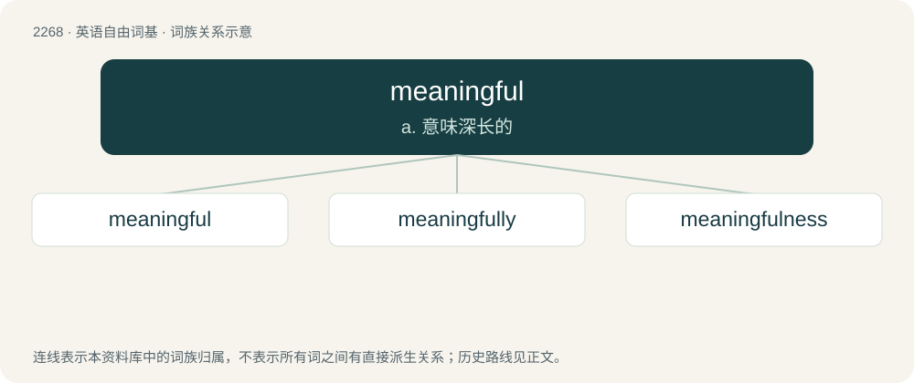

# 2373 · meaningful — a. 意味深长的

[总目录](../00_总目录_按常用程度.md)

**类型**：英语自由词基　｜　**来源语言**：见词源记录

## 核心含义与来源

- 核心含义：a. 意味深长的
- 英文含义：Having meaning, significant.
- 词形：meaningful

**来源记录 1**（形容词；Having meaning, significant.）

From meaning + -ful.

## 词族图

## 单词速览（常用到不常用）

| 单词 | 音标 | 释义 |
|---|---|---|
| [meaningful](#w-1) | 英 /ˈmiː.nɪŋ.fl̩/；美 /ˈmi.nɪŋ.fl̩/ | a. 意味深长的 |
| [meaningfully](#w-2) | /ˈmiːniŋfuli/ | adv. 意味深长地 |
| [meaningfulness](#w-3) | /ˈmiːnɪŋflnəs/ | n. 富有意义 |

## 逐词详解

### 1. meaningful

**词性**：形容词　｜　**音标**：英 /ˈmiː.nɪŋ.fl̩/；美 /ˈmi.nɪŋ.fl̩/

**中文释义**：a. 意味深长的

**英文义项**：Having meaning, significant. / Full of implication; heavy with unstated meaning.

**构词拆分**：meaning + -ful

**词源与演化**：

From meaning + -ful.

**例句**：

> "So you enjoyed yourself, did you," she said, with a meaningful smile.

该用例对应义项：Full of implication; heavy with unstated meaning.

### 2. meaningfully

**词性**：副词　｜　**音标**：/ˈmiːniŋfuli/

**中文释义**：adv. 意味深长地

**英文义项**：In a meaningful or significant manner.

**构词拆分**：meaningful + -ly

**词源与演化**：

From meaningful + -ly.

**例句**：

> He glanced at her meaningfully.

该用例对应义项：in a meaningful manner; so as to be meaningful

### 3. meaningfulness

**词性**：名词　｜　**音标**：/ˈmiːnɪŋflnəs/

**中文释义**：n. 富有意义

**英文义项**：The state or measure of being meaningful.

**构词拆分**：meaningful + -ness

**词源与演化**：

From meaningful + -ness.
