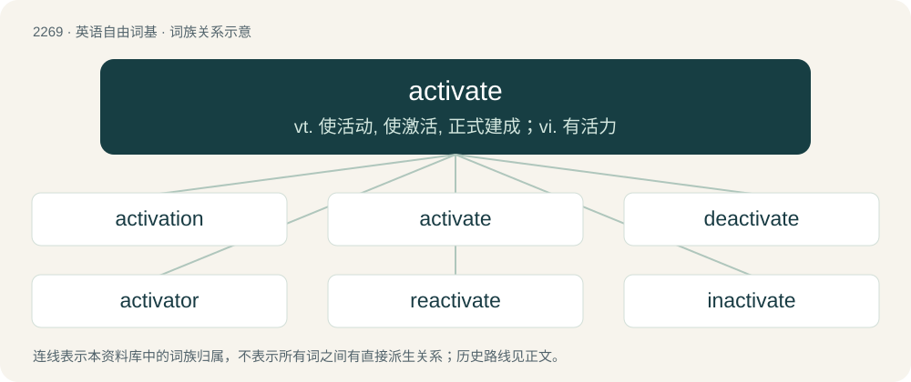

# 2374 · activate — vt. 使活动, 使激活, 正式建成；vi. 有活力

[总目录](../00_总目录_按常用程度.md)

**类型**：英语自由词基　｜　**来源语言**：见词源记录

## 核心含义与来源

- 核心含义：vt. 使活动, 使激活, 正式建成；vi. 有活力
- 英文含义：To encourage development or induce increased activity; to stimulate.
- 词形：activate

**来源记录 1**（动词；To encourage development or induce increased activity; to stimulate.）

From active + -ate.

## 词族图

## 单词速览（常用到不常用）

| 单词 | 音标 | 释义 |
|---|---|---|
| [activation](#w-1) | 英 /ˌæktɪˈveɪʃn̩/；美 /ˌæktəˈveɪʃən/ | n. 活化, 激活；\[化\] 活化; 活化作用; 激活; 激活作用 |
| [activate](#w-2) | /ˈæktɪˌveɪt/ | vt. 使活动, 使激活, 正式建成；vi. 有活力 |
| [deactivate](#w-3) | 英 /ˌdiːˈæktɪveɪt/ | vt. 撤消遣散, 复员, 使无效, 使不活动 |
| [activator](#w-4) | /ˈæktiveitə/ | n. 活化剂, 催化剂, 触媒剂；\[化\] 助催化剂; 活化剂; 激活剂; 激活剂发光材料 |
| [reactivate](#w-5) | /riˈæktiveit/ | v. (使)恢复活动 |
| [inactivate](#w-6) | /ɪˈnæktɪveɪt/ | vt. 使不活动, 撤销, 使失去活性, 灭活；\[医\] 灭活, 使不活动 |

## 逐词详解

### 1. activation

**词性**：名词　｜　**音标**：英 /ˌæktɪˈveɪʃn̩/；美 /ˌæktəˈveɪʃən/

**中文释义**：n. 活化, 激活；\[化\] 活化; 活化作用; 激活; 激活作用

**英文义项**：Making active and effective; bringing into a state of activity. / The process of making a radioisotope by bombarding a stable element with neutrons or protons.

**构词拆分**：active + -ation + activate + -ion

**词源与演化**：

From active or activate + -ation

**用法示例／搭配（非完整句）**：

> using shopper activation to convert shoppers into buyers

该用例对应义项：The promotion of a brand through an event or campaign.

### 2. activate

**词性**：动词　｜　**音标**：/ˈæktɪˌveɪt/

**中文释义**：vt. 使活动, 使激活, 正式建成；vi. 有活力

**英文义项**：To encourage development or induce increased activity; to stimulate. / To put a device, mechanism (alarm etc.) or system into action or motion; to trigger, to actuate, to set off, to enable.

**构词拆分**：active + -ate

**词源与演化**：

From active + -ate.

**例句**：

> The burglar alarm activates automatically.

该用例对应义项：To enter an active state.

### 3. deactivate

**词性**：动词　｜　**音标**：英 /ˌdiːˈæktɪveɪt/

**中文释义**：vt. 撤消遣散, 复员, 使无效, 使不活动

**英文义项**：to make something inactive or no longer effective / to prevent the action of a biochemical agent (such as an enzyme)

**构词拆分**：de- + activate

**词源与演化**：

From de- + activate.

**例句**：

> You should deactivate your old account to protect your privacy.

该用例对应义项：to make something inactive or no longer effective

### 4. activator

**词性**：名词　｜　**音标**：/ˈæktiveitə/

**中文释义**：n. 活化剂, 催化剂, 触媒剂；\[化\] 助催化剂; 活化剂; 激活剂; 激活剂发光材料

**英文义项**：One who, or that which, activates. / Something that activates a catalyst

**构词拆分**：activate + -or

**词源与演化**：

From activate + -or.

**例句**：

> There are several effective anti-clotting agents that doctors can use to clear these clogged blood vessels, including one called tissue plasminogen activator, or tPA.

### 5. reactivate

**词性**：动词　｜　**音标**：/riˈæktiveit/

**中文释义**：v. (使)恢复活动

**英文义项**：To activate again.

**构词拆分**：re- + activate

**词源与演化**：

From re- + activate.

**例句**：

> Cosmic radiation during a solar minimum can reactivate viruses from their dormancy.

### 6. inactivate

**词性**：动词　｜　**音标**：/ɪˈnæktɪveɪt/

**中文释义**：vt. 使不活动, 撤销, 使失去活性, 灭活；\[医\] 灭活, 使不活动

**英文义项**：To make inactive.

**构词拆分**：inactive + -ate；inactive + -ate (verb-forming suffix)；in- + activate

**词源与演化**：

From inactive + -ate (verb-forming suffix) or in- + activate.
