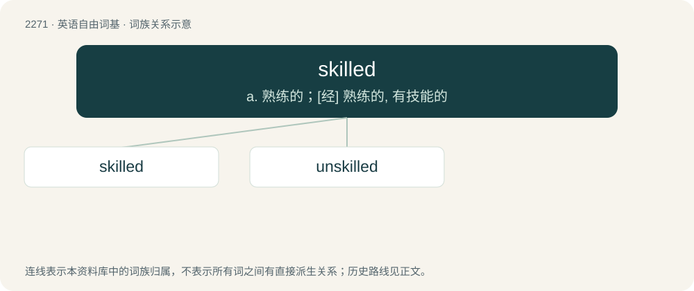

# 2375 · skilled — a. 熟练的；\[经\] 熟练的, 有技能的

[总目录](../00_总目录_按常用程度.md)

**类型**：英语自由词基　｜　**来源语言**：见词源记录

## 核心含义与来源

- 核心含义：a. 熟练的；\[经\] 熟练的, 有技能的
- 英文含义：Having or showing skill; skillful.
- 词形：skilled

**来源记录 1**（形容词；Having or showing skill; skillful.）

From skill (noun) + -ed.

## 词族图

## 单词速览（常用到不常用）

| 单词 | 音标 | 释义 |
|---|---|---|
| [skilled](#w-1) | /skɪld/ | a. 熟练的；\[经\] 熟练的, 有技能的 |
| [unskilled](#w-2) | /ʌnˈskɪld/ | a. 无(特殊)技能的, 不熟练的, 拙劣的 |

## 逐词详解

### 1. skilled

**词性**：形容词　｜　**音标**：/skɪld/

**中文释义**：a. 熟练的；\[经\] 熟练的, 有技能的

**英文义项**：Having or showing skill; skillful. / Requiring special abilities or training.

**构词拆分**：skill + -ed

**词源与演化**：

From skill (noun) + -ed.

**例句**：

> Only the most skilled gymnasts make an Olympic team.

该用例对应义项：having or showing or requiring special skill

### 2. unskilled

**词性**：形容词　｜　**音标**：/ʌnˈskɪld/

**中文释义**：a. 无(特殊)技能的, 不熟练的, 拙劣的

**英文义项**：Of a person or workforce: not having a skill or technical training. / Of a job: not requiring skill or training.

**构词拆分**：un- + skilled

**词源与演化**：

From un- + skilled.

**例句**：

> Unskilled in the art of rhetoric.

该用例对应义项：not having or showing or requiring special skill or proficiency
