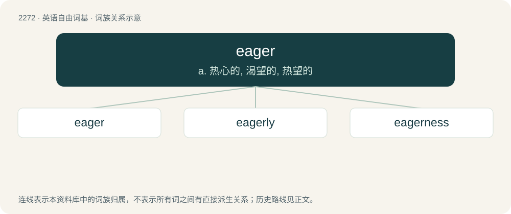

# 2376 · eager — a. 热心的, 渴望的, 热望的

[总目录](../00_总目录_按常用程度.md)

**类型**：英语自由词基　｜　**来源语言**：见词源记录

## 核心含义与来源

- 核心含义：a. 热心的, 渴望的, 热望的
- 英文含义：Desirous; keen to do or obtain something.
- 词形：eager

**来源记录 1**（形容词；Desirous; keen to do or obtain something.）

Inherited from Middle English egre, eger, from Old French aigre, egre (modern French aigre), from Latin ācrus, variant of ācer (“sharp, keen”); see acid, acerb, etc. Compare vinegar, alegar.

## 词族图

## 单词速览（常用到不常用）

| 单词 | 音标 | 释义 |
|---|---|---|
| [eager](#w-1) | 英 /ˈiːɡə/；美 /ˈiɡɚ/ | a. 热心的, 渴望的, 热望的 |
| [eagerly](#w-2) | 英 /ˈiːɡəli/；美 /ˈiɡɚli/ | adv. 渴望, 热衷于, 热切 |
| [eagerness](#w-3) | 英 /ˈiːɡənəs/；美 /ˈiɡɚnəs/ | n. 热心 |

## 逐词详解

### 1. eager

**词性**：形容词　｜　**音标**：英 /ˈiːɡə/；美 /ˈiɡɚ/

**中文释义**：a. 热心的, 渴望的, 热望的

**英文义项**：Desirous; keen to do or obtain something. / Not employing lazy evaluation; calculating results immediately, rather than deferring calculation until they are required.

**词源与演化**：

Inherited from Middle English egre, eger, from Old French aigre, egre (modern French aigre), from Latin ācrus, variant of ācer (“sharp, keen”); see acid, acerb, etc. Compare vinegar, alegar.

**例句**：

> You stayed up all night to get to the front of the queue. You must be very eager to get tickets.

该用例对应义项：Desirous; keen to do or obtain something.

### 2. eagerly

**词性**：副词　｜　**音标**：英 /ˈiːɡəli/；美 /ˈiɡɚli/

**中文释义**：adv. 渴望, 热衷于, 热切

**英文义项**：In an eager manner.

**构词拆分**：eager + -ly

**词源与演化**：

From Middle English egerly; equivalent to eager + -ly.

**例句**：

> The news was eagerly awaited.

该用例对应义项：with eagerness; in an eager manner

### 3. eagerness

**词性**：名词　｜　**音标**：英 /ˈiːɡənəs/；美 /ˈiɡɚnəs/

**中文释义**：n. 热心

**英文义项**：The state or quality of being eager; ardent desire.

**构词拆分**：eager + -ness

**词源与演化**：

From Middle English egernesse, egrenesse; equivalent to eager + -ness.

**例句**：

> Pierre ate and drank a lot, with his usual eagerness.
