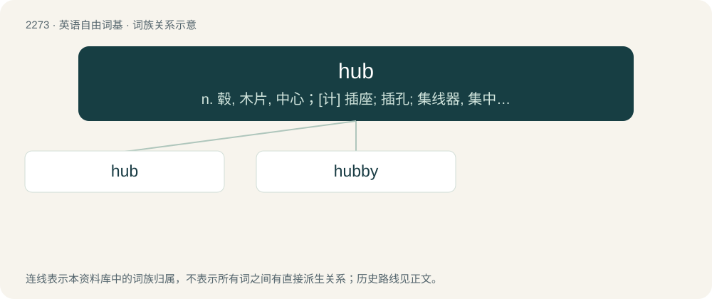

# 2377 · hub — n. 毂, 木片, 中心；\[计\] 插座; 插孔; 集线器, 集中器, 连接器, 中继站

[总目录](../00_总目录_按常用程度.md)

**类型**：英语自由词基　｜　**来源语言**：见词源记录

## 核心含义与来源

- 核心含义：n. 毂, 木片, 中心；\[计\] 插座; 插孔; 集线器, 集中器, 连接器, 中继站
- 英文含义：The central part, usually cylindrical, of a wheel; the nave.
- 词形：hub

**来源记录 1**（名词；The central part, usually cylindrical, of a wheel; the nave.）

From earlier hubbe, which has the same immediate origin as hob. Hub was originally a dialectal word; its ultimate origin is unknown. Compare German Hubbel (“bump on a surface”), from Proto-West Germanic \*hubil (“bump, hill”) (which contains a diminutive suffix \*-il); compare English hive, or perhaps ultimately from the same root as hip or hop.

## 词族图

## 单词速览（常用到不常用）

| 单词 | 音标 | 释义 |
|---|---|---|
| [hub](#w-1) | /hʌb/ | n. 毂, 木片, 中心；\[计\] 插座; 插孔; 集线器, 集中器, 连接器, 中继站 |
| [hubby](#w-2) | /ˈhʌbi/ | 【英文】Full of hubs or protuberances. |

## 逐词详解

### 1. hub

**词性**：名词　｜　**音标**：/hʌb/

**中文释义**：n. 毂, 木片, 中心；\[计\] 插座; 插孔; 集线器, 集中器, 连接器, 中继站

**英文义项**：The central part, usually cylindrical, of a wheel; the nave. / A point where many routes meet and traffic is distributed, dispensed, or diverted.

**词源与演化**：

From earlier hubbe, which has the same immediate origin as hob. Hub was originally a dialectal word; its ultimate origin is unknown. Compare German Hubbel (“bump on a surface”), from Proto-West Germanic \*hubil (“bump, hill”) (which contains a diminutive suffix \*-il); compare English hive, or perhaps ultimately from the same root as hip or hop.

**例句**：

> Hong Kong International Airport is one of the most important air traffic hubs in Asia.

该用例对应义项：A point where many routes meet and traffic is distributed, dispensed, or diverted.

### 2. hubby

**词性**：形容词　｜　**音标**：/ˈhʌbi/

**英文义项**：Full of hubs or protuberances.

**构词拆分**：hub + -y

**词源与演化**：

From hub + -y (adjectival suffix).

**例句**：

> A road that has been frozen while muddy is hubby.

该用例对应义项：Full of hubs or protuberances.
