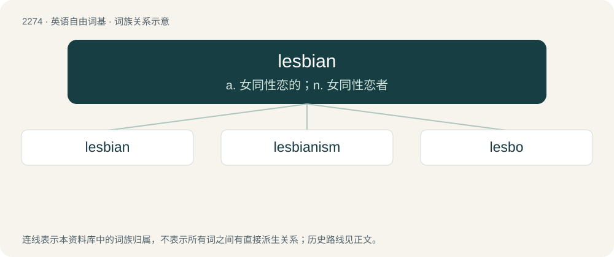

# 2378 · lesbian — a. 女同性恋的；n. 女同性恋者

[总目录](../00_总目录_按常用程度.md)

**类型**：英语自由词基　｜　**来源语言**：见词源记录

## 核心含义与来源

- 核心含义：a. 女同性恋的；n. 女同性恋者
- 英文含义：Homosexual, gay; preferring exclusively women as romantic or sexual partners.
- 词形：lesbian

**来源记录 1**（形容词；Homosexual, gay; preferring exclusively women as romantic or sexual partners.）

From Latin Lesbiana, from Ancient Greek Λέσβος (Lésbos) + Latin adjective suffix -iana; by reference to Sappho of Lesbos (whence also sapphist, sapphic), known for her sentimental poems about women. This sense of the word may have been borrowed from, or influenced by, the German cognate lesbisch, where it is found in medical literature from the 1830s.

## 词族图

## 单词速览（常用到不常用）

| 单词 | 音标 | 释义 |
|---|---|---|
| [lesbian](#w-1) | 英 /ˈlɛz.bi.ən/ | a. 女同性恋的；n. 女同性恋者 |
| [lesbianism](#w-2) | /ˈlɛzbiəˌnɪzəm/ | \[医\] 女子同性恋爱的 |
| [lesbo](#w-3) | 英 /ˈlɛzbəʊ/；美 /ˈlɛzboʊ/ | n. &lt;口&gt;=Lesbian |

## 逐词详解

### 1. lesbian

**词性**：形容词　｜　**音标**：英 /ˈlɛz.bi.ən/

**中文释义**：a. 女同性恋的；n. 女同性恋者

**英文义项**：Homosexual, gay; preferring exclusively women as romantic or sexual partners. / Preferring primarily women as romantic or sexual partners.

**词源与演化**：

From Latin Lesbiana, from Ancient Greek Λέσβος (Lésbos) + Latin adjective suffix -iana; by reference to Sappho of Lesbos (whence also sapphist, sapphic), known for her sentimental poems about women. This sense of the word may have been borrowed from, or influenced by, the German cognate lesbisch, where it is found in medical literature from the 1830s.

**例句**：

> Lesbian fans of the show were rooting for Jane and Amanda to get together.

该用例对应义项：Homosexual, gay; preferring exclusively women as romantic or sexual partners.

### 2. lesbianism

**词性**：名词　｜　**音标**：/ˈlɛzbiəˌnɪzəm/

**中文释义**：\[医\] 女子同性恋爱的

**英文义项**：Female homosexuality; the state of a woman being sexually attracted to other women.

**构词拆分**：lesbian + -ism

**词源与演化**：

From lesbian + -ism.

### 3. lesbo

**词性**：名词　｜　**音标**：英 /ˈlɛzbəʊ/；美 /ˈlɛzboʊ/

**中文释义**：n. &lt;口&gt;=Lesbian

**英文义项**：A lesbian.

**构词拆分**：lesbian + -o

**词源与演化**：

From lesb(ian) + -o.
