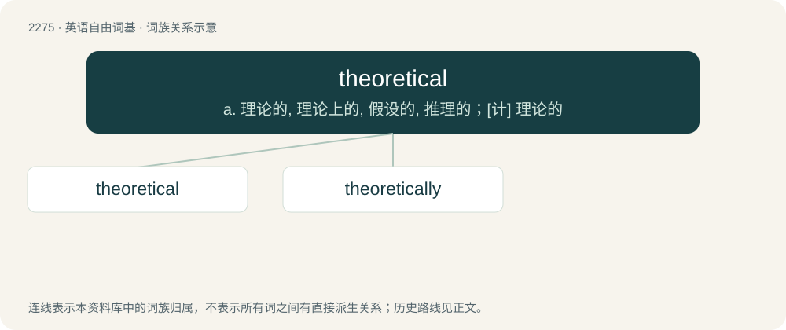

# 2379 · theoretical — a. 理论的, 理论上的, 假设的, 推理的；\[计\] 理论的

[总目录](../00_总目录_按常用程度.md)

**类型**：英语自由词基　｜　**来源语言**：见词源记录

## 核心含义与来源

- 核心含义：a. 理论的, 理论上的, 假设的, 推理的；\[计\] 理论的
- 英文含义：Of or relating to theory; abstract; not empirical.
- 词形：theoretical

**来源记录 1**（形容词；Of or relating to theory; abstract; not empirical.）

From Middle English theorothycall, probably from Latin theōrēticus + -al, from Ancient Greek θεωρητικός (theōrētikós).

## 词族图

## 单词速览（常用到不常用）

| 单词 | 音标 | 释义 |
|---|---|---|
| [theoretical](#w-1) | 英 /ˌθɪəˈɹɛtɪkəl/；美 /ˌθi.əˈɹɛt.ɪ.kəl/ | a. 理论的, 理论上的, 假设的, 推理的；\[计\] 理论的 |
| [theoretically](#w-2) | /.θiːəˈretikli/ | adv. 理论上, 理论地 |

## 逐词详解

### 1. theoretical

**词性**：形容词　｜　**音标**：英 /ˌθɪəˈɹɛtɪkəl/；美 /ˌθi.əˈɹɛt.ɪ.kəl/

**中文释义**：a. 理论的, 理论上的, 假设的, 推理的；\[计\] 理论的

**英文义项**：Of or relating to theory; abstract; not empirical.

**词源与演化**：

From Middle English theorothycall, probably from Latin theōrēticus + -al, from Ancient Greek θεωρητικός (theōrētikós).

**例句**：

> The lecture is composed by two parts, one theoretical, the other practical.

### 2. theoretically

**词性**：副词　｜　**音标**：/.θiːəˈretikli/

**中文释义**：adv. 理论上, 理论地

**英文义项**：in theory; on paper / in a theoretical manner

**构词拆分**：theoretical + -ly

**词源与演化**：

From theoretical + -ly.

**例句**：

> I solved the problem theoretically rather than practically.

该用例对应义项：in a theoretical manner
