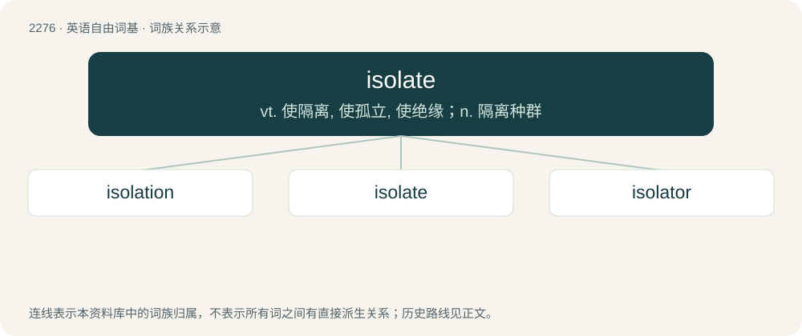

# 2380 · isolate — vt. 使隔离, 使孤立, 使绝缘；n. 隔离种群

[总目录](../00_总目录_按常用程度.md)

**类型**：英语自由词基　｜　**来源语言**：见词源记录

## 核心含义与来源

- 核心含义：vt. 使隔离, 使孤立, 使绝缘；n. 隔离种群
- 英文含义：To set apart or cut off from others.
- 词形：isolate

**来源记录 1**（动词；To set apart or cut off from others.）

Back-formation from isolated, from French isolé, from Italian isolato, from Latin īnsulātus (whence also insulate), see -ate (etymology 1, 2 and 3).

## 词族图

## 单词速览（常用到不常用）

| 单词 | 音标 | 释义 |
|---|---|---|
| [isolation](#w-1) | 英 /ˌaɪsəˈleɪʃən/ | n. 隔绝, 孤立, 隔离；\[化\] 分离; 生物分离 |
| [isolate](#w-2) | /ˈaɪ.sə.leɪt/ | vt. 使隔离, 使孤立, 使绝缘；n. 隔离种群 |
| [isolator](#w-3) | /ˈaisəleitə/ | n. 隔离者(物), 隔音装置；\[计\] 隔离器 |

## 逐词详解

### 1. isolation

**词性**：名词　｜　**音标**：英 /ˌaɪsəˈleɪʃən/

**中文释义**：n. 隔绝, 孤立, 隔离；\[化\] 分离; 生物分离

**英文义项**：The state of being isolated, detached, or separated; the state of being away from other people. / The act of isolating.

**构词拆分**：isolate + -ion

**词源与演化**：

First attested in 1800. From French isolation, from isolé, placed on an island (thus away from other people). Equivalent to isolate + -ion.

**例句**：

> She lived her final year in complete isolation, not wanting to see anybody.

该用例对应义项：The state of being isolated, detached, or separated; the state of being away from other people.

### 2. isolate

**词性**：动词　｜　**音标**：/ˈaɪ.sə.leɪt/

**中文释义**：vt. 使隔离, 使孤立, 使绝缘；n. 隔离种群

**英文义项**：To set apart or cut off from others. / To place in quarantine or isolation.

**词源与演化**：

Back-formation from isolated, from French isolé, from Italian isolato, from Latin īnsulātus (whence also insulate), see -ate (etymology 1, 2 and 3).

**例句**：

> The chemist managed to isolate the compound.

该用例对应义项：obtain in pure form

### 3. isolator

**词性**：名词　｜　**音标**：/ˈaisəleitə/

**中文释义**：n. 隔离者(物), 隔音装置；\[计\] 隔离器

**英文义项**：An electrical device that detects short circuits and isolates them. / A device that isolates something from the surrounding environment to keep it sterile.

**构词拆分**：From isolate + -or.

**词源与演化**：

From isolate + -or.
