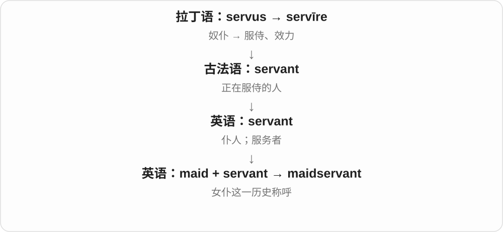

# 2382 · maid — 年轻女子的旧称与服务角色，扩到故事和首次的比喻

[逐词精讲目录](../00_逐词精讲目录.md) · [总目录](../00_总目录_按常用程度.md)

## 核心词根与来源

现代词形的长短与历史出现顺序不必一致。maid、maiden 的旧身份称呼和现代岗位、首次比喻，也要分开。

**MAID：历史上从 MAIDEN 截短，再形成不同角色名称**

maiden → maid；mermaid、nursemaid 等组合；maiden voyage 首航是固定扩展。

- **基础旧称与首次用法**：maid · maiden
- **故事人物与照料角色**：mermaid · nursemaid
- **其他工作、仪式角色**：bridesmaid · housemaid · barmaid · chambermaid · handmaid · maidservant

## 词形与演化规律

mægden → maiden → maid；mer- 水域，nurse 照料；house、chamber、bar 等限定角色场所。

## 单词速览（按词族由简到繁）

同一基础词的相关扩展放在一起，先读基础形式，再读扩展；各组之间优先读常用的。具体词源关系见各词讲解。

| 单词 | 音标 | 核心意思 |
|---|---|---|
| [maid](#w-1) | /meɪd/ | 女仆、女佣、女性清洁服务人员；少女〔旧、文学用法〕 |
| [maiden](#w-2) | /ˈmeɪdən/ | 少女、未婚年轻女子〔旧、文学用法〕；首次的 |
| [maidservant](#w-9) | 英 /ˈmeɪdsɜːvənt/；美 /ˈmeɪdsɜːrvənt/ | 女仆 |
| [mermaid](#w-3) | 英 /ˈmɜːmeɪd/；美 /ˈmɜːrmeɪd/ | 美人鱼 |
| [bridesmaid](#w-4) | /ˈbraɪdzmeɪd/ | 伴娘；长期接近冠军却未夺冠的人或队伍〔比喻〕 |
| [housemaid](#w-5) | /ˈhaʊsmeɪd/ | 女家仆；女佣〔传统职位称呼〕 |
| [barmaid](#w-6) | 英 /ˈbɑːmeɪd/；美 /ˈbɑːrmeɪd/ | 女酒吧服务员〔传统称呼〕 |
| [chambermaid](#w-7) | 英 /ˈtʃeɪmbəmeɪd/；美 /ˈtʃeɪmbərmeɪd/ | 客房女服务员〔传统称呼〕 |
| [handmaid](#w-8) | /ˈhændmeɪd/ | 女仆〔历史用语〕；为某事服务的工具〔比喻〕 |
| [nursemaid](#w-10) | 英 /ˈnɜːsmeɪd/；美 /ˈnɜːrsmeɪd/ | 照料孩子的女保姆〔常见于历史语境〕；事事照料、替人操心 |

## 逐词讲解

### 1. maid — 女仆、女佣、女性清洁服务人员；少女〔旧、文学用法〕

**音标**：/meɪd/

**先抓住这个画面**

历史上先是年轻女子的称呼，后来一些工作角色也用 maid 命名。现代常在酒店、家务服务或历史故事里看到。

**怎么拆**

中古英语 maid 是 maiden 的截短，后者承古英语 mægden。现代虽然 maid 更短，却不代表 maiden 一定是从现代 maid 新加后缀产生。

**怎么变成今天的意思**

**古英语 mægden → 中古英语 maiden**  
女孩、未婚年轻女子等旧称

↓

**maiden 的截短 → maid**  
年轻女子；女仆、清洁服务人员等

a hotel maid 酒店女清洁服务员，a lady’s maid 女主人的贴身女仆〔历史〕。今天具体工作也常用 housekeeper、cleaner 等名称。

**常见搭配与例句**

a hotel maid；a lady’s maid。

> The novel follows a maid in a large country house.

小说以乡间大宅里的一名女仆为主角。

> The hotel maid found the missing scarf.

酒店女清洁员找到了遗失的围巾。

**别混淆**

maid 与 made 同音。历史 maiden、maid 的身份词义与现代岗位名称不同，不能据职业称呼推断婚姻、年龄。

### 2. maiden — 少女、未婚年轻女子〔旧、文学用法〕；首次的

**音标**：/ˈmeɪdən/

**先抓住这个画面**

旧时说年轻、未婚女子，后来把尚未经历某事的形象用于首次：a maiden voyage 是船的第一次航行。

**怎么拆**

古英语 mægden 经中古英语 maiden 传下，更早含旧小称形式。maid 反而是后来的截短，现代不要只凭较短词形倒推历史。

**怎么变成今天的意思**

**古英语 mægden → 中古英语 maiden**  
女孩、未婚年轻女子等旧称

↓

**复合词与首次的比喻**  
mermaid 海中女子；nursemaid 照料孩子者；maiden voyage 首航

a maiden voyage 首航，a maiden speech 首次演说，maiden name 婚前姓〔传统用法〕。名词少女义多见文学、旧语境。

**常见搭配与例句**

a maiden voyage；a maiden speech；maiden name。

> The ship began its maiden voyage in spring.

这艘船在春天开始首航。

> Her maiden speech focused on education.

她的首次演说集中谈教育。

**别混淆**

maiden 作首次的形容词时，不是在说船、演讲的性别；maiden name 也不是名字中的第一个词。

### 3. maidservant — 女仆

**音标**：英 /ˈmeɪdsɜːvənt/；美 /ˈmeɪdsɜːrvənt/

**先抓住这个画面**

旧式家庭里承担清洁、起居照料等工作的女性仆人。

**怎么拆**

maid + servant，两个成分共同限定服务者。

**怎么变成今天的意思**

带明显旧式用语色彩，历史叙述和小说较多。现代工作场景宜用具体职位名称。

**常见搭配与例句**

a young maidservant；the family’s maidservant。

> The diary records the wages paid to a maidservant.

日记记录了付给一名女仆的工资。

> A maidservant carried fresh linen upstairs.

一名女仆把干净床单抱上楼。

**别混淆**

maidservant 不等于所有女性服务人员，更不是“女服务员”的通用现代称呼。

### 4. mermaid — 美人鱼

**音标**：英 /ˈmɜːmeɪd/；美 /ˈmɜːrmeɪd/

**先抓住这个画面**

故事中上半身是女人、下半身是鱼尾的海中人物，就是 mermaid。名称把水域和女子接在一起。

**怎么拆**

中古英语 mermayde，由 mere 海、湖等水域旧词 + maid 女子。前半 mer- 不取法语 mère 母亲义。

**怎么变成今天的意思**

**古英语 mægden → 中古英语 maiden**  
女孩、未婚年轻女子等旧称

↓

**maiden 的截短 → maid**  
年轻女子；女仆、清洁服务人员等

↓

**mere + maid → mermaid**  
海、湖里的女子 → 美人鱼

a mermaid tale 美人鱼故事，a mermaid statue 美人鱼雕像。merman 是相应男性虚构形象的常见名称。

**常见搭配与例句**

a mermaid tale；a mermaid statue。

> The child drew a mermaid with a silver tail.

孩子画了一条银尾美人鱼。

> A mermaid statue stands near the harbor.

一尊美人鱼雕像立在港边。

**别混淆**

mermaid 是神话、故事形象。manatee 海牛等真实动物与它不是同一分类名称。

### 5. bridesmaid — 伴娘；长期接近冠军却未夺冠的人或队伍〔比喻〕

**音标**：/ˈbraɪdzmeɪd/

**先抓住这个画面**

婚礼里陪伴、协助新娘；比赛比喻里则像总在婚礼边上帮忙，自己始终没当上主角。

**怎么拆**

bride 新娘 + -s- 所属关系 + maid 女侍、姑娘。并非必须是多个新娘；比喻义联系 always a bridesmaid, never a bride 的说法。

**怎么变成今天的意思**

**古英语 -es 等所有格形式 → 中古英语 -s/-es**  
某物的、与某物有关的关系

↓

**在复合词中固化为连接成分 -s-**  
前后两部分连成一个名称；较新词也可类推形成

↓

**bride + -s- + maid → bridesmaid**  
新娘身边的陪伴协助者

↓

**固定说法的比喻**  
常居次席、屡近冠军但未登顶

be a bridesmaid 当伴娘，a bridesmaid’s dress 伴娘礼服，always the bridesmaid 总差冠军一步〔体育等比喻〕。

**常见搭配与例句**

be a bridesmaid；a bridesmaid’s dress；always the bridesmaid。

> She asked her sister to be her bridesmaid.

她请姐姐当自己的伴娘。

> After three second places, the team was tired of being the bridesmaid.

三次拿到第二名后，球队不想再当陪衬了。

**别混淆**

bridesmaid 不是新娘本人，也不必与新娘有亲属关系；比喻到球队时也不说明队伍或选手是女性。

### 6. housemaid — 女家仆；女佣〔传统职位称呼〕

**音标**：/ˈhaʊsmeɪd/

**先抓住这个画面**

传统大宅里有人负责打扫、整理等家务，这个称呼特指相应女性雇员。

**怎么拆**

house（宅邸、家务场所）+ maid（女仆的旧职业义），不是“房子造出来”里的 made。

**怎么变成今天的意思**

**英语 house；maid**  
并列组合的两部分

↓

**house + maid → housemaid**  
负责住宅家务的女雇员

历史小说和旧式家庭服务场景常见。现代 housekeeper、cleaner 等可能更贴合具体岗位，不把所有家庭女性称作 housemaid。

**常见搭配与例句**

a young housemaid；a housemaid’s duties；work as a housemaid。

> The housemaid opened the curtains in the morning.

女佣早晨拉开了窗帘。

> The novel follows a housemaid working in a large country house.

小说写一位在乡间大宅工作的女佣。

**别混淆**

housemaid 是雇佣角色，housewife 通常是家庭角色；不是丈夫的妻子因为做家务就成了 housemaid。

### 7. barmaid — 女酒吧服务员〔传统称呼〕

**音标**：英 /ˈbɑːmeɪd/；美 /ˈbɑːrmeɪd/

**先抓住这个画面**

传统上按性别给吧台服务人员命名；今天很多场合直接用 bartender。

**怎么拆**

bar + maid，maid 在旧职业词中可指女性服务人员；整个词已固定，不需要每次额外推断婚姻状态。

**怎么变成今天的意思**

**古法语 barre → 中古英语 barre → bar**  
杆、横木、阻隔物；更远来源不确定

↓

**现代 bar**  
条杆、障碍；柜台和酒吧；屏幕条状区域等支线

↓

**bar + maid → barmaid**  
女性吧台服务人员

work as a barmaid 做女酒吧服务员，the pub’s barmaid 酒馆女服务员。使用时留意说话人、年代和地区的习惯。

**常见搭配与例句**

work as a barmaid；the pub’s barmaid；a former barmaid。

> The novel follows a barmaid working in a village pub.

小说讲述一位在乡村酒馆工作的女服务员。

> The barmaid collected the empty glasses.

女酒吧服务员收走了空杯子。

**别混淆**

barmaid 是传统女性称呼，bartender 是通用称呼；maid 在此不等于顾客家的女佣。

### 8. chambermaid — 客房女服务员〔传统称呼〕

**音标**：英 /ˈtʃeɪmbəmeɪd/；美 /ˈtʃeɪmbərmeɪd/

**先抓住这个画面**

负责把客人的房间整理好，让床铺、用品和环境恢复整洁。

**怎么拆**

英语 chamber“房间” + maid“女仆、女服务员”，由工作地点形成职业名。

**怎么变成今天的意思**

**古希腊语 kamara → 拉丁语 camera**  
有拱顶的空间、房间；更早来源未定

↓

**古法语 chambre → 中古英语 chambre → chamber**  
房间、内室；进一步用于腔室和议院

↓

**英语 chamber + maid → chambermaid**  
房间 + 女服务人员 → 客房女服务员

旧小说和旅馆史中常见；现代酒店更常用 room attendant 或 housekeeping staff，不强调性别。这个词所说的核心工作是客房清洁和整理。

**常见搭配与例句**

work as a chambermaid；the hotel chambermaid。

> The novel’s heroine works as a chambermaid in a seaside hotel.

小说女主人公在海滨旅馆做客房女服务员。

> The chambermaid found the lost ring beneath the bed.

客房女服务员在床下找到了遗失的戒指。

**别混淆**

chambermaid 不是 chamberlain“宫廷总管”；两者的后半部分、职责与社会角色不同。

### 9. handmaid — 女仆〔历史用语〕；为某事服务的工具〔比喻〕

**音标**：/ˈhændmeɪd/

**先抓住这个画面**

旧时在主人身边随时听使唤的人，后来也比喻从属于另一件事的角色。

**怎么拆**

接中古英语 handemayde 等，可析 hand + maid，hand 在手边、随时可用的旧表达中理解；不是用手做出的女孩。

**怎么变成今天的意思**

**古英语 hand → 中古英语 hand / hond**  
手；与操作、工作者相关的用法

↓

**中古英语 handemayde 等 → handmaid**  
随侍的女仆

↓

**handmaid 的比喻用法**  
服务、从属于另一目标的东西

历史小说、宗教文献和相关作品标题可见，也有 handmaiden 形式。the handmaid of ... 比喻为……服务的工具、附属。

**常见搭配与例句**

a household handmaid；the handmaid of；a handmaid in a historical tale。

> The story is told by a young handmaid in the household.

故事由宅中的年轻女仆讲述。

> The essay argues that technique should be the handmaid of imagination.

文章认为技巧应当为想象力服务。

**别混淆**

handmaid 与 handmade /ˈhændmeɪd/ 常同音：前者女仆，后者手工制成；看 maid 人物与 made 制作结果。

### 10. nursemaid — 照料孩子的女保姆〔常见于历史语境〕；事事照料、替人操心

**音标**：英 /ˈnɜːsmeɪd/；美 /ˈnɜːrsmeɪd/

**先抓住这个画面**

nurse 在这里取照料义，maid 取工作角色义，合起来是照顾孩子的人。动词再借这种角色说不停替人、某设备操心。

**怎么拆**

nurse + maid。由照顾幼儿的工作名称，转成事事照看的动词。

**怎么变成今天的意思**

**古英语 mægden → 中古英语 maiden**  
女孩、未婚年轻女子等旧称

↓

**maiden 的截短 → maid**  
年轻女子；女仆、清洁服务人员等

↓

**nurse + maid → nursemaid**  
照顾孩子者 → 不断替人操心、照料

a child’s nursemaid 孩子的保姆，nursemaid a machine 不停照看一台不可靠的机器〔比喻〕。

**常见搭配与例句**

a child’s nursemaid；nursemaid a machine。

> The nursemaid took the children to the garden.

保姆带孩子们去了花园。

> The unreliable printer needs nursemaiding all day.

那台不可靠的打印机整天都得有人照看。

**别混淆**

nursemaid 不只看成医院护士加女佣；这里 nurse 的照料义更宽。动词对成年人使用时，常暗含不该需要如此照看的不耐烦。

## 这一组要分清什么

maiden 历史早于截短 maid；maiden voyage 不说船的性别；nursemaid 的 nurse 取照料义。

## 串起来练习

The nursemaid read the children a tale about a mermaid’s first voyage.

保姆给孩子们读了一个美人鱼初次航行的故事。
