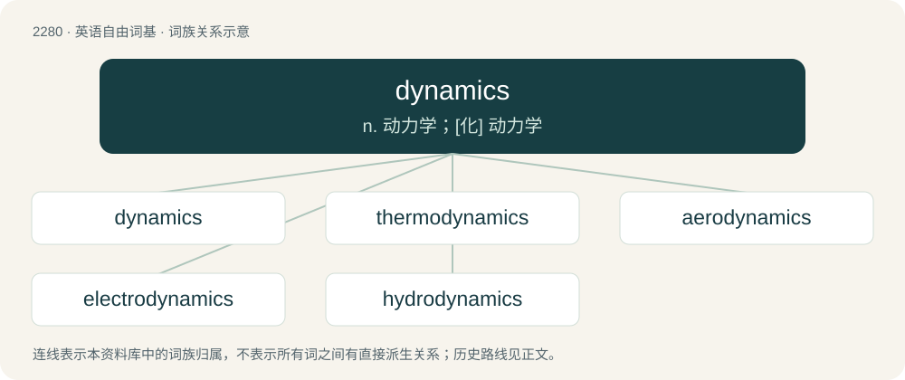

# 2383 · dynamics — n. 动力学；\[化\] 动力学

[总目录](../00_总目录_按常用程度.md)

**类型**：英语自由词基　｜　**来源语言**：见词源记录

## 核心含义与来源

- 核心含义：n. 动力学；\[化\] 动力学
- 英文含义：The branch of mechanics that is concerned with the effects of forces on the motion of objects.
- 词形：dynamics

**来源记录 1**（名词；The branch of mechanics that is concerned with the effects of forces on the motion of objects.）

From dynamic + -ics.

## 词族图

## 单词速览（常用到不常用）

| 单词 | 音标 | 释义 |
|---|---|---|
| [dynamics](#w-1) | 英 /dʌɪˈnamɪks/；美 /dɑɪˈnæm.ɪks/ | n. 动力学；\[化\] 动力学 |
| [thermodynamics](#w-2) | /ˌθɜː(ɹ)moʊdaɪˈnæmɪks/ | n. 热力学；\[化\] 热力学 |
| [aerodynamics](#w-3) | /.єərəudaiˈnæmiks/ | n. 空气动力学；\[化\] 空气动力学 |
| [electrodynamics](#w-4) | /ilektrəjdaiˈnæmiks/ | n. 电动力学；\[化\] 电动力学 |
| [hydrodynamics](#w-5) | /ˈhaidrəudaiˈnæmiks/ | n. 流体力学, 水动力学；\[化\] 流体动力学 |

## 逐词详解

### 1. dynamics

**词性**：名词　｜　**音标**：英 /dʌɪˈnamɪks/；美 /dɑɪˈnæm.ɪks/

**中文释义**：n. 动力学；\[化\] 动力学

**英文义项**：The changing amplitude or level of a sound wave or selection of audio. / The volume with which music is to be performed, denoted by such terms as piano, mezzo piano, mezzo forte, or forte.

**构词拆分**：dynamic + -ics

**词源与演化**：

From dynamic + -ics.

**例句**：

> The changing dynamics in international politics led to such an outcome.

该用例对应义项：Forces that stimulate growth, change, or development.

### 2. thermodynamics

**词性**：名词　｜　**音标**：/ˌθɜː(ɹ)moʊdaɪˈnæmɪks/

**中文释义**：n. 热力学；\[化\] 热力学

**英文义项**：The science of the conversions between heat and other forms of energy.

**构词拆分**：thermo- + dynamics

**词源与演化**：

From thermo- + dynamics. First attested in the 1850s.

**例句**：

> Thermodynamics is a branch of physics which deals with the energy and work of a system.

### 3. aerodynamics

**词性**：名词　｜　**音标**：/.єərəudaiˈnæmiks/

**中文释义**：n. 空气动力学；\[化\] 空气动力学

**英文义项**：The science of the dynamics of bodies moving relative to gases, especially the interaction of moving objects with the atmosphere. / The aerodynamic properties of a particular object (typically a car or aircraft).

**构词拆分**：aero- + dynamics

**词源与演化**：

From aero- + dynamics. Compare French aérodynamique, German Aerodynamik, and Italian aerodinamica.

**例句**：

> This type of airfoil doesn't have the right aerodynamics to achieve what they're trying to achieve.

该用例对应义项：The aerodynamic properties of a particular object (typically a car or aircraft).

### 4. electrodynamics

**词性**：名词　｜　**音标**：/ilektrəjdaiˈnæmiks/

**中文释义**：n. 电动力学；\[化\] 电动力学

**英文义项**：The phenomena associated with moving electric charges, and their interaction with electric and magnetic fields; the study of these phenomena.

**构词拆分**：electro- + dynamics

**词源与演化**：

From electro- + dynamics.

### 5. hydrodynamics

**词性**：名词　｜　**音标**：/ˈhaidrəudaiˈnæmiks/

**中文释义**：n. 流体力学, 水动力学；\[化\] 流体动力学

**英文义项**：The scientific study of liquids in motion. / The phenomena thus studied.

**构词拆分**：hydro- + dynamics

**词源与演化**：

From hydro- + dynamics.

**例句**：

> This type of valve doesn't have the right hydrodynamics to achieve what they're trying to achieve.

该用例对应义项：The phenomena thus studied.
