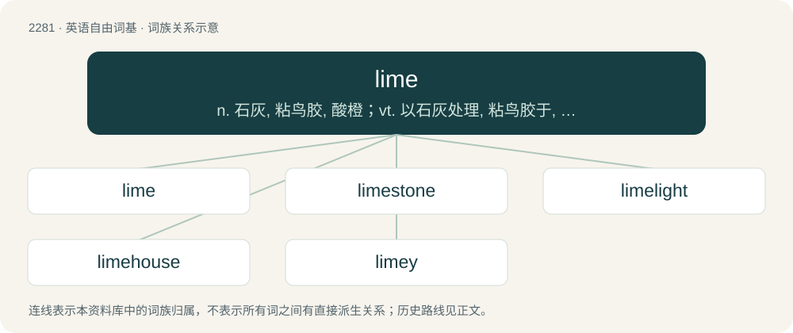

# 2384 · lime — n. 石灰, 粘鸟胶, 酸橙；vt. 以石灰处理, 粘鸟胶于, 撒石灰

[总目录](../00_总目录_按常用程度.md)

**类型**：英语自由词基　｜　**来源语言**：见词源记录

## 核心含义与来源

- 核心含义：n. 石灰, 粘鸟胶, 酸橙；vt. 以石灰处理, 粘鸟胶于, 撒石灰
- 英文含义：Any inorganic material containing calcium, usually calcium oxide (quicklime) or calcium hydroxide (slaked lime).
- 词形：lime

**多个词源／构词路径**：同一拼写可能有不同来源；以下按词性和含义分别列出。

**来源记录 1**（名词；Any inorganic material containing calcium, usually calcium oxide (quicklime) or calcium hydroxide (slaked lime).）

From Middle English lyme, lym, lime, from Old English līm, from Proto-West Germanic \*līm, from Proto-Germanic \*līmaz, from Proto-Indo-European \*h₂leyH- (“to smear”). Cognate with Saterland Frisian Liem (“glue”), Dutch lijm (“glue”), German Leim (“glue”), Danish, Norwegian Bokmål, Norwegian Nynorsk, and Swedish lim (“glue”), Faroese and Icelandic lím (“glue”), Latin limus (“mud”).

**来源记录 2**（名词；A deciduous tree of the genus Tilia, especially Tilia × europaea; the linden tree.）

Lime (17th c.) and line (16th c.) are alterations of obsolete lind, from Middle English lynde, from Old English lind, from Proto-Germanic \*lindijō. The phonetic development is unusual, but it has been suggested that it began in compounds (loss of -d- perhaps before tree, the change to -m- before labials as in bark or wood). Doublet of linden, which see.

**来源记录 3**（名词；Any of several green citrus fruit, somewhat smaller and sharper-tasting than a lemon.）

Borrowed from French lime, from Spanish lima, from Arabic لِيمَة (līma), from Classical Persian لِیمُو (līmū, līmō), from Sanskrit निम्बू (nimbū, “lime”), ultimately from Proto-Malayo-Polynesian \*limaw or Munda. Doublet of lemon.

**来源记录 4**（动词；To hang out or socialize in an informal, relaxed environment, especially with friends, for example at a party or on the beach.）

Either a back-formation of limer or from the derogatory term limey, a term first given to British soldiers but also used by Trinidadians for American soldiers who used to hang out idle in Port of Spain during World War 2.

## 词族图

## 单词速览（常用到不常用）

| 单词 | 音标 | 释义 |
|---|---|---|
| [lime](#w-1) | /laɪm/ | n. 石灰, 粘鸟胶, 酸橙；vt. 以石灰处理, 粘鸟胶于, 撒石灰 |
| [limestone](#w-2) | 英 /ˈlaɪmˌstəʊn/；美 /ˈlaɪmˌstoʊn/ | n. 石灰石；\[化\] 石灰石; 石灰岩 |
| [limelight](#w-3) | 英 /ˈlaɪm.laɪt/ | n. 石灰光, 石灰光灯, 以石灰光灯照射的舞台；vt. 使受到注目, 使显露头角 |
| [limehouse](#w-4) |  | 【英文】An oast house that uses a limekiln. |
| [limey](#w-5) | /ˈlaɪmi/ | n. 英国海军, 英国人 |

## 逐词详解

### 1. lime

**词性**：名词　｜　**音标**：/laɪm/

**中文释义**：n. 石灰, 粘鸟胶, 酸橙；vt. 以石灰处理, 粘鸟胶于, 撒石灰

**英文义项**：Any inorganic material containing calcium, usually calcium oxide (quicklime) or calcium hydroxide (slaked lime). / Any gluey or adhesive substance that traps or captures; sometimes a synonym for birdlime.

**词源与演化**：

From Middle English lyme, lym, lime, from Old English līm, from Proto-West Germanic \*līm, from Proto-Germanic \*līmaz, from Proto-Indo-European \*h₂leyH- (“to smear”). Cognate with Saterland Frisian Liem (“glue”), Dutch lijm (“glue”), German Leim (“glue”), Danish, Norwegian Bokmål, Norwegian Nynorsk, and Swedish lim (“glue”), Faroese and Icelandic lím (“glue”), Latin limus (“mud”).

**例句**：

> Surprisingly, the starving farm cat ate moldy white bread and lime jello.

### 2. limestone

**词性**：名词　｜　**音标**：英 /ˈlaɪmˌstəʊn/；美 /ˈlaɪmˌstoʊn/

**中文释义**：n. 石灰石；\[化\] 石灰石; 石灰岩

**英文义项**：An abundant rock of marine and freshwater sediments; primarily composed of calcite (CaCO₃); and occurring in a variety of forms, both crystalline and amorphous.

**构词拆分**：lime + stone

**词源与演化**：

From lime + stone.

**用法示例／搭配（非完整句）**：

> a limestone viaduct

该用例对应义项：An abundant rock of marine and freshwater sediments; primarily composed of calcite (CaCO₃); and occurring in a variety of forms, both crystalline and amorphous.

### 3. limelight

**词性**：名词　｜　**音标**：英 /ˈlaɪm.laɪt/

**中文释义**：n. 石灰光, 石灰光灯, 以石灰光灯照射的舞台；vt. 使受到注目, 使显露头角

**英文义项**：The intense white light produced when heating lime in an oxyhydrogen flame. / A type of stage lighting once used in theatres and music halls, producing a bright light by the use of incandescent quicklime.

**构词拆分**：lime + light

**词源与演化**：

From lime + light.

**用法示例／搭配（非完整句）**：

> steal the limelight

该用例对应义项：Attention, notice, a starring or central role, present fame; spotlight.

### 4. limehouse

**词性**：名词

**英文义项**：An oast house that uses a limekiln.

**构词拆分**：lime + house

**词源与演化**：

From lime + house.

### 5. limey

**词性**：形容词　｜　**音标**：/ˈlaɪmi/

**中文释义**：n. 英国海军, 英国人

**英文义项**：Resembling limes (the fruit); lime-like. / Of, or pertaining to, limes (the fruit).

**构词拆分**：by surface analysis, lime + -y

**词源与演化**：

In adjectival senses, by surface analysis, lime + -y. In the sense of Englishman, reduced from the 19th century term lime-juicer (“a British ship”), from the lime juice British ships carried to ward off scurvy.

**例句**：

> This drink is full of limey goodness.

该用例对应义项：Of, or pertaining to, limes (the fruit).
