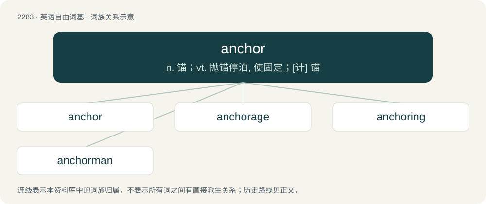

# 2385 · anchor — n. 锚；vt. 抛锚停泊, 使固定；\[计\] 锚

[总目录](../00_总目录_按常用程度.md)

**类型**：英语自由词基　｜　**来源语言**：见词源记录

## 核心含义与来源

- 核心含义：n. 锚；vt. 抛锚停泊, 使固定；\[计\] 锚
- 英文含义：A tool used to moor a vessel to the bottom of a sea or river to resist movement.
- 词形：anchor

**多个词源／构词路径**：同一拼写可能有不同来源；以下按词性和含义分别列出。

**来源记录 1**（名词；A tool used to moor a vessel to the bottom of a sea or river to resist movement.）

From Middle English anker, from Old English ancor, ancra, from Latin ancora, from (or cognate with) Ancient Greek ἄγκυρα (ánkura). The modern form is a sixteenth-century modification after the Medieval Latin spelling anchora. Doublet of ancora, anker, angora, and Ankara.

**来源记录 2**（动词；To connect an object, especially a ship or a boat, to a fixed point.）

From Middle English anchoren, ankeren, either from the noun or perhaps (via Old French ancrer) from a Medieval Latin verb ancorare, from the same Latin word ancora.

## 词族图

## 单词速览（常用到不常用）

| 单词 | 音标 | 释义 |
|---|---|---|
| [anchor](#w-1) | 英 /ˈæŋ.kəː/；/ˈæŋ.kɚ/ | n. 锚；vt. 抛锚停泊, 使固定；\[计\] 锚 |
| [anchorage](#w-2) | 英 /ˈæŋkəɹɪd͡ʒ/；美 /ˈæŋkɚɪd͡ʒ/ | n. 下锚, 锚地, 停泊税；\[化\] 固着; 固定; 锚定 |
| [anchoring](#w-3) |  | \[机\] 吊骨 |
| [anchorman](#w-4) | /ˈæŋkəmæn/ | n. 末棒运动员, 成绩倒数第一名, 新闻节目主持人 |

## 逐词详解

### 1. anchor

**词性**：名词　｜　**音标**：英 /ˈæŋ.kəː/；/ˈæŋ.kɚ/

**中文释义**：n. 锚；vt. 抛锚停泊, 使固定；\[计\] 锚

**英文义项**：A tool used to moor a vessel to the bottom of a sea or river to resist movement. / An iron device so shaped as to grip the bottom and hold a vessel at her berth by the chain or rope attached.

**词源与演化**：

From Middle English anker, from Old English ancor, ancra, from Latin ancora, from (or cognate with) Ancient Greek ἄγκυρα (ánkura). The modern form is a sixteenth-century modification after the Medieval Latin spelling anchora. Doublet of ancora, anker, angora, and Ankara.

**例句**：

> This ship is outfitted with a windlass to heave up the anchor.

### 2. anchorage

**词性**：名词　｜　**音标**：英 /ˈæŋkəɹɪd͡ʒ/；美 /ˈæŋkɚɪd͡ʒ/

**中文释义**：n. 下锚, 锚地, 停泊税；\[化\] 固着; 固定; 锚定

**英文义项**：A harbor, river, or offshore area that can accommodate a ship at anchor, either for quarantine, queuing, or discharge. / A fee charged for anchoring.

**构词拆分**：anchor + -age

**词源与演化**：

From anchor + -age.

**例句**：

> Anchorage is five pounds a night outside the harbour.

该用例对应义项：A fee charged for anchoring.

### 3. anchoring

**词性**：名词

**中文释义**：\[机\] 吊骨

**英文义项**：The act or means by which something is anchored or made firm. / The tendency of people to place subsequently refined answers to a given question close to the initially estimated answer, giving undue weight to the initial answer, such as adjusting an initial estimate of 20% to 30% when 90% would be more appropriate.

**构词拆分**：anchor + -ing

**词源与演化**：

From anchor + -ing.

### 4. anchorman

**词性**：名词　｜　**音标**：/ˈæŋkəmæn/

**中文释义**：n. 末棒运动员, 成绩倒数第一名, 新闻节目主持人

**英文义项**：The main host of a television or radio program, particularly one relating to the broadcast of news. / The most reliable runner in a relay team, usually the one that runs last.

**构词拆分**：anchor + man

**词源与演化**：

From anchor + man. Senses 1 and 4 derive from sense 2, sense 3 is literal.

**例句**：

> The anchorman had an audience with the king.
