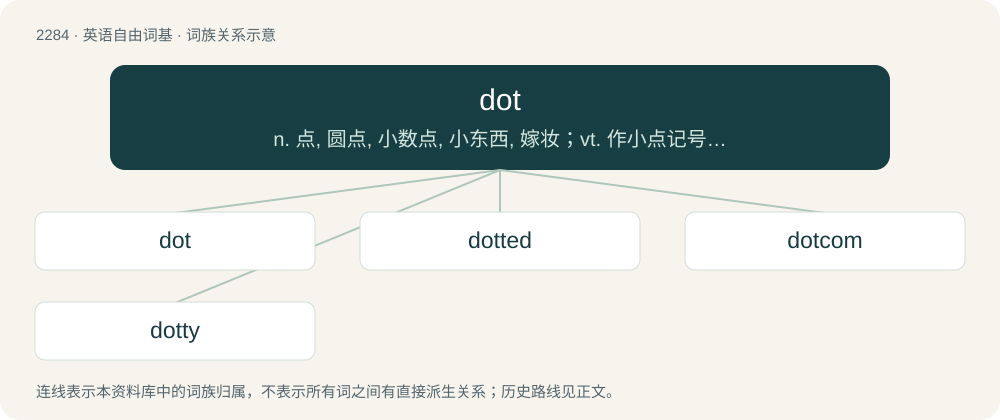

# 2386 · dot — n. 点, 圆点, 小数点, 小东西, 嫁妆；vt. 作小点记号, 加小点于；vi. 打上点

[总目录](../00_总目录_按常用程度.md)

**类型**：英语自由词基　｜　**来源语言**：见词源记录

## 核心含义与来源

- 核心含义：n. 点, 圆点, 小数点, 小东西, 嫁妆；vt. 作小点记号, 加小点于；vi. 打上点
- 英文含义：A small, round spot.
- 词形：dot

**来源记录 1**（名词；A small, round spot.）

From Middle English \*dot, dotte, from Old English dott (“a dot, point”), from Proto-West Germanic \*dott, from Proto-Germanic \*duttaz (“wisp”). Cognate with Saterland Frisian Dot, Dotte (“a clump”), Dutch dot (“lump, knot, clod”), Low German Dutte (“a plug”), dialectal Swedish dott (“a little heap, bunch, clump”).

## 词族图

## 单词速览（常用到不常用）

| 单词 | 音标 | 释义 |
|---|---|---|
| [dot](#w-1) | 英 /dɒt/；美 /dɑt/ | n. 点, 圆点, 小数点, 小东西, 嫁妆；vt. 作小点记号, 加小点于；vi. 打上点 |
| [dotted](#w-2) | 英 /ˈdɒtɪd/；美 /ˈdɑtɪd/ | a. 有点的, 星罗棋布的 |
| [dotcom](#w-3) | 英 /dɒtˈkɒm/；美 /ˌdɑtˈkɑm/ | n. 网站 |
| [dotty](#w-4) | 美 /ˈdɑ.ti/；/ˈdɒti/ | 【英文】Having many dots. |

## 逐词详解

### 1. dot

**词性**：名词　｜　**音标**：英 /dɒt/；美 /dɑt/

**中文释义**：n. 点, 圆点, 小数点, 小东西, 嫁妆；vt. 作小点记号, 加小点于；vi. 打上点

**英文义项**：A small, round spot. / A punctuation mark used to indicate the end of a sentence or an abbreviated part of a word; a full stop; a period.

**词源与演化**：

From Middle English \*dot, dotte, from Old English dott (“a dot, point”), from Proto-West Germanic \*dott, from Proto-Germanic \*duttaz (“wisp”). Cognate with Saterland Frisian Dot, Dotte (“a clump”), Dutch dot (“lump, knot, clod”), Low German Dutte (“a plug”), dialectal Swedish dott (“a little heap, bunch, clump”).

**用法示例／搭配（非完整句）**：

> a dot of colour

该用例对应义项：A small, round spot.

### 2. dotted

**词性**：形容词　｜　**音标**：英 /ˈdɒtɪd/；美 /ˈdɑtɪd/

**中文释义**：a. 有点的, 星罗棋布的

**英文义项**：Made up of a series of dots. / That contains dots.

**构词拆分**：From dot + -ed.

**词源与演化**：

From dot + -ed.

**例句**：

> The landscapes were green and treed and dotted with cows.

### 3. dotcom

**词性**：名词　｜　**音标**：英 /dɒtˈkɒm/；美 /ˌdɑtˈkɑm/

**中文释义**：n. 网站

**英文义项**：A company whose business is based around a website or primarily via the Internet.

**构词拆分**：dot + com

**词源与演化**：

From dot + com, from the DNS suffix .com.

### 4. dotty

**词性**：形容词　｜　**音标**：美 /ˈdɑ.ti/；/ˈdɒti/

**英文义项**：Having many dots.

**构词拆分**：dot + -y

**词源与演化**：

From dot + -y.

**例句**：

> Look at the dotty pattern on that cheetah's fur.

该用例对应义项：Having many dots.
