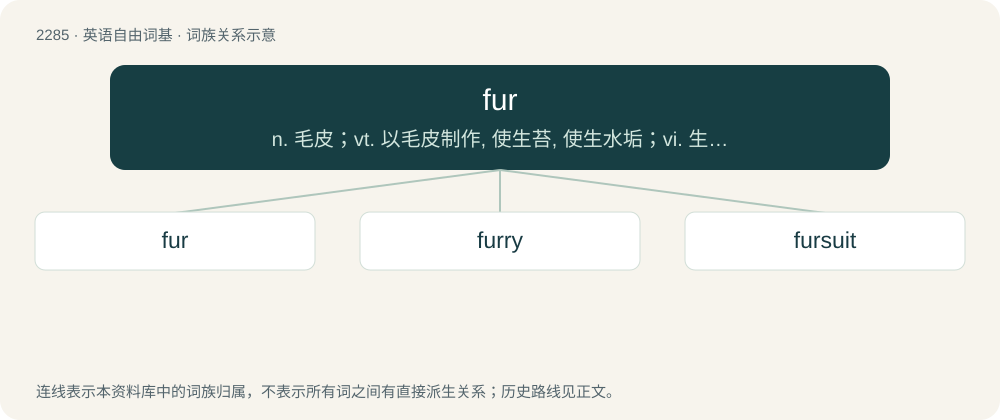

# 2387 · fur — n. 毛皮；vt. 以毛皮制作, 使生苔, 使生水垢；vi. 生苔, 积水垢

[总目录](../00_总目录_按常用程度.md)

**类型**：英语自由词基　｜　**来源语言**：见词源记录

## 核心含义与来源

- 核心含义：n. 毛皮；vt. 以毛皮制作, 使生苔, 使生水垢；vi. 生苔, 积水垢
- 英文含义：The hairy coat of various mammal species, especially when fine, soft and thick.
- 词形：fur

**来源记录 1**（名词；The hairy coat of various mammal species, especially when fine, soft and thick.）

From Middle English furre, forre, from Anglo-Norman forre, fuerre (“case; sheath”), from Frankish \*fōdar, from Proto-West Germanic \*fōdr, from Proto-Germanic \*fōdrą (“sheath”) (compare Old English fōdor (“sheaf”), Dutch voering (“lining”), German Futter (“lining”), Gothic 𐍆𐍉𐌳𐍂 (fōdr, “sheath”)), from Proto-Indo-European \*peh₂-, \*poh₂- (“to protect”) (compare Lithuanian piemuō (“protection”), Ancient Greek πῶῠ̈ (pôŭ̈, “flock”), πῶμα (pôma, “lid”), ποιμήν (poimḗn, “shepherd”), Old Armenian հաւրան (hawran, “herd, flock”), Northern Kurdish pawan (“to watch over”), Sanskrit पाति (pāti, “he watches, protects”). The verb is from Middle English furren, from Anglo-Norman furrer, forrer, fourrer (“to line, stuff, fill”), from the noun.

## 词族图

## 单词速览（常用到不常用）

| 单词 | 音标 | 释义 |
|---|---|---|
| [fur](#w-1) | 英 /fɜː/；美 /fɝ/ | n. 毛皮；vt. 以毛皮制作, 使生苔, 使生水垢；vi. 生苔, 积水垢 |
| [furry](#w-2) | 英 /ˈfɜː.ɹi/；美 /ˈfɜɹ.i/ | a. 毛皮的, 盖着毛皮的, 似毛皮的 |
| [fursuit](#w-3) | 英 /ˈfɜː(ɹ)ˌsuːt/；美 /ˈfɜɹˌsuːt/ | 【英文】An anthropomorphic animal costume used in the furry subculture. |

## 逐词详解

### 1. fur

**词性**：名词　｜　**音标**：英 /fɜː/；美 /fɝ/

**中文释义**：n. 毛皮；vt. 以毛皮制作, 使生苔, 使生水垢；vi. 生苔, 积水垢

**英文义项**：The hairy coat of various mammal species, especially when fine, soft and thick. / The hairy skins of animals used as a material for clothing.

**词源与演化**：

From Middle English furre, forre, from Anglo-Norman forre, fuerre (“case; sheath”), from Frankish \*fōdar, from Proto-West Germanic \*fōdr, from Proto-Germanic \*fōdrą (“sheath”) (compare Old English fōdor (“sheaf”), Dutch voering (“lining”), German Futter (“lining”), Gothic 𐍆𐍉𐌳𐍂 (fōdr, “sheath”)), from Proto-Indo-European \*peh₂-, \*poh₂- (“to protect”) (compare Lithuanian piemuō (“protection”), Ancient Greek πῶῠ̈ (pôŭ̈, “flock”), πῶμα (pôma, “lid”), ποιμήν (poimḗn, “shepherd”), Old Armenian հաւրան (hawran, “herd, flock”), Northern Kurdish pawan (“to watch over”), Sanskrit पाति (pāti, “he watches, protects”). The verb is from Middle English furren, from Anglo-Norman furrer, forrer, fourrer (“to line, stuff, fill”), from the noun.

**例句**：

> During the colonial period, Britain used Canada as a major source of furs.

该用例对应义项：An animal pelt used to make, trim or line clothing.

### 2. furry

**词性**：形容词　｜　**音标**：英 /ˈfɜː.ɹi/；美 /ˈfɜɹ.i/

**中文释义**：a. 毛皮的, 盖着毛皮的, 似毛皮的

**英文义项**：Covered with fur, or with something resembling fur. / Resembling or characteristic of fur.

**构词拆分**：fur + -y

**词源与演化**：

From fur + -y.

**例句**：

> His treatment of our furry friends was nothing short of appalling.

该用例对应义项：Covered with fur, or with something resembling fur.

### 3. fursuit

**词性**：名词　｜　**音标**：英 /ˈfɜː(ɹ)ˌsuːt/；美 /ˈfɜɹˌsuːt/

**英文义项**：An anthropomorphic animal costume used in the furry subculture.

**构词拆分**：fur + suit

**词源与演化**：

From fur + suit.

**例句**：

> I'll probably just wear my fursuit and call it a costume.
