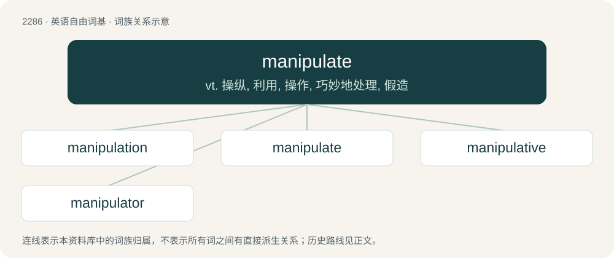

# 2388 · manipulate — vt. 操纵, 利用, 操作, 巧妙地处理, 假造

[总目录](../00_总目录_按常用程度.md)

**类型**：英语自由词基　｜　**来源语言**：见词源记录

## 核心含义与来源

- 核心含义：vt. 操纵, 利用, 操作, 巧妙地处理, 假造
- 英文含义：To move, arrange or operate something using the hands
- 词形：manipulate

**来源记录 1**（动词；To move, arrange or operate something using the hands）

Back-formation from manipulation.

## 词族图

## 单词速览（常用到不常用）

| 单词 | 音标 | 释义 |
|---|---|---|
| [manipulation](#w-1) | 英 /məˌnɪp.juˈleɪ.ʃən/；美 /məˌnɪp.jəˈleɪ.ʃən/ | n. 操作, 处理；\[化\] (用手)操作; 使用 |
| [manipulate](#w-2) | 英 /məˈnɪp.jʊ.leɪt/；美 /məˈnɪp.jə.leɪt/ | vt. 操纵, 利用, 操作, 巧妙地处理, 假造 |
| [manipulative](#w-3) | 英 /məˈnɪp.jə.lə.tɪv/；美 /məˈnɪp.jə.leɪ.tɪv/ | a. 处理的, 巧妙处理的, 操纵的 |
| [manipulator](#w-4) | /məˈnɪpjʊleɪtə(ɹ)/ | n. 操作者, 机械手；\[化\] 机械手 |

## 逐词详解

### 1. manipulation

**词性**：名词　｜　**音标**：英 /məˌnɪp.juˈleɪ.ʃən/；美 /məˌnɪp.jəˈleɪ.ʃən/

**中文释义**：n. 操作, 处理；\[化\] (用手)操作; 使用

**英文义项**：The practice of manipulating or the state of being manipulated. / The skillful use of the hands in, for example, chiropractic.

**构词拆分**：manipulate + -ion

**词源与演化**：

From French manipulation, from Old French manipule, from Latin manipulus. Morphologically manipulate + -ion.

**例句**：

> After a few minutes of manipulation each week, she obtained days of relief from her neck pain.

该用例对应义项：The skillful use of the hands in, for example, chiropractic.

### 2. manipulate

**词性**：动词　｜　**音标**：英 /məˈnɪp.jʊ.leɪt/；美 /məˈnɪp.jə.leɪt/

**中文释义**：vt. 操纵, 利用, 操作, 巧妙地处理, 假造

**英文义项**：To move, arrange or operate something using the hands / To influence, manage, direct, control or tamper with something

**词源与演化**：

Back-formation from manipulation.

**例句**：

> She knew how to manipulate people to get her way.

该用例对应义项：To influence or control someone in order to achieve a specific purpose, especially one that is unknown to the one being manipulated and beneficial to the manipulator; to use

### 3. manipulative

**词性**：形容词　｜　**音标**：英 /məˈnɪp.jə.lə.tɪv/；美 /məˈnɪp.jə.leɪ.tɪv/

**中文释义**：a. 处理的, 巧妙处理的, 操纵的

**英文义项**：Using manipulation purposefully. / Tending to manipulate.

**构词拆分**：manipulate + -ive

**词源与演化**：

From manipulate + -ive.

**用法示例／搭配（非完整句）**：

> You manipulative bitch!

该用例对应义项：Reaching one's goals at the expense of other people by using them.

### 4. manipulator

**词性**：名词　｜　**音标**：/məˈnɪpjʊleɪtə(ɹ)/

**中文释义**：n. 操作者, 机械手；\[化\] 机械手

**英文义项**：A device which can be used to move, arrange or operate something. / A puppeteer, especially one controlling marionettes.

**构词拆分**：From manipulate + -or.

**词源与演化**：

From manipulate + -or.

**例句**：

> Yanni was in the clutches of Skura, a master manipulator.
