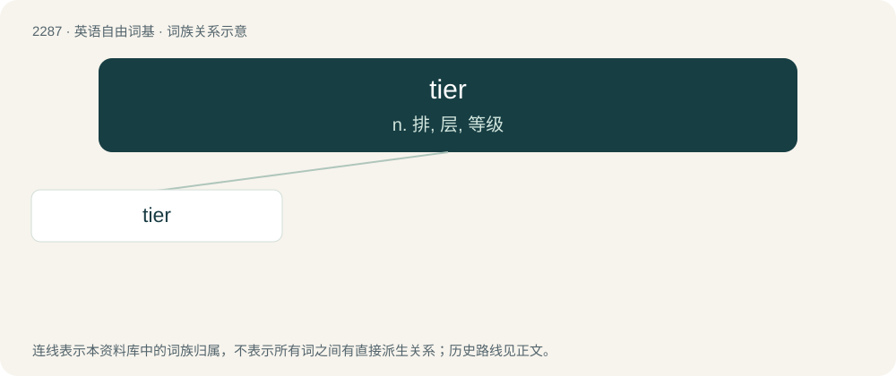

# 2389 · tier — n. 排, 层, 等级

[总目录](../00_总目录_按常用程度.md)

**类型**：英语自由词基　｜　**来源语言**：见词源记录

## 核心含义与来源

- 核心含义：n. 排, 层, 等级
- 英文含义：One who ties (knots, etc.).
- 词形：tier

**多个词源／构词路径**：同一拼写可能有不同来源；以下按词性和含义分别列出。

**来源记录 1**（名词；One who ties (knots, etc.).）

From tie + -er.

**来源记录 2**（名词；A row or range, especially one at a higher or lower level than another.）

From Middle French tier, from Old French tire (“rank, sequence, order, kind”), probably from tirer (“to draw, draw out”). Alternatively, from a Germanic source related to Middle English tir (“honour, glory, power, rule”), Old English tīr (“glory, honour, fame”), Old Norse tírr (“glory, honour, renown”).

## 词族图

## 单词速览（常用到不常用）

| 单词 | 音标 | 释义 |
|---|---|---|
| [tier](#w-1) | 英 /ˈtaɪ.ə/；美 /ˈtaɪ.ɚ/ | n. 排, 层, 等级 |

## 逐词详解

### 1. tier

**词性**：名词　｜　**音标**：英 /ˈtaɪ.ə/；美 /ˈtaɪ.ɚ/

**中文释义**：n. 排, 层, 等级

**英文义项**：One who ties (knots, etc.). / Something that ties.

**构词拆分**：tie + -er

**词源与演化**：

From tie + -er.

**例句**：

> Tier upon tier of huge casks.

该用例对应义项：one of two or more layers one atop another
