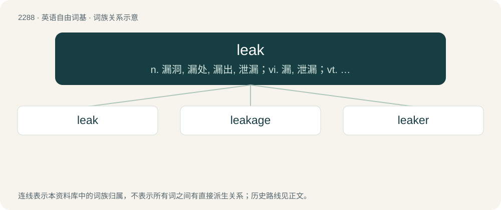

# 2390 · leak — n. 漏洞, 漏处, 漏出, 泄漏；vi. 漏, 泄漏；vt. 使渗漏

[总目录](../00_总目录_按常用程度.md)

**类型**：英语自由词基　｜　**来源语言**：见词源记录

## 核心含义与来源

- 核心含义：n. 漏洞, 漏处, 漏出, 泄漏；vi. 漏, 泄漏；vt. 使渗漏
- 英文含义：A crack, crevice, fissure, or hole which admits water or other fluid, or lets it escape.
- 词形：leak

**来源记录 1**（名词；A crack, crevice, fissure, or hole which admits water or other fluid, or lets it escape.）

From Middle English leken (“to let water in or out”), from Old English \*lecan (“to leak”), Middle Dutch leken (“to leak, drip”) or Old Norse leka (“to leak, drip”); all from Proto-Germanic \*lekaną (“to leak, drain”), from Proto-Indo-European \*leg- (“to leak”). Cognate with Dutch lekken (“to leak”), German lechen, lecken (“to leak”), Danish lække (“to leak”), Swedish läcka (“to leak”), Norwegian Bokmål lekke (“to leak”), Faroese, Icelandic, and Norwegian Nynorsk leka (“to leak”). Related also to Old English leċċan (“to water, wet”), Albanian lag, lak (“to damp, make wet”). See also leach, lake. (divulgation, disclosure of information): Compare typologically Bulgarian изтичане (iztičane), Polish przeciek, Russian уте́чка (utéčka) (akin to течь impf or f (tečʹ)).

## 词族图

## 单词速览（常用到不常用）

| 单词 | 音标 | 释义 |
|---|---|---|
| [leak](#w-1) | /liːk/ | n. 漏洞, 漏处, 漏出, 泄漏；vi. 漏, 泄漏；vt. 使渗漏 |
| [leakage](#w-2) | /ˈliːkɪd͡ʒ/ | n. 漏, 漏出物, 泄漏；\[化\] 漏电; 漏水; 漏气; 渗漏; 漏失量; 漏出量 |
| [leaker](#w-3) |  | \[机\] 漏水铸件, 漏箱 |

## 逐词详解

### 1. leak

**词性**：名词　｜　**音标**：/liːk/

**中文释义**：n. 漏洞, 漏处, 漏出, 泄漏；vi. 漏, 泄漏；vt. 使渗漏

**英文义项**：A crack, crevice, fissure, or hole which admits water or other fluid, or lets it escape. / The entrance or escape of a fluid through a crack, fissure, or other aperture.

**词源与演化**：

From Middle English leken (“to let water in or out”), from Old English \*lecan (“to leak”), Middle Dutch leken (“to leak, drip”) or Old Norse leka (“to leak, drip”); all from Proto-Germanic \*lekaną (“to leak, drain”), from Proto-Indo-European \*leg- (“to leak”). Cognate with Dutch lekken (“to leak”), German lechen, lecken (“to leak”), Danish lække (“to leak”), Swedish läcka (“to leak”), Norwegian Bokmål lekke (“to leak”), Faroese, Icelandic, and Norwegian Nynorsk leka (“to leak”). Related also to Old English leċċan (“to water, wet”), Albanian lag, lak (“to damp, make wet”). See also leach, lake. (divulgation, disclosure of information): Compare typologically Bulgarian изтичане (iztičane), Polish przeciek, Russian уте́чка (utéčka) (akin to течь impf or f (tečʹ)).

**例句**：

> The leaks by Chelsea Manning showed the secrets of the US military.

该用例对应义项：A divulgation, or disclosure, of information previously held secret.

### 2. leakage

**词性**：名词　｜　**音标**：/ˈliːkɪd͡ʒ/

**中文释义**：n. 漏, 漏出物, 泄漏；\[化\] 漏电; 漏水; 漏气; 渗漏; 漏失量; 漏出量

**英文义项**：An act of leaking, or something that leaks. / The amount lost due to a leak.

**构词拆分**：leak + -age

**词源与演化**：

From leak + -age.

**例句**：

> Engineers discovered leakage in the fuel tank.

该用例对应义项：An act of leaking, or something that leaks.

### 3. leaker

**词性**：名词

**中文释义**：\[机\] 漏水铸件, 漏箱

**英文义项**：Somebody who leaks information. / Anything that leaks.

**构词拆分**：leak + -er

**词源与演化**：

From leak + -er.
