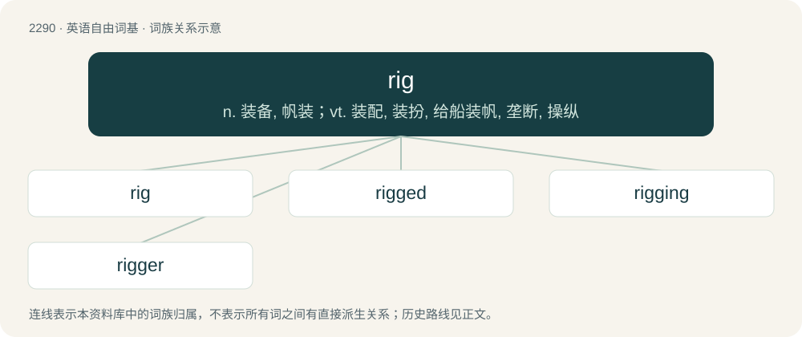

# 2392 · rig — n. 装备, 帆装；vt. 装配, 装扮, 给船装帆, 垄断, 操纵

[总目录](../00_总目录_按常用程度.md)

**类型**：英语自由词基　｜　**来源语言**：见词源记录

## 核心含义与来源

- 核心含义：n. 装备, 帆装；vt. 装配, 装扮, 给船装帆, 垄断, 操纵
- 英文含义：The rigging of a sailing ship or other such craft.
- 词形：rig

**多个词源／构词路径**：同一拼写可能有不同来源；以下按词性和含义分别列出。

**来源记录 1**（名词；The rigging of a sailing ship or other such craft.）

From Early Modern English rygge, probably of North Germanic origin. Compare Norwegian rigge (“to bind up; wrap around; rig; equip”), Swedish dialectal rigga (“to rig a horse”), Faroese rigga (“to rig; to equip and fit; to make s.th. function”). Possibly from Proto-Germanic \*rik- (“to bind”), from Proto-Indo-European \*rign-, \*reyg- (“to bind”); or related to Old English \*wrīhan, wrīohan, wrēohan, wrēon (“to bind; wrap up; cover”). See also wry (“to cover; clothe; dress; hide”).

**来源记录 2**（名词；A ridge.）

See ridge.

**来源记录 3**（名词；A promiscuous woman.）

Compare wriggle.

**来源记录 4**（名词；An algebraic structure similar to a ring, but without the requirement that every element have an additive inverse.）

From ring (“algebraic structure”), omitting the letter n to suggest the lack of negatives. Compare rng (“structure like a ring but lacking a multiplicative identity”).

## 词族图

## 单词速览（常用到不常用）

| 单词 | 音标 | 释义 |
|---|---|---|
| [rig](#w-1) | /ɹɪɡ/ | n. 装备, 帆装；vt. 装配, 装扮, 给船装帆, 垄断, 操纵 |
| [rigged](#w-2) | /ɹɪɡd/ | a. 作弊的, 非法操纵的 |
| [rigging](#w-3) | /ˈɹɪɡɪŋ/ | n. 索具, 装备；\[经\] 提价 |
| [rigger](#w-4) | 英 /ˈɹɪɡə(ɹ)/；美 /ˈɹɪɡɚ/ | n. 装配工 |

## 逐词详解

### 1. rig

**词性**：名词　｜　**音标**：/ɹɪɡ/

**中文释义**：n. 装备, 帆装；vt. 装配, 装扮, 给船装帆, 垄断, 操纵

**英文义项**：The rigging of a sailing ship or other such craft. / Special equipment or gear used for a particular purpose.

**词源与演化**：

From Early Modern English rygge, probably of North Germanic origin. Compare Norwegian rigge (“to bind up; wrap around; rig; equip”), Swedish dialectal rigga (“to rig a horse”), Faroese rigga (“to rig; to equip and fit; to make s.th. function”). Possibly from Proto-Germanic \*rik- (“to bind”), from Proto-Indo-European \*rign-, \*reyg- (“to bind”); or related to Old English \*wrīhan, wrīohan, wrēohan, wrēon (“to bind; wrap up; cover”). See also wry (“to cover; clothe; dress; hide”).

**例句**：

> The climbers each had a different rig for climbing that particular rockface.

该用例对应义项：Special equipment or gear used for a particular purpose.

### 2. rigged

**词性**：形容词　｜　**音标**：/ɹɪɡd/

**中文释义**：a. 作弊的, 非法操纵的

**英文义项**：Prearranged and fixed so that the winner or outcome is decided in advance. / Having the rigging up.

**构词拆分**：From rig + -ed.

**词源与演化**：

From rig + -ed.

**例句**：

> There was a vicious rumour that the final was rigged, as the defense seemed useless.

该用例对应义项：Prearranged and fixed so that the winner or outcome is decided in advance.

### 3. rigging

**词性**：名词　｜　**音标**：/ˈɹɪɡɪŋ/

**中文释义**：n. 索具, 装备；\[经\] 提价

**英文义项**：Dress; tackle; especially (nautical), the ropes, chains, etc., that support the masts and spars of a sailing vessel, and serve as purchases for adjusting the sails, etc. / Similar supporting material used for construction work, or in film, theater, etc.

**构词拆分**：rig + -ing

**词源与演化**：

From Middle English riggyng, ryggyng, riggynge, equivalent to rig + -ing.

**例句**：

> The whistling of the wind through the rigging sounded like funereal wailings.

### 4. rigger

**词性**：名词　｜　**音标**：英 /ˈɹɪɡə(ɹ)/；美 /ˈɹɪɡɚ/

**中文释义**：n. 装配工

**英文义项**：One whose occupation is to fit the rigging of a ship or of a counterweight system. / One whose occupation is to lift and move large and heavy objects (such as industrial machinery) with the help of cables, hoists, and other equipment.

**构词拆分**：rig + -er

**词源与演化**：

From rig + -er.
