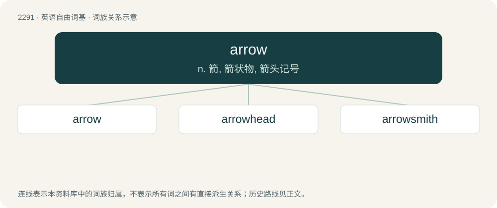

# 2393 · arrow — n. 箭, 箭状物, 箭头记号

[总目录](../00_总目录_按常用程度.md)

**类型**：英语自由词基　｜　**来源语言**：见词源记录

## 核心含义与来源

- 核心含义：n. 箭, 箭状物, 箭头记号
- 英文含义：A projectile consisting of a shaft, a point and a tail with stabilizing fins that is shot from a bow.
- 词形：arrow

**来源记录 1**（名词；A projectile consisting of a shaft, a point and a tail with stabilizing fins that is shot from a bow.）

From Middle English arwe, from Old English earh (“arrow”) (oblique form ēarw-), from Proto-West Germanic \*arhu (“arrow”), from Proto-Germanic \*arhwō (“arrow”), from Proto-Indo-European \*h₂érkʷo- (“bow, arrow”). Cognate with Faroese ørv, ørvur (“arrow”), Icelandic ör (“arrow”), örvar (“arrows”), Gothic 𐌰𐍂𐍈𐌰𐌶𐌽𐌰 (arƕazna, “dart”), Asturian and Leonese arcu (“bow”), Aragonese, Galician, Italian, Portuguese, and Spanish arco (“bow”), Catalan, French, and Romanian arc (“bow”), Latin arcus (“bow”). Doublet of arch, arc, arco, and arcus.

## 词族图

## 单词速览（常用到不常用）

| 单词 | 音标 | 释义 |
|---|---|---|
| [arrow](#w-1) | 英 /ˈæ.ɹəʊ/；美 /ˈæɹə/ | n. 箭, 箭状物, 箭头记号 |
| [arrowhead](#w-2) | 英 /ˈæɹəʊhɛd/；/ˈæɹoʊhɛd/ | n. 箭头, 镞, 慈菇；\[计\] 箭头尖 |
| [arrowsmith](#w-3) |  | 【英文】A smith who made the iron tips for arrows. |

## 逐词详解

### 1. arrow

**词性**：动词　｜　**音标**：英 /ˈæ.ɹəʊ/；美 /ˈæɹə/

**中文释义**：n. 箭, 箭状物, 箭头记号

**英文义项**：To move swiftly and directly (like an arrow). / To let fly swiftly and directly.

**词源与演化**：

From Middle English arwe, from Old English earh (“arrow”) (oblique form ēarw-), from Proto-West Germanic \*arhu (“arrow”), from Proto-Germanic \*arhwō (“arrow”), from Proto-Indo-European \*h₂érkʷo- (“bow, arrow”). Cognate with Faroese ørv, ørvur (“arrow”), Icelandic ör (“arrow”), örvar (“arrows”), Gothic 𐌰𐍂𐍈𐌰𐌶𐌽𐌰 (arƕazna, “dart”), Asturian and Leonese arcu (“bow”), Aragonese, Galician, Italian, Portuguese, and Spanish arco (“bow”), Catalan, French, and Romanian arc (“bow”), Latin arcus (“bow”). Doublet of arch, arc, arco, and arcus.

**例句**：

> Arrow left until you reach the start of the text you want to delete.

该用例对应义项：To navigate using the arrow keys.

### 2. arrowhead

**词性**：名词　｜　**音标**：英 /ˈæɹəʊhɛd/；/ˈæɹoʊhɛd/

**中文释义**：n. 箭头, 镞, 慈菇；\[计\] 箭头尖

**英文义项**：The pointed part of an arrow (the weapon). / The pointed part of an arrow (the symbol).

**构词拆分**：By surface analysis, arrow + head

**词源与演化**：

From Middle English arewehede, arowhede, arowheved. By surface analysis, arrow + head.

**例句**：

> If you're practicing target archery, you'll be using a narrow, pointed arrowhead rather than a broadhead.

### 3. arrowsmith

**词性**：名词

**英文义项**：A smith who made the iron tips for arrows.

**构词拆分**：arrow + smith

**词源与演化**：

From arrow + smith.
