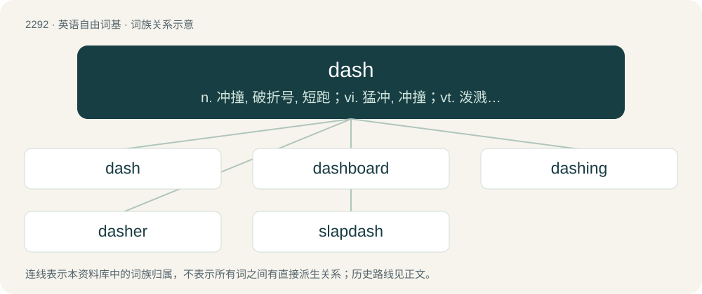

# 2394 · dash — n. 冲撞, 破折号, 短跑；vi. 猛冲, 冲撞；vt. 泼溅, 使猛撞, 搀和, 使破灭, 使沮丧

[总目录](../00_总目录_按常用程度.md)

**类型**：英语自由词基　｜　**来源语言**：见词源记录

## 核心含义与来源

- 核心含义：n. 冲撞, 破折号, 短跑；vi. 猛冲, 冲撞；vt. 泼溅, 使猛撞, 搀和, 使破灭, 使沮丧
- 英文含义：Any of the following symbols: ‒ (figure dash), – (en dash), — (em dash), or ― (horizontal bar).
- 词形：dash

**来源记录 1**（名词；Any of the following symbols: ‒ (figure dash), – (en dash), — (em dash), or ― (horizontal bar).）

From Middle English daschen, dassen, from Danish daske (“to slap, strike”), related to Swedish daska (“to smack, slap, spank”), of obscure origin. Compare German tatschen (“to grope, paw”), Old English dwǣsċan (“to quell, put out, destroy, extinguish”). See also dush.

## 词族图

## 单词速览（常用到不常用）

| 单词 | 音标 | 释义 |
|---|---|---|
| [dash](#w-1) | 英 /ˈdæʃ/；/ˈdɛəʃ/ | n. 冲撞, 破折号, 短跑；vi. 猛冲, 冲撞；vt. 泼溅, 使猛撞, 搀和, 使破灭, 使沮丧 |
| [dashboard](#w-2) | 英 /ˈdæʃˌbɔːd/；美 /ˈdæʃˌboɹd/ | n. 仪表板, 挡泥板 |
| [dashing](#w-3) | 英 /ˈdæʃɪŋ(ɡ)/ | a. 闯劲足的, 有力的 |
| [dasher](#w-4) | 英 /ˈdæʃə(ɹ)/ | n. 猛冲者, 精力充沛的人, 搅拌装置 |
| [slapdash](#w-5) | /ˈslæpdæʃ/ | n. 草率；a. 猛烈的, 粗心的 |

## 逐词详解

### 1. dash

**词性**：名词　｜　**音标**：英 /ˈdæʃ/；/ˈdɛəʃ/

**中文释义**：n. 冲撞, 破折号, 短跑；vi. 猛冲, 冲撞；vt. 泼溅, 使猛撞, 搀和, 使破灭, 使沮丧

**英文义项**：Any of the following symbols: ‒ (figure dash), – (en dash), — (em dash), or ― (horizontal bar). / A hyphen or minus sign.

**词源与演化**：

From Middle English daschen, dassen, from Danish daske (“to slap, strike”), related to Swedish daska (“to smack, slap, spank”), of obscure origin. Compare German tatschen (“to grope, paw”), Old English dwǣsċan (“to quell, put out, destroy, extinguish”). See also dush.

**例句**：

> There is a dash of craziness in his personality.

该用例对应义项：A slight admixture.

### 2. dashboard

**词性**：名词　｜　**音标**：英 /ˈdæʃˌbɔːd/；美 /ˈdæʃˌboɹd/

**中文释义**：n. 仪表板, 挡泥板

**英文义项**：A panel beneath the windshield of a vehicle or aircraft containing indicator gauges, compartments, and sometimes controls and indicator lights. / The float of a paddle wheel.

**构词拆分**：dash (“to sprinkle; to splatter”) + board

**词源与演化**：

From dash (“to sprinkle; to splatter”) + board for meaning 1. Possibly expanded meaning later.

**例句**：

> Log in to the dashboard to change your account settings.

该用例对应义项：A graphical user interface for changing settings.

### 3. dashing

**词性**：形容词　｜　**音标**：英 /ˈdæʃɪŋ(ɡ)/

**中文释义**：a. 闯劲足的, 有力的

**英文义项**：Spirited, audacious and full of high spirits. / Chic, fashionable.

**构词拆分**：dash + -ing

**词源与演化**：

From Middle English daschande, equivalent to dash + -ing.

**例句**：

> All heads turned as the dashing young man entered the room.

该用例对应义项：Chic, fashionable.

### 4. dasher

**词性**：名词　｜　**音标**：英 /ˈdæʃə(ɹ)/

**中文释义**：n. 猛冲者, 精力充沛的人, 搅拌装置

**英文义项**：A person who dashes; a fast runner. / That which dashes or agitates.

**构词拆分**：dash + -er

**词源与演化**：

From dash + -er.

**用法示例／搭配（非完整句）**：

> the dasher of a churn

该用例对应义项：That which dashes or agitates.

### 5. slapdash

**词性**：动词　｜　**音标**：/ˈslæpdæʃ/

**中文释义**：n. 草率；a. 猛烈的, 粗心的

**英文义项**：To apply, or apply something to, in a hasty, careless, or rough manner; to roughcast.

**构词拆分**：slap + dash

**词源与演化**：

From slap + dash. First attested in the late 17th century, meaning "careless".

**用法示例／搭配（非完整句）**：

> to slapdash mortar or paint on a wall

该用例对应义项：To apply, or apply something to, in a hasty, careless, or rough manner; to roughcast.
