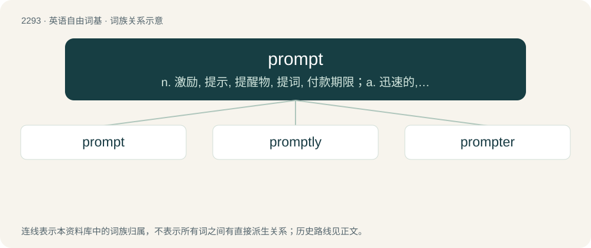

# 2395 · prompt — n. 激励, 提示, 提醒物, 提词, 付款期限；a. 迅速的, 敏捷的, 立刻的, 提词员的；vt. 激励, 鼓动, 提示

[总目录](../00_总目录_按常用程度.md)

**类型**：英语自由词基　｜　**来源语言**：见词源记录

## 核心含义与来源

- 核心含义：n. 激励, 提示, 提醒物, 提词, 付款期限；a. 迅速的, 敏捷的, 立刻的, 提词员的；vt. 激励, 鼓动, 提示
- 英文含义：Quick; acting without delay.
- 词形：prompt

**来源记录 1**（形容词；Quick; acting without delay.）

The adjective is from Middle English prompte, from Middle French prompt and its etymon Latin prōmptus (“visible, apparent, evident”), past participle of prōmō (“to take or bring out or forth, produce, bring to light”), from prō (“forth, forward”) + emō (“to take, acquire, buy”). Doublet of pronto. The verb is from Middle English prompen, apparently from the adjective. The noun is from the verb.

## 词族图

## 单词速览（常用到不常用）

| 单词 | 音标 | 释义 |
|---|---|---|
| [prompt](#w-1) | 英 /pɹɒmpt/；美 /pɹɑmpt/ | n. 激励, 提示, 提醒物, 提词, 付款期限；a. 迅速的, 敏捷的, 立刻的, 提词员的；vt. 激励, 鼓动, 提示 |
| [promptly](#w-2) | 英 /ˈpɹɒmptli/；美 /ˈpɹɑmptli/ | adv. 敏捷地, 迅速地 |
| [prompter](#w-3) | /ˈprɒmptə/ | n. 提词员, 激励者, 唤起者 |

## 逐词详解

### 1. prompt

**词性**：形容词　｜　**音标**：英 /pɹɒmpt/；美 /pɹɑmpt/

**中文释义**：n. 激励, 提示, 提醒物, 提词, 付款期限；a. 迅速的, 敏捷的, 立刻的, 提词员的；vt. 激励, 鼓动, 提示

**英文义项**：Quick; acting without delay. / On time; punctual.

**词源与演化**：

The adjective is from Middle English prompte, from Middle French prompt and its etymon Latin prōmptus (“visible, apparent, evident”), past participle of prōmō (“to take or bring out or forth, produce, bring to light”), from prō (“forth, forward”) + emō (“to take, acquire, buy”). Doublet of pronto. The verb is from Middle English prompen, apparently from the adjective. The noun is from the verb.

**例句**：

> He was very prompt at getting a new job.

该用例对应义项：Quick; acting without delay.

### 2. promptly

**词性**：副词　｜　**音标**：英 /ˈpɹɒmptli/；美 /ˈpɹɑmptli/

**中文释义**：adv. 敏捷地, 迅速地

**英文义项**：Both soon and quickly. / Exactly at a specific time.

**构词拆分**：prompt + -ly

**词源与演化**：

From prompt + -ly.

**例句**：

> The sale will begin on January 28th, promptly at 9 a.m.

该用例对应义项：Exactly at a specific time.

### 3. prompter

**词性**：名词　｜　**音标**：/ˈprɒmptə/

**中文释义**：n. 提词员, 激励者, 唤起者

**英文义项**：The person who does the prompting. / Synonym of teleprompter.

**构词拆分**：From prompt + -er.

**词源与演化**：

From prompt + -er.

**例句**：

> You could still hear the prompter in the tenth row.
