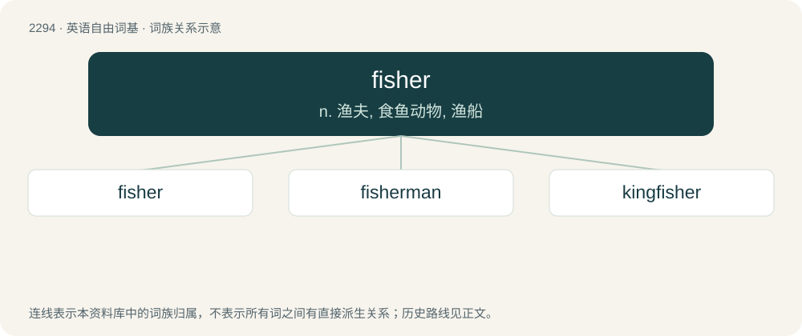

# 2396 · fisher — n. 渔夫, 食鱼动物, 渔船

[总目录](../00_总目录_按常用程度.md)

**类型**：英语自由词基　｜　**来源语言**：见词源记录

## 核心含义与来源

- 核心含义：n. 渔夫, 食鱼动物, 渔船
- 英文含义：A person who catches fish, especially for a living or for sport; a person engaging in the pastime of fishing.
- 词形：fisher

**多个词源／构词路径**：同一拼写可能有不同来源；以下按词性和含义分别列出。

**来源记录 1**（名词；A person who catches fish, especially for a living or for sport; a person engaging in the pastime of fishing.）

From Middle English fischer, fischare, from Old English fisċere (“fisher”), from Proto-Germanic \*fiskārijaz (“fisher”), equivalent to fish + -er. Cognate with Saterland Frisian Fisker (“fisher”), West Frisian fisker (“fisher”), Dutch visser (“fisher”), German Low German Fisker, Fisser (“fisher”), German Fischer (“fisher”), Danish fisker (“fisher”), Swedish fiskare (“fisher”).

**来源记录 2**（名词；A North American marten-like mammal (Pekania pennanti), that has thick brown fur.）

From French fichet (“polecat pelt”), probably from Dutch visse (“nasty”); modified by folk etymology to resemble Etymology 1.

## 词族图

## 单词速览（常用到不常用）

| 单词 | 音标 | 释义 |
|---|---|---|
| [fisher](#w-1) | 英 /ˈfɪʃə/；美 /ˈfɪʃɚ/ | n. 渔夫, 食鱼动物, 渔船 |
| [fisherman](#w-2) | 英 /ˈfɪʃ.ə.mən/；美 /ˈfɪʃ.ɚ.mən/ | n. 渔夫, 钓鱼者, 渔船 |
| [kingfisher](#w-3) | 英 /ˈkɪŋˌfɪʃə/ | n. 鱼狗, 翠鸟 |

## 逐词详解

### 1. fisher

**词性**：名词　｜　**音标**：英 /ˈfɪʃə/；美 /ˈfɪʃɚ/

**中文释义**：n. 渔夫, 食鱼动物, 渔船

**英文义项**：A person who catches fish, especially for a living or for sport; a person engaging in the pastime of fishing.

**构词拆分**：fish + -er

**词源与演化**：

From Middle English fischer, fischare, from Old English fisċere (“fisher”), from Proto-Germanic \*fiskārijaz (“fisher”), equivalent to fish + -er. Cognate with Saterland Frisian Fisker (“fisher”), West Frisian fisker (“fisher”), Dutch visser (“fisher”), German Low German Fisker, Fisser (“fisher”), German Fischer (“fisher”), Danish fisker (“fisher”), Swedish fiskare (“fisher”).

**例句**：

> This is the boy whose name is Tom Fisher.

### 2. fisherman

**词性**：名词　｜　**音标**：英 /ˈfɪʃ.ə.mən/；美 /ˈfɪʃ.ɚ.mən/

**中文释义**：n. 渔夫, 钓鱼者, 渔船

**英文义项**：Any person who attempts to catch fish. / A person whose profession is catching fish.

**构词拆分**：fisher + -man

**词源与演化**：

From fisher + -man.

**例句**：

> He is a fisherman, out on a trawler for days at a time.

该用例对应义项：A person whose profession is catching fish.

### 3. kingfisher

**词性**：名词　｜　**音标**：英 /ˈkɪŋˌfɪʃə/

**中文释义**：n. 鱼狗, 翠鸟

**英文义项**：Any of various birds of the suborder Alcedines (or the family Alcedinidae sensu lato), having a large head, short tail and brilliant colouration; they feed mostly on fish. / common kingfisher (Alcedo atthis)

**构词拆分**：king + fisher

**词源与演化**：

Originally king's fisher, from Middle English kyngys fyschare; equivalent to king + fisher. So named for obscure reasons.

**例句**：

> Most species of kingfisher are found in tropical regions.
