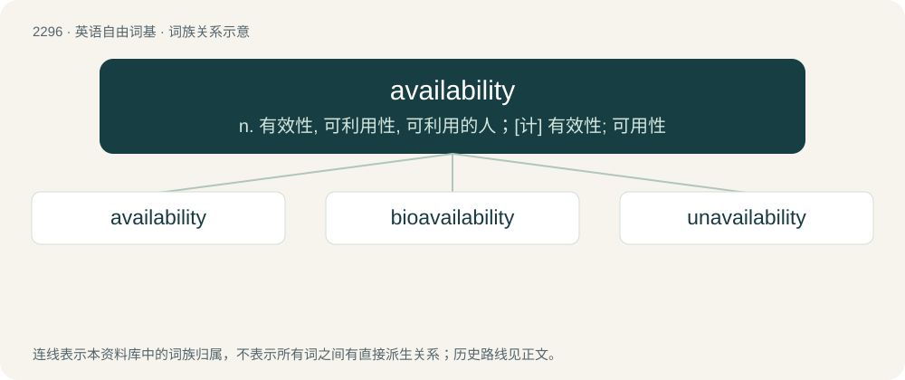

# 2397 · availability — n. 有效性, 可利用性, 可利用的人；\[计\] 有效性; 可用性

[总目录](../00_总目录_按常用程度.md)

**类型**：英语自由词基　｜　**来源语言**：见词源记录

## 核心含义与来源

- 核心含义：n. 有效性, 可利用性, 可利用的人；\[计\] 有效性; 可用性
- 英文含义：The quality of being available.
- 词形：availability

**来源记录 1**（名词；The quality of being available.）

From available + -ity; attested since the early 1800s.

## 词族图

## 单词速览（常用到不常用）

| 单词 | 音标 | 释义 |
|---|---|---|
| [availability](#w-1) | 英 /əˌveɪ.ləˈbɪl.ɪ.ti/；美 /əˌveɪ.ləˈbɪl.ɪ.ti/ | n. 有效性, 可利用性, 可利用的人；\[计\] 有效性; 可用性 |
| [bioavailability](#w-2) | /,baiəuə,veiləˈbiliti/ | \[化\] 生物可利用率 |
| [unavailability](#w-3) | /ˈʌnəveiləˈbiliti/ | \[计\] 无效性, 不可用性 |

## 逐词详解

### 1. availability

**词性**：名词　｜　**音标**：英 /əˌveɪ.ləˈbɪl.ɪ.ti/；美 /əˌveɪ.ləˈbɪl.ɪ.ti/

**中文释义**：n. 有效性, 可利用性, 可利用的人；\[计\] 有效性; 可用性

**英文义项**：The quality of being available. / That which is available.

**构词拆分**：available + -ity

**词源与演化**：

From available + -ity; attested since the early 1800s.

**例句**：

> What is your availability this week?

该用例对应义项：The quality of being available.

### 2. bioavailability

**词性**：名词　｜　**音标**：/,baiəuə,veiləˈbiliti/

**中文释义**：\[化\] 生物可利用率

**英文义项**：The extent to which a substance is molecularly available to cells and tissues in a living organism, which depends on factors such as solubility, pH level, and presence of enzymes and cofactors; for example, even if one's ingestion of vitamin B₁₂ is average/typical, one might nonetheless have B₁₂ deficiency if one has poor metabolism of this particular vitamin. / The amount of drug or nutrient which reaches the site of physiological activity after administration.

**构词拆分**：bio- + availability

**词源与演化**：

From bio- + availability.

**用法示例／搭配（非完整句）**：

> poor/low oral bioavailability

该用例对应义项：The amount of drug or nutrient which reaches the site of physiological activity after administration.

### 3. unavailability

**词性**：名词　｜　**音标**：/ˈʌnəveiləˈbiliti/

**中文释义**：\[计\] 无效性, 不可用性

**英文义项**：The state of being unavailable

**构词拆分**：un- + availability

**词源与演化**：

From un- + availability.
