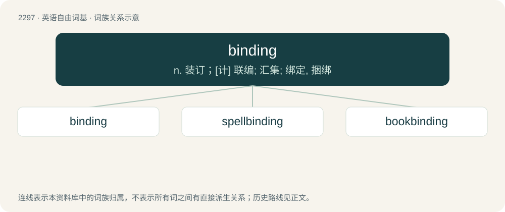

# 2398 · binding — n. 装订；\[计\] 联编; 汇集; 绑定, 捆绑

[总目录](../00_总目录_按常用程度.md)

**类型**：英语自由词基　｜　**来源语言**：见词源记录

## 核心含义与来源

- 核心含义：n. 装订；\[计\] 联编; 汇集; 绑定, 捆绑
- 英文含义：Imposing stipulations or requirements that must be honoured.
- 词形：binding

**来源记录 1**（形容词；Imposing stipulations or requirements that must be honoured.）

From Middle English byndynge; equivalent to bind + -ing.

## 词族图

## 单词速览（常用到不常用）

| 单词 | 音标 | 释义 |
|---|---|---|
| [binding](#w-1) | /ˈbaɪndɪŋ/ | n. 装订；\[计\] 联编; 汇集; 绑定, 捆绑 |
| [spellbinding](#w-2) | /ˈspɛlˌbaɪndɪŋ/ | v. 用符咒迷惑, 迷住, 使入迷( spellbind的现在分词 ) |
| [bookbinding](#w-3) | /ˈbukbaindiŋ/ | n. 装订 |

## 逐词详解

### 1. binding

**词性**：形容词　｜　**音标**：/ˈbaɪndɪŋ/

**中文释义**：n. 装订；\[计\] 联编; 汇集; 绑定, 捆绑

**英文义项**：Imposing stipulations or requirements that must be honoured. / Having the effect of counteracting diarrhea.

**构词拆分**：bind + -ing

**词源与演化**：

From Middle English byndynge; equivalent to bind + -ing.

**例句**：

> A sworn statement (i.e., "made under oath)"is legally binding.

该用例对应义项：Imposing stipulations or requirements that must be honoured.

### 2. spellbinding

**词性**：形容词　｜　**音标**：/ˈspɛlˌbaɪndɪŋ/

**中文释义**：v. 用符咒迷惑, 迷住, 使入迷( spellbind的现在分词 )

**英文义项**：Engrossing; fascinating; gaining rapt attention; captivating. / Having the power to bind magically through the agency of a spell.

**构词拆分**：spell + binding

**词源与演化**：

From spell + binding.

**例句**：

> A spellbinding description of life in ancient Rome.

该用例对应义项：attracting and holding interest as if by a spell

### 3. bookbinding

**词性**：名词　｜　**音标**：/ˈbukbaindiŋ/

**中文释义**：n. 装订

**英文义项**：The art, craft or process of binding books.

**构词拆分**：book + binding

**词源与演化**：

From book + binding.
