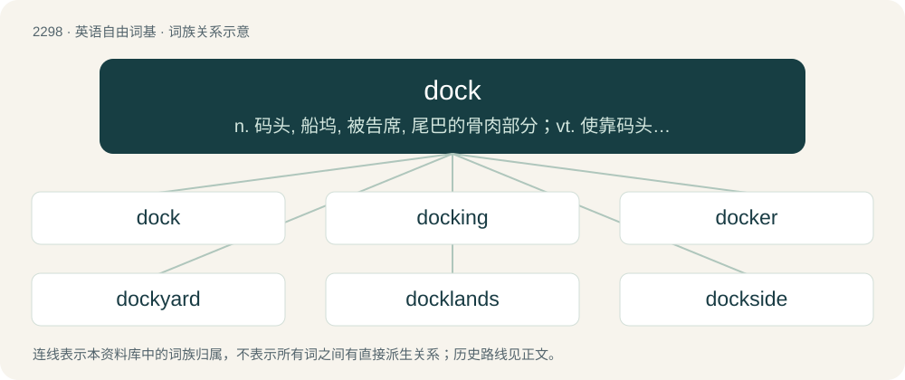

# 2399 · dock — n. 码头, 船坞, 被告席, 尾巴的骨肉部分；vt. 使靠码头, 使(船)进港, 剪短；vi. 进港

[总目录](../00_总目录_按常用程度.md)

**类型**：英语自由词基　｜　**来源语言**：见词源记录

## 核心含义与来源

- 核心含义：n. 码头, 船坞, 被告席, 尾巴的骨肉部分；vt. 使靠码头, 使(船)进港, 剪短；vi. 进港
- 英文含义：Any of the genus Rumex of coarse weedy plants with small green flowers related to buckwheat, especially bitter dock (Rumex obtusifolius), and used as potherbs and in folk medicine, especially in curing nettle rash.
- 词形：dock

**多个词源／构词路径**：同一拼写可能有不同来源；以下按词性和含义分别列出。

**来源记录 1**（名词；Any of the genus Rumex of coarse weedy plants with small green flowers related to buckwheat, especially bitter dock (Rumex obtusifolius), and used as potherbs and in folk medicine, especially in curing nettle rash.）

From Middle English dokke, from Old English docce, from Proto-West Germanic \*dokkā, from Proto-Germanic \*dukkǭ (compare Old Danish dokke (“water-dock”), West Flemish dokke, dokkebladeren (“coltsfoot, butterbur”)), from Proto-Indo-European \*dʰew- (“dark”) (compare Latvian duga (“scum, slime on water”)).

**来源记录 2**（名词；The fleshy root of an animal's tail; specifically after clipping or cutting.）

A dog with a partially docked (etymology 2, verb sense 1) tail From Middle English dok (“trimmed hair, dock”), from Old English \*docce, \*docca (as in fingerdocce (“finger muscles”)), from Proto-West Germanic \*dokkā, from Proto-Germanic \*dukkǭ, from Proto-Indo-European \*dʰeu-k- (“to spin, shake”). Compare Icelandic dokkur (“stumpy tail”), Low German Dokke (“bundle of straw”), West Frisian dok (“bunch, ball (twine)”), Albanian dak (“big ram”), Lithuanian dvė̃kti (“to breathe, wheeze”), dvãkas (“breath”), Sanskrit धुक्षति (dhukṣati, “to blow”). The verb is from Middle English dokken (“to cut short, dock, curtail”), derived from the noun.

**来源记录 3**（名词；A fixed structure attached to shore to which a vessel is secured when in port; usually for loading and unloading.）

A laptop docking (etymology 3, noun sense 5) station A GUI dock (etymology 3, noun sense 6) on Linux From Early Modern English meaning "area of mud in which a ship can rest at low tide, dock", borrowed from either Dutch dok (“dock, wharf”) or Middle Low German docke (“dock, wharf”), both from Middle Dutch docke (“port, harbour”), of uncertain origin. The original sense may have been "the furrow a grounded vessel makes in a mud bank". Compare Danish dok, Dutch dok, West Frisian dok, German Dock, Low German Dock, Swedish docka. Some sources link this word to an unattested Middle Dutch \*docke (“watercourse, trench, canal”), which is a ghost word, only being inferred from Mediaeval Latin documents in the form of ducta, doctus, doccia (“conduit, canal”). However, if this theory is correct, then it would relate the word to Italian doccia (“drainpipe”), making dock a doublet of douche and duct. An alternative theory ties Middle Dutch docke to a North Germanic or Scandinavian source, notably Old Norse dǫkk, dökð (“depression in the landscape, pit, pool, trench”); compare Icelandic dökk, Norwegian dokk (“hollow, low ground”), Swedish dank (“marshy ground”). If so, this would make dock a doublet of dank.

**来源记录 4**（名词；Part of a courtroom where the accused sits.）

Originally criminal slang; from or akin to obsolete Dutch (West Flemish) dok (“cage, hutch”) or docke (“cage”), possibly from Middle Dutch docke (“block, wooden object”), related to Middle Low German docke (“tenon, banister rod, bench cheek, side panel of a pew”), of uncertain origin.

## 词族图

## 单词速览（常用到不常用）

| 单词 | 音标 | 释义 |
|---|---|---|
| [dock](#w-1) | 英 /dɒk/；美 /dɑk/ | n. 码头, 船坞, 被告席, 尾巴的骨肉部分；vt. 使靠码头, 使(船)进港, 剪短；vi. 进港 |
| [docking](#w-2) | /ˈdɒkiŋ/ | n. 入坞；\[化\] (煤的)灰分评价 |
| [docker](#w-3) | 美 /ˈdɑkɚ/ | n. 码头工人 |
| [dockyard](#w-4) | /ˈdɒkjɑːd/ | n. 造船厂, 海军工厂 |
| [docklands](#w-5) |  | 【英文】An area of a town or city which contains, or used to contain, an industrial port. |
| [dockside](#w-6) | /ˈdɔksaid/ | a. 码头前沿的 |
| [burdock](#w-7) | 英 /ˈbɜːdɒk/；美 /ˈbɝːdɑːk/ | n. 牛蒡；\[医\] 牛蒡\[根\] |
| [drydock](#w-8) | /ˈdraidɔk/ | (使)入干船坞 |

## 逐词详解

### 1. dock

**词性**：名词　｜　**音标**：英 /dɒk/；美 /dɑk/

**中文释义**：n. 码头, 船坞, 被告席, 尾巴的骨肉部分；vt. 使靠码头, 使(船)进港, 剪短；vi. 进港

**英文义项**：Any of the genus Rumex of coarse weedy plants with small green flowers related to buckwheat, especially bitter dock (Rumex obtusifolius), and used as potherbs and in folk medicine, especially in curing nettle rash. / A burdock plant, or the leaves of that plant.

**词源与演化**：

From Middle English dokke, from Old English docce, from Proto-West Germanic \*dokkā, from Proto-Germanic \*dukkǭ (compare Old Danish dokke (“water-dock”), West Flemish dokke, dokkebladeren (“coltsfoot, butterbur”)), from Proto-Indo-European \*dʰew- (“dark”) (compare Latvian duga (“scum, slime on water”)).

**例句**：

> There are a number of fishing boats tied up at the dock.

### 2. docking

**词性**：名词　｜　**音标**：/ˈdɒkiŋ/

**中文释义**：n. 入坞；\[化\] (煤的)灰分评价

**英文义项**：The process of cutting off or trimming the tail or ears of an animal. / The securing of a vessel to the quayside with cables.

**构词拆分**：By surface analysis, dock + -ing

**词源与演化**：

From Middle English dockyng. By surface analysis, dock + -ing.

**例句**：

> A long breakwater was built, along with piers and docking terminals.

### 3. docker

**词性**：名词　｜　**音标**：美 /ˈdɑkɚ/

**中文释义**：n. 码头工人

**英文义项**：One who performs docking, as of tails. / One who engages in the sexual practice of docking (where the tip of one participant's penis is inserted into the foreskin of the other participant).

**构词拆分**：dock + -er

**词源与演化**：

From dock (verb) + -er.

### 4. dockyard

**词性**：名词　｜　**音标**：/ˈdɒkjɑːd/

**中文释义**：n. 造船厂, 海军工厂

**英文义项**：A place where ships are repaired or outfitted.

**构词拆分**：dock + yard

**词源与演化**：

From dock + yard.

**例句**：

> When it closed in 1984, thousands were put out of work and the dockyard fell into disuse.

### 5. docklands

**词性**：名词

**英文义项**：An area of a town or city which contains, or used to contain, an industrial port.

**构词拆分**：dock + lands

**词源与演化**：

From dock + lands.

### 6. dockside

**词性**：名词　｜　**音标**：/ˈdɔksaid/

**中文释义**：a. 码头前沿的

**英文义项**：The area near a dock, or next to a docked ship.

**构词拆分**：dock + -side

**词源与演化**：

From dock + -side.

### 7. burdock

**词性**：名词　｜　**音标**：英 /ˈbɜːdɒk/；美 /ˈbɝːdɑːk/

**中文释义**：n. 牛蒡；\[医\] 牛蒡\[根\]

**英文义项**：Any of the species of biennial thistles in the genus Arctium.

**构词拆分**：bur(ry) + dock

**词源与演化**：

From Middle English \*bury dokke (attested as plural bury dokkis), equivalent to bur(ry) + dock.

**例句**：

> My child cannot say "Kinpira style sauteed great burdock", he always says "Kinpira style sauteed Dockbur" instead.

### 8. drydock

**词性**：名词　｜　**音标**：/ˈdraidɔk/

**中文释义**：(使)入干船坞

**英文义项**：A dock that can be drained of water and is used in the repair and construction of ships.

**构词拆分**：dry + dock

**词源与演化**：

From dry + dock.
