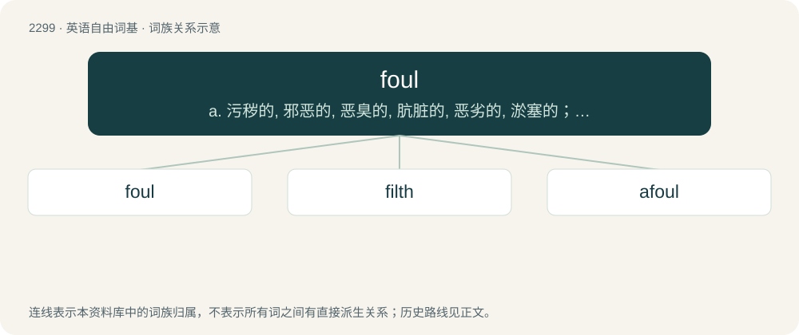

# 2400 · foul — a. 污秽的, 邪恶的, 恶臭的, 肮脏的, 恶劣的, 淤塞的；vt. 弄脏, 妨害, 污蔑, 犯规, 淤塞；vi. 腐烂, 犯规, 缠结

[总目录](../00_总目录_按常用程度.md)

**类型**：英语自由词基　｜　**来源语言**：见词源记录

## 核心含义与来源

- 核心含义：a. 污秽的, 邪恶的, 恶臭的, 肮脏的, 恶劣的, 淤塞的；vt. 弄脏, 妨害, 污蔑, 犯规, 淤塞；vi. 腐烂, 犯规, 缠结
- 英文含义：Covered with, or containing unclean matter; dirty.
- 词形：foul

**多个词源／构词路径**：同一拼写可能有不同来源；以下按词性和含义分别列出。

**来源记录 1**（形容词；Covered with, or containing unclean matter; dirty.）

Inherited from Middle English ffoul, foul, foull, fowel, fowle, fuyle, voul, vul, from Old English fūl (“foul, dirty, unclean, impure, vile, corrupt, rotten, stinking, guilty”), from Proto-West Germanic \*fūl, from Proto-Germanic \*fūlaz (“foul, rotten”), from Proto-Indo-European \*puH- (“foul, rotten”). Cognates Cognate with Central Franconian fuul (“putrid, rotten; lazy, workshy”), Cimbrian baul, vaul (“putrid, rotten”), Dutch vuil (“dirty, foul; lewd, obscene; dishonorable; illegal”), German faul (“foul, putrid, rotten; lazy”), Yiddish פֿױל (foyl, “putrid; lazy”), Danish ful (“nasty, ugly”), Icelandic fúll (“foul, rotten, sullen”), Norwegian Bokmål and Norwegian Nynorsk ful (“clever, sly”), and Swedish ful (“ugly; bad, dirty”), Gothic 𐍆𐌿𐌻𐍃 (fuls, “fetid, foul, putrid”), and through Indo-European, with Latin puter (“decaying, rotten; friable, crumbling”), Greek πύο (pýo), πύον (pýon, “pus”), Albanian fëlliq (“to make dirty, sully”), Latvian pūt (“to rot”), Lithuanian pūti (“to rot”), Armenian փուտ (pʻut, “rottenness”), Persian پوده (pude, “rubbed, worn; foul, rotten; empty, hollow”), Sanskrit पूयति (pūyati, “to become foul; to stink”). More at putrid. Ancient Greek φαῦλος (phaûlos, “bad”) is a false cognate inasmuch as it is not from the same etymon, instead being cognate to few.

**来源记录 2**（动词；To make dirty.）

Inherited from Middle English foulen, fulen, from Old English fūlian (“to become foul; rot; decay”), from Proto-West Germanic \*fūlēn, from Proto-Germanic \*fūlāną (“to rot; decay”).

## 词族图

## 单词速览（常用到不常用）

| 单词 | 音标 | 释义 |
|---|---|---|
| [foul](#w-1) | /faʊl/ | a. 污秽的, 邪恶的, 恶臭的, 肮脏的, 恶劣的, 淤塞的；vt. 弄脏, 妨害, 污蔑, 犯规, 淤塞；vi. 腐烂, 犯规, 缠结 |
| [filth](#w-2) | /fɪlθ/ | n. 污秽, 不洁, 猥亵；\[法\] 污秽, 污物, 淫猥 |
| [afoul](#w-3) | /əˈfaʊl/ | adv. 冲撞着；\[法\] 破撞, 缠住, 冲突 |

## 逐词详解

### 1. foul

**词性**：形容词　｜　**音标**：/faʊl/

**中文释义**：a. 污秽的, 邪恶的, 恶臭的, 肮脏的, 恶劣的, 淤塞的；vt. 弄脏, 妨害, 污蔑, 犯规, 淤塞；vi. 腐烂, 犯规, 缠结

**英文义项**：Covered with, or containing unclean matter; dirty. / Obscene, vulgar or abusive.

**词源与演化**：

Inherited from Middle English ffoul, foul, foull, fowel, fowle, fuyle, voul, vul, from Old English fūl (“foul, dirty, unclean, impure, vile, corrupt, rotten, stinking, guilty”), from Proto-West Germanic \*fūl, from Proto-Germanic \*fūlaz (“foul, rotten”), from Proto-Indo-European \*puH- (“foul, rotten”). Cognates Cognate with Central Franconian fuul (“putrid, rotten; lazy, workshy”), Cimbrian baul, vaul (“putrid, rotten”), Dutch vuil (“dirty, foul; lewd, obscene; dishonorable; illegal”), German faul (“foul, putrid, rotten; lazy”), Yiddish פֿױל (foyl, “putrid; lazy”), Danish ful (“nasty, ugly”), Icelandic fúll (“foul, rotten, sullen”), Norwegian Bokmål and Norwegian Nynorsk ful (“clever, sly”), and Swedish ful (“ugly; bad, dirty”), Gothic 𐍆𐌿𐌻𐍃 (fuls, “fetid, foul, putrid”), and through Indo-European, with Latin puter (“decaying, rotten; friable, crumbling”), Greek πύο (pýo), πύον (pýon, “pus”), Albanian fëlliq (“to make dirty, sully”), Latvian pūt (“to rot”), Lithuanian pūti (“to rot”), Armenian փուտ (pʻut, “rottenness”), Persian پوده (pude, “rubbed, worn; foul, rotten; empty, hollow”), Sanskrit पूयति (pūyati, “to become foul; to stink”). More at putrid. Ancient Greek φαῦλος (phaûlos, “bad”) is a false cognate inasmuch as it is not from the same etymon, instead being cognate to few.

**例句**：

> His foul language causes many people to believe he is uneducated.

该用例对应义项：Obscene, vulgar or abusive.

### 2. filth

**词性**：名词　｜　**音标**：/fɪlθ/

**中文释义**：n. 污秽, 不洁, 猥亵；\[法\] 污秽, 污物, 淫猥

**英文义项**：Dirt; foul matter; that which soils or defiles. / Smut; that which sullies or defiles the moral character; corruption; pollution.

**构词拆分**：foul + -th (abstract nominal suffix)

**词源与演化**：

From Middle English filth, from Old English fȳlþu, from Proto-West Germanic \*fūliþu, equivalent to foul + -th (abstract nominal suffix).

**例句**：

> Before we start cooking we need to clean up the filth in this kitchen.

该用例对应义项：Dirt; foul matter; that which soils or defiles.

### 3. afoul

**词性**：副词　｜　**音标**：/əˈfaʊl/

**中文释义**：adv. 冲撞着；\[法\] 破撞, 缠住, 冲突

**英文义项**：In a state of entanglement or conflict (with).

**构词拆分**：a- + foul

**词源与演化**：

From a- + foul.

**例句**：

> He had a knack for running afoul of the law.

该用例对应义项：In a state of entanglement or conflict (with).
