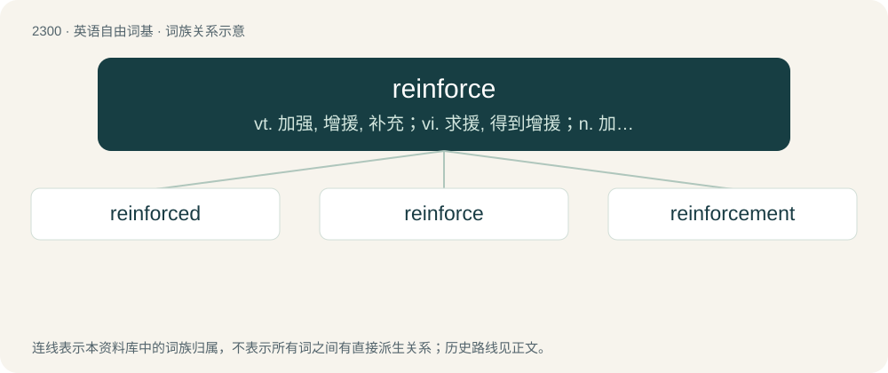

# 2401 · reinforce — vt. 加强, 增援, 补充；vi. 求援, 得到增援；n. 加固材料

[总目录](../00_总目录_按常用程度.md)

**类型**：英语自由词基　｜　**来源语言**：见词源记录

## 核心含义与来源

- 核心含义：vt. 加强, 增援, 补充；vi. 求援, 得到增援；n. 加固材料
- 英文含义：To strengthen, especially by addition or augmentation.
- 词形：reinforce

**来源记录 1**（动词；To strengthen, especially by addition or augmentation.）

From re- + inforce.

## 词族图

## 单词速览（常用到不常用）

| 单词 | 音标 | 释义 |
|---|---|---|
| [reinforced](#w-1) |  | a. 加强的；加固的；加筋的 |
| [reinforce](#w-2) | 英 /ˌɹiː.ɪnˈfɔːs/；美 /ˌɹi.ɪnˈfɔɹs/ | vt. 加强, 增援, 补充；vi. 求援, 得到增援；n. 加固材料 |
| [reinforcement](#w-3) | 英 /ˌɹiːɪnˈfɔːsmənt/；美 /ˌɹiɪnˈfoɹsmənt/ | n. 加强, 增援, 补充, 援军, 加固物；\[化\] 补强; 加强件 |

## 逐词详解

### 1. reinforced

**词性**：形容词

**中文释义**：a. 加强的；加固的；加筋的

**英文义项**：Having been or containing reinforcement.

**构词拆分**：reinforce + -ed

**词源与演化**：

From reinforce + -ed.

**例句**：

> Her phobia of snakes was only reinforced when she moved to Arizona.

### 2. reinforce

**词性**：动词　｜　**音标**：英 /ˌɹiː.ɪnˈfɔːs/；美 /ˌɹi.ɪnˈfɔɹs/

**中文释义**：vt. 加强, 增援, 补充；vi. 求援, 得到增援；n. 加固材料

**英文义项**：To strengthen, especially by addition or augmentation. / To emphasize or review.

**构词拆分**：re- + inforce

**词源与演化**：

From re- + inforce.

**例句**：

> Advertising for fast food can reinforce unhealthy dietary tendencies.

该用例对应义项：To encourage (a behavior or idea) through repeated stimulus.

### 3. reinforcement

**词性**：名词　｜　**音标**：英 /ˌɹiːɪnˈfɔːsmənt/；美 /ˌɹiɪnˈfoɹsmənt/

**中文释义**：n. 加强, 增援, 补充, 援军, 加固物；\[化\] 补强; 加强件

**英文义项**：The act, process, or state of reinforcing or being reinforced. / A thing that reinforces.

**构词拆分**：reinforce + -ment

**词源与演化**：

From reinforce + -ment.

**例句**：

> There's a website that can be a good learning reinforcement.

该用例对应义项：A thing that reinforces.
