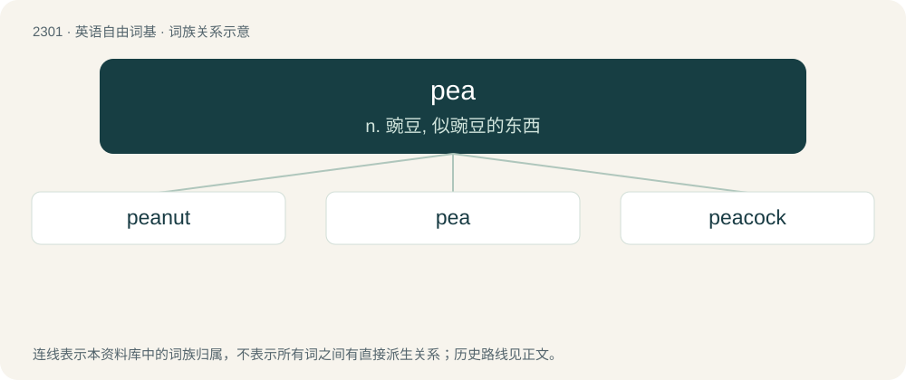

# 2403 · pea — n. 豌豆, 似豌豆的东西

[总目录](../00_总目录_按常用程度.md)

**类型**：英语自由词基　｜　**来源语言**：见词源记录

## 核心含义与来源

- 核心含义：n. 豌豆, 似豌豆的东西
- 英文含义：Any of certain plants of the family Fabaceae: Pisum sativum and others.
- 词形：pea

**多个词源／构词路径**：同一拼写可能有不同来源；以下按词性和含义分别列出。

**来源记录 1**（名词；Any of certain plants of the family Fabaceae: Pisum sativum and others.）

Back-formation from pease, an original singular reinterpreted as a plural. Further from Middle English pese (“a pea”), from Old English pise, from Latin pisa, pisum, from Ancient Greek πίσον (píson).

**来源记录 2**（名词；A ball travelling at high velocity.）

From having the appearance of a pea (see English etymology 1), the edible seed of Pisum sativum, the pea plant.

## 词族图

## 单词速览（常用到不常用）

| 单词 | 音标 | 释义 |
|---|---|---|
| [peanut](#w-1) | 英 /ˈpiːnʌt/；美 /ˈpiˌnʌt/ | n. 花生, 小人物, 极小的数额；a. 渺小的, 微不足道的 |
| [pea](#w-2) | /piː/ | n. 豌豆, 似豌豆的东西 |
| [peacock](#w-3) | 英 /ˈpiːkɒk/；美 /ˈpikɑk/ | n. 孔雀, 好炫耀的人；vi. 炫耀, 神气活现地行走 |

## 逐词详解

### 1. peanut

**词性**：名词　｜　**音标**：英 /ˈpiːnʌt/；美 /ˈpiˌnʌt/

**中文释义**：n. 花生, 小人物, 极小的数额；a. 渺小的, 微不足道的

**英文义项**：A legume resembling a nut, the fruit of the plant Arachis hypogaea, native to South America. / Synonym of countneck (“very small hard clam”).

**构词拆分**：pea + nut

**词源与演化**：

From pea + nut, perhaps a folk etymology of pinda, pinder (still found in Southern US dialects).

**例句**：

> He always liked eating peanuts along with tea before biscuits came into his life.

该用例对应义项：A legume resembling a nut, the fruit of the plant Arachis hypogaea, native to South America.

### 2. pea

**词性**：名词　｜　**音标**：/piː/

**中文释义**：n. 豌豆, 似豌豆的东西

**英文义项**：Any of certain plants of the family Fabaceae: Pisum sativum and others. / A plant, Pisum sativum, member of the legume (Fabaceae) family.

**词源与演化**：

Back-formation from pease, an original singular reinterpreted as a plural. Further from Middle English pese (“a pea”), from Old English pise, from Latin pisa, pisum, from Ancient Greek πίσον (píson).

**例句**：

> Vigna unguiculata subsp. unguiculata is what most people call black-eyed peas but some people call black-eyed beans.

该用例对应义项：Any of several varieties of bean.

### 3. peacock

**词性**：名词　｜　**音标**：英 /ˈpiːkɒk/；美 /ˈpikɑk/

**中文释义**：n. 孔雀, 好炫耀的人；vi. 炫耀, 神气活现地行走

**英文义项**：A male peafowl, especially Pavo cristatus, notable for its brilliant iridescently ocellated tail. / A peafowl (of the genus Pavo or Afropavo), either male or female.

**构词拆分**：pea + cock

**词源与演化**：

From Middle English pecok, pekok, pocok, pacok, first component from Old English pēa, pāwa (“peacock, peafowl”), ultimately from Latin pāvō; equivalent to pea + cock. Compare Old Norse páfugl (“peacock”, literally “peafowl”), and English peahen, peachick, etc.

**例句**：

> The peacock (Inachis io) is a beautiful and easily recognizable butterfly.
