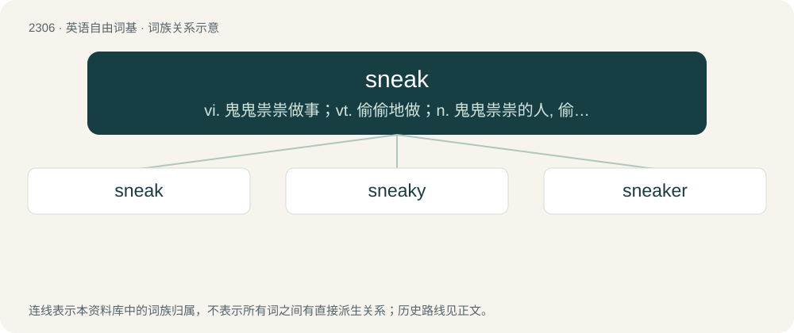

# 2404 · sneak — vi. 鬼鬼祟祟做事；vt. 偷偷地做；n. 鬼鬼祟祟的人, 偷偷摸摸的行为, 帆布胶底运动鞋

[总目录](../00_总目录_按常用程度.md)

**类型**：英语自由词基　｜　**来源语言**：见词源记录

## 核心含义与来源

- 核心含义：vi. 鬼鬼祟祟做事；vt. 偷偷地做；n. 鬼鬼祟祟的人, 偷偷摸摸的行为, 帆布胶底运动鞋
- 英文含义：One who sneaks; one who moves stealthily to acquire an item or information.
- 词形：sneak

**来源记录 1**（名词；One who sneaks; one who moves stealthily to acquire an item or information.）

Possibly from Middle English sniken (“to creep, crawl”), from Old English snīcan (“to creep, crawl”), from Proto-West Germanic \*snīkan, from Proto-Germanic \*snīkaną (“to creep, crawl”), of sound-symbolic origin; compare formally unrelated snake, snoop, snook, snoke, and snoot. Cognate with Danish snige (“to sneak”), Swedish snika (“to sneak, hanker after”), Icelandic sníkja (“to sneak, hanker after”). Possibly related to snitch.

## 词族图

## 单词速览（常用到不常用）

| 单词 | 音标 | 释义 |
|---|---|---|
| [sneak](#w-1) | /sniːk/ | vi. 鬼鬼祟祟做事；vt. 偷偷地做；n. 鬼鬼祟祟的人, 偷偷摸摸的行为, 帆布胶底运动鞋 |
| [sneaky](#w-2) | /ˈsniːki/ | a. 鬼祟的, 卑微的 |
| [sneaker](#w-3) | 美 /ˈsnikɚ/ | n. 鬼鬼祟祟做事的人, 卑鄙者, 帆布胶底运动鞋 |

## 逐词详解

### 1. sneak

**词性**：名词　｜　**音标**：/sniːk/

**中文释义**：vi. 鬼鬼祟祟做事；vt. 偷偷地做；n. 鬼鬼祟祟的人, 偷偷摸摸的行为, 帆布胶底运动鞋

**英文义项**：One who sneaks; one who moves stealthily to acquire an item or information. / The act of sneaking

**词源与演化**：

Possibly from Middle English sniken (“to creep, crawl”), from Old English snīcan (“to creep, crawl”), from Proto-West Germanic \*snīkan, from Proto-Germanic \*snīkaną (“to creep, crawl”), of sound-symbolic origin; compare formally unrelated snake, snoop, snook, snoke, and snoot. Cognate with Danish snige (“to sneak”), Swedish snika (“to sneak, hanker after”), Icelandic sníkja (“to sneak, hanker after”). Possibly related to snitch.

**例句**：

> My little brother is such a sneak; yesterday I caught him trying to look through my diary.

该用例对应义项：One who sneaks; one who moves stealthily to acquire an item or information.

### 2. sneaky

**词性**：形容词　｜　**音标**：/ˈsniːki/

**中文释义**：a. 鬼祟的, 卑微的

**英文义项**：Elusive; difficult to capture or observe due to constantly outwitting the adversaries. / Dishonest; deceitful.

**构词拆分**：sneak + -y

**词源与演化**：

From sneak + -y.

**例句**：

> Catching those thieves will be hard: they're so sneaky!

该用例对应义项：Elusive; difficult to capture or observe due to constantly outwitting the adversaries.

### 3. sneaker

**词性**：名词　｜　**音标**：美 /ˈsnikɚ/

**中文释义**：n. 鬼鬼祟祟做事的人, 卑鄙者, 帆布胶底运动鞋

**英文义项**：One who sneaks. / An athletic shoe with a soft, rubber sole. A trainer.

**构词拆分**：sneak + -er

**词源与演化**：

From sneak + -er. The shoes sense is a reference to the quietness of the shoes.

**例句**：

> My uncommonly well-made sneaker lasted 5 years. Its mate did not.
