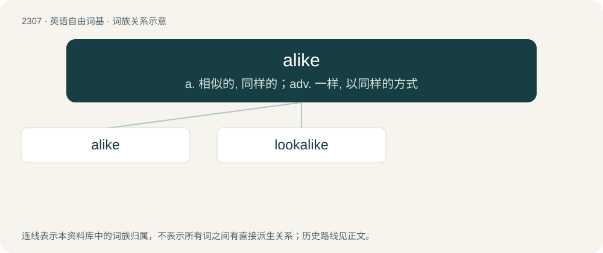

# 2405 · alike — a. 相似的, 同样的；adv. 一样, 以同样的方式

[总目录](../00_总目录_按常用程度.md)

**类型**：英语自由词基　｜　**来源语言**：见词源记录

## 核心含义与来源

- 核心含义：a. 相似的, 同样的；adv. 一样, 以同样的方式
- 英文含义：Having resemblance or similitude; similar; without difference.
- 词形：alike

**来源记录 1**（形容词；Having resemblance or similitude; similar; without difference.）

The adjective comes from a conflation of several different terms: \* Middle English alich, alych, alyke, a Late Middle English development from earlier Middle English anlich, anlyke, from Old English onlīċ, anlīċ. Compare German ähnlich. \* The borrowed Old Norse cognate of the same word, álíkr, ultimately yielding similar Late Middle English forms. \* Middle English ylich, ylych, ilich, ylik, ylike, ȝelic, from Old English ġelīċ (“like; alike; similar; equal”), from Proto-West Germanic \*galīk, from Proto-Germanic \*galīkaz (“alike, similar”). Cognate with Scots elyke, alyke (“like, alike”), Saterland Frisian gliek (“like, alike”), West Frisian lyk, gelyk (“like, alike”), Dutch gelijk (“like, alike”), German Low German liek, gliek (“like, alike”), German gleich (“equal, like”), Danish lig (“alike”), Swedish lik (“like, similar”), Norwegian lik (“like, alike”), Icelandic líkur (“alike, like, similar”). Equivalent to a- (Etymology 3) + like. Compare also West Frisian allyk (“all the same, alike”). Similarly, the adverb also comes from a conflation of several different terms: \* Middle English aliche, alyche, alyke, a Late Middle English development from earlier Middle English anliche, anlyke, from Old English onlīċe, anlīċe. \* Additionally Middle English oliche, olike, ultimately from the Old Norse cognate of the same word, álíka. \* Middle English yliche, ylyche, iliche, ylike, ȝelice, from Old English ġelīċe (“alike, similarly”).

## 词族图

## 单词速览（常用到不常用）

| 单词 | 音标 | 释义 |
|---|---|---|
| [alike](#w-1) | 英 /əˈlaɪk/ | a. 相似的, 同样的；adv. 一样, 以同样的方式 |
| [lookalike](#w-2) | 美 /ˈlʊkəlaɪk/ | n. 酷似…的人 |

## 逐词详解

### 1. alike

**词性**：形容词　｜　**音标**：英 /əˈlaɪk/

**中文释义**：a. 相似的, 同样的；adv. 一样, 以同样的方式

**英文义项**：Having resemblance or similitude; similar; without difference.

**构词拆分**：a- (Etymology 3) + like

**词源与演化**：

The adjective comes from a conflation of several different terms: \* Middle English alich, alych, alyke, a Late Middle English development from earlier Middle English anlich, anlyke, from Old English onlīċ, anlīċ. Compare German ähnlich. \* The borrowed Old Norse cognate of the same word, álíkr, ultimately yielding similar Late Middle English forms. \* Middle English ylich, ylych, ilich, ylik, ylike, ȝelic, from Old English ġelīċ (“like; alike; similar; equal”), from Proto-West Germanic \*galīk, from Proto-Germanic \*galīkaz (“alike, similar”). Cognate with Scots elyke, alyke (“like, alike”), Saterland Frisian gliek (“like, alike”), West Frisian lyk, gelyk (“like, alike”), Dutch gelijk (“like, alike”), German Low German liek, gliek (“like, alike”), German gleich (“equal, like”), Danish lig (“alike”), Swedish lik (“like, similar”), Norwegian lik (“like, alike”), Icelandic líkur (“alike, like, similar”). Equivalent to a- (Etymology 3) + like. Compare also West Frisian allyk (“all the same, alike”). Similarly, the adverb also comes from a conflation of several different terms: \* Middle English aliche, alyche, alyke, a Late Middle English development from earlier Middle English anliche, anlyke, from Old English onlīċe, anlīċe. \* Additionally Middle English oliche, olike, ultimately from the Old Norse cognate of the same word, álíka. \* Middle English yliche, ylyche, iliche, ylike, ȝelice, from Old English ġelīċe (“alike, similarly”).

**例句**：

> Twins are physically alike, that is, similar-looking people on the outside.

该用例对应义项：Having resemblance or similitude; similar; without difference.

### 2. lookalike

**词性**：名词　｜　**音标**：美 /ˈlʊkəlaɪk/

**中文释义**：n. 酷似…的人

**英文义项**：A doppelganger, impersonator, imposter, or body double. / Something that looks very similar to or the same as the genuine article.

**构词拆分**：look + alike

**词源与演化**：

From look + alike. See also look alike.

**例句**：

> The cousins were such close lookalikes they could impersonate each other, and sometimes did.

该用例对应义项：A doppelganger, impersonator, imposter, or body double.
