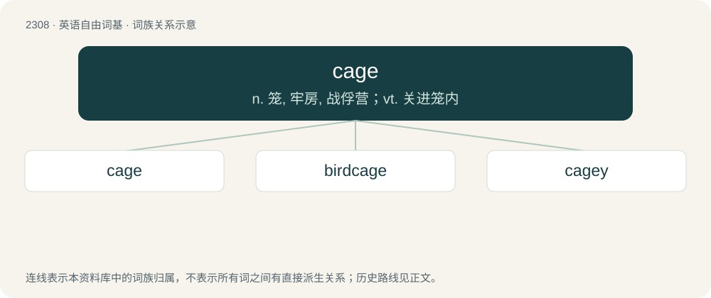

# 2407 · cage — n. 笼, 牢房, 战俘营；vt. 关进笼内

[总目录](../00_总目录_按常用程度.md)

**类型**：英语自由词基　｜　**来源语言**：见词源记录

## 核心含义与来源

- 核心含义：n. 笼, 牢房, 战俘营；vt. 关进笼内
- 英文含义：An enclosure made of spaced bars, normally to hold animals while providing some ventilation.
- 词形：cage

**来源记录 1**（名词；An enclosure made of spaced bars, normally to hold animals while providing some ventilation.）

From Middle English cage, from Old French cage, from Latin cavea. Doublet of cadge and cavea and related to jail.

## 词族图

## 单词速览（常用到不常用）

| 单词 | 音标 | 释义 |
|---|---|---|
| [cage](#w-1) | /keɪd͡ʒ/ | n. 笼, 牢房, 战俘营；vt. 关进笼内 |
| [birdcage](#w-2) | /ˈbəːdkeidʒ/ | n. 鸟笼 |
| [cagey](#w-3) | /ˈkeɪd͡ʒi/ | a. 狡猾的, 机警的, 有戒心的, 不敢表态的, 小心谨慎的, 不甚友善的 |

## 逐词详解

### 1. cage

**词性**：名词　｜　**音标**：/keɪd͡ʒ/

**中文释义**：n. 笼, 牢房, 战俘营；vt. 关进笼内

**英文义项**：An enclosure made of spaced bars, normally to hold animals while providing some ventilation. / The passenger compartment of a lift.

**词源与演化**：

From Middle English cage, from Old French cage, from Latin cavea. Doublet of cadge and cavea and related to jail.

**例句**：

> The most dangerous prisoners are locked away in a cage.

该用例对应义项：An enclosure made of spaced bars, normally to hold animals while providing some ventilation.

### 2. birdcage

**词性**：名词　｜　**音标**：/ˈbəːdkeidʒ/

**中文释义**：n. 鸟笼

**英文义项**：A cage to keep pet or zoological specimen birds in. / A game of chance played with dice; chuck-a-luck.

**构词拆分**：bird + cage

**词源与演化**：

From bird + cage.

**例句**：

> There was a pile of feathers underneath the birdcage and a content cat sleeping near the fireplace.

### 3. cagey

**词性**：形容词　｜　**音标**：/ˈkeɪd͡ʒi/

**中文释义**：a. 狡猾的, 机警的, 有戒心的, 不敢表态的, 小心谨慎的, 不甚友善的

**英文义项**：Wary, careful, shrewd. / Uncommunicative; unwilling or hesitant to give information.

**构词拆分**：by surface analysis, cage + -y

**词源与演化**：

Initially US colloquial, of unknown origin. A connection with the behavior of caged prisoners (wary and closed-lipped) and caged animals (wary) has been speculated. If so, by surface analysis, cage + -y.

**例句**：

> Tom told me a little, but he was cagey about the details.
