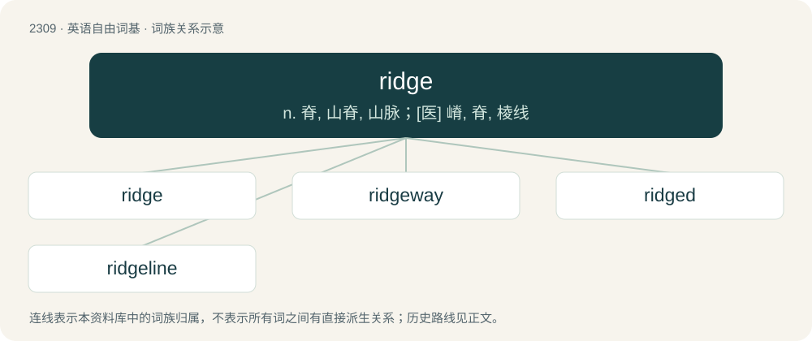

# 2408 · ridge — n. 脊, 山脊, 山脉；\[医\] 嵴, 脊, 棱线

[总目录](../00_总目录_按常用程度.md)

**类型**：英语自由词基　｜　**来源语言**：见词源记录

## 核心含义与来源

- 核心含义：n. 脊, 山脊, 山脉；\[医\] 嵴, 脊, 棱线
- 英文含义：The back of any animal; especially the upper or projecting part of the back of a quadruped.
- 词形：ridge

**来源记录 1**（名词；The back of any animal; especially the upper or projecting part of the back of a quadruped.）

From Middle English rigge, rygge, (also rig, ryg, rug), from Old English hryċġ (“back, spine, ridge, elevated surface”), from Proto-West Germanic \*hrugi, from Proto-Germanic \*hrugjaz (“back”), from Proto-Indo-European \*(s)krewk-, \*(s)ker- (“to turn, bend”). Cognate with Scots rig (“back, spine, ridge”), North Frisian reg (“back”), West Frisian rêch (“back”), Dutch rug (“back, ridge”), German Rücken (“back, ridge”), Swedish rygg (“back, spine, ridge”), Icelandic hryggur (“spine”). Cognate to Albanian kërrus (“to bend one's back”) and kurriz (“back”).

## 词族图

## 单词速览（常用到不常用）

| 单词 | 音标 | 释义 |
|---|---|---|
| [ridge](#w-1) | 英 /ɹɪd͡ʒ/ | n. 脊, 山脊, 山脉；\[医\] 嵴, 脊, 棱线 |
| [ridgeway](#w-2) | /ˈridʒwei/ | n. 山脊路 |
| [ridged](#w-3) | /ˈɹɪd͡ʒd/ | \[医\]嵴状的, 起皱的 |
| [ridgeline](#w-4) |  | un. 分水线；\[网络\] 脊线；山脊线；脊线评测 |

## 逐词详解

### 1. ridge

**词性**：名词　｜　**音标**：英 /ɹɪd͡ʒ/

**中文释义**：n. 脊, 山脊, 山脉；\[医\] 嵴, 脊, 棱线

**英文义项**：The back of any animal; especially the upper or projecting part of the back of a quadruped. / Any extended protuberance; a projecting line or strip.

**词源与演化**：

From Middle English rigge, rygge, (also rig, ryg, rug), from Old English hryċġ (“back, spine, ridge, elevated surface”), from Proto-West Germanic \*hrugi, from Proto-Germanic \*hrugjaz (“back”), from Proto-Indo-European \*(s)krewk-, \*(s)ker- (“to turn, bend”). Cognate with Scots rig (“back, spine, ridge”), North Frisian reg (“back”), West Frisian rêch (“back”), Dutch rug (“back, ridge”), German Rücken (“back, ridge”), Swedish rygg (“back, spine, ridge”), Icelandic hryggur (“spine”). Cognate to Albanian kërrus (“to bend one's back”) and kurriz (“back”).

**例句**：

> The plough threw up ridges of earth between the furrows.

该用例对应义项：Any extended protuberance; a projecting line or strip.

### 2. ridgeway

**词性**：名词　｜　**音标**：/ˈridʒwei/

**中文释义**：n. 山脊路

**英文义项**：A track or path that follows the highest part of the landscape.

**构词拆分**：ridge + way

**词源与演化**：

From ridge + way.

**例句**：

> He turned into the ridgeway and drew towards the barn.

### 3. ridged

**词性**：形容词　｜　**音标**：/ˈɹɪd͡ʒd/

**中文释义**：\[医\]嵴状的, 起皱的

**英文义项**：Having ridges.

**构词拆分**：ridge + -ed

**词源与演化**：

From Middle English rigged, riggid, ryggyd, rugged, equivalent to ridge + -ed.

**例句**：

> The bark is light brown, red-tinged, deeply ridged, and broken into plate-like scales.

### 4. ridgeline

**词性**：名词

**中文释义**：un. 分水线；\[网络\] 脊线；山脊线；脊线评测

**英文义项**：The topmost edge along a mountain ridge. / The topmost edge along a roof, where its sloping sides meet.

**构词拆分**：ridge + line

**词源与演化**：

From ridge + line.

**例句**：

> To either side there are beautiful views from the trail along the ridgeline.

该用例对应义项：The topmost edge along a mountain ridge.
