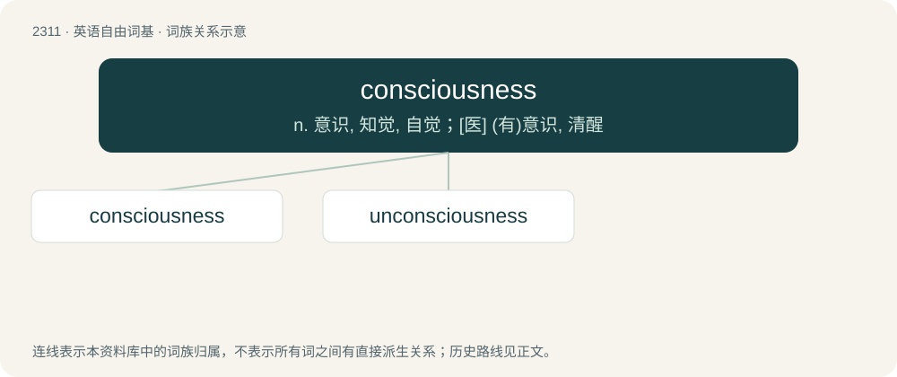

# 2409 · consciousness — n. 意识, 知觉, 自觉；\[医\] (有)意识, 清醒

[总目录](../00_总目录_按常用程度.md)

**类型**：英语自由词基　｜　**来源语言**：见词源记录

## 核心含义与来源

- 核心含义：n. 意识, 知觉, 自觉；\[医\] (有)意识, 清醒
- 英文含义：The state of being conscious or aware; awareness.
- 词形：consciousness

**来源记录 1**（名词；The state of being conscious or aware; awareness.）

From conscious + -ness.

## 词族图

## 单词速览（常用到不常用）

| 单词 | 音标 | 释义 |
|---|---|---|
| [consciousness](#w-1) | 英 /ˈkɒnʃəsnəs/；美 /ˈkɑnʃəsnəs/ | n. 意识, 知觉, 自觉；\[医\] (有)意识, 清醒 |
| [unconsciousness](#w-2) | /.ʌnˈkɒnʃəsnis/ | n. 无意识, 意识不清, 人事不省；\[医\] 人事不省, 神志丧失; 无意识 |

## 逐词详解

### 1. consciousness

**词性**：名词　｜　**音标**：英 /ˈkɒnʃəsnəs/；美 /ˈkɑnʃəsnəs/

**中文释义**：n. 意识, 知觉, 自觉；\[医\] (有)意识, 清醒

**英文义项**：The state of being conscious or aware; awareness. / The state or trait of having cognition and sensation; cognition and sensation themselves.

**构词拆分**：conscious + -ness

**词源与演化**：

From conscious + -ness.

**用法示例／搭配（非完整句）**：

> To lose consciousness after striking one's head

该用例对应义项：The state or trait of having cognition and sensation; cognition and sensation themselves.

### 2. unconsciousness

**词性**：名词　｜　**音标**：/.ʌnˈkɒnʃəsnis/

**中文释义**：n. 无意识, 意识不清, 人事不省；\[医\] 人事不省, 神志丧失; 无意识

**英文义项**：The state of lacking consciousness, of being unconscious / ignorance or innocence; the state of being uninformed or unaware

**构词拆分**：unconscious + -ness；un- + consciousness

**词源与演化**：

From unconscious + -ness or un- + consciousness.

**例句**：

> I was roused from unconsciousness by the alarm clock.

该用例对应义项：The state of lacking consciousness, of being unconscious
