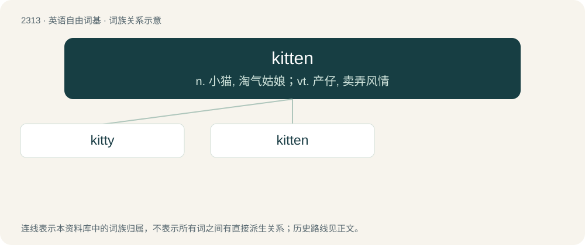

# 2411 · kitten — n. 小猫, 淘气姑娘；vt. 产仔, 卖弄风情

[总目录](../00_总目录_按常用程度.md)

**类型**：英语自由词基　｜　**来源语言**：见词源记录

## 核心含义与来源

- 核心含义：n. 小猫, 淘气姑娘；vt. 产仔, 卖弄风情
- 英文含义：A young cat, especially before sexual maturity (reached at about seven months).
- 词形：kitten

**来源记录 1**（名词；A young cat, especially before sexual maturity (reached at about seven months).）

From Middle English kitoun, kytton, kyton, keton (“kitten”), of obscure origin. Seemingly from, and usually explained as being from, unattested Anglo-Norman \*kitoun, \*ketun (compare Old French chitoun, cheton, chaton (“kitten”), diminutive of cat, chat (“cat”)); whence Modern French chaton (“kitten”). Similar words of Germanic origin may have reinforced this word; compare English kitling (“kit, kitten”), Low German Kitten (“kitten”), Icelandic kettlingur (“kitten”), Middle English chitte ("whelp, pup", see chit). The idea that kitoun, rather than being of Anglo-Norman origin, was in fact a purely Germanic derivation from one of these words is etymologically problematic, but cannot be definitively ruled out.

## 词族图

## 单词速览（常用到不常用）

| 单词 | 音标 | 释义 |
|---|---|---|
| [kitty](#w-1) | 英 /ˈkɪti/；美 /ˈkɪti/ | n. 小猫, 全部赌注 |
| [kitten](#w-2) | /ˈkɪtən̩/ | n. 小猫, 淘气姑娘；vt. 产仔, 卖弄风情 |

## 逐词详解

### 1. kitty

**词性**：名词　｜　**音标**：英 /ˈkɪti/；美 /ˈkɪti/

**中文释义**：n. 小猫, 全部赌注

**英文义项**：A young cat; a kitten. / An adult cat; also (often childish), sometimes in the form Kitty: a pet name for a cat of any age.

**构词拆分**：kitt(en) + -y (diminutive suffix)

**词源与演化**：

From kitt(en) + -y (diminutive suffix). Compare Dutch katje (“kitty”). Etymology 1 sense 2 (“vulva and/or vagina”) is probably modelled after the use of pussy to refer to the body part, from the appearance of an unshaven vulva.

**例句**：

> He said there was a beast with fangs in the alley, but it turned out to be a cute little kitty.

该用例对应义项：A young cat; a kitten.

### 2. kitten

**词性**：名词　｜　**音标**：/ˈkɪtən̩/

**中文释义**：n. 小猫, 淘气姑娘；vt. 产仔, 卖弄风情

**英文义项**：A young cat, especially before sexual maturity (reached at about seven months). / A young rabbit, rat, hedgehog, squirrel, fox, beaver, badger, etc.

**词源与演化**：

From Middle English kitoun, kytton, kyton, keton (“kitten”), of obscure origin. Seemingly from, and usually explained as being from, unattested Anglo-Norman \*kitoun, \*ketun (compare Old French chitoun, cheton, chaton (“kitten”), diminutive of cat, chat (“cat”)); whence Modern French chaton (“kitten”). Similar words of Germanic origin may have reinforced this word; compare English kitling (“kit, kitten”), Low German Kitten (“kitten”), Icelandic kettlingur (“kitten”), Middle English chitte ("whelp, pup", see chit). The idea that kitoun, rather than being of Anglo-Norman origin, was in fact a purely Germanic derivation from one of these words is etymologically problematic, but cannot be definitively ruled out.

**例句**：

> But if you put the kitten between the whales, he'll be warm.
