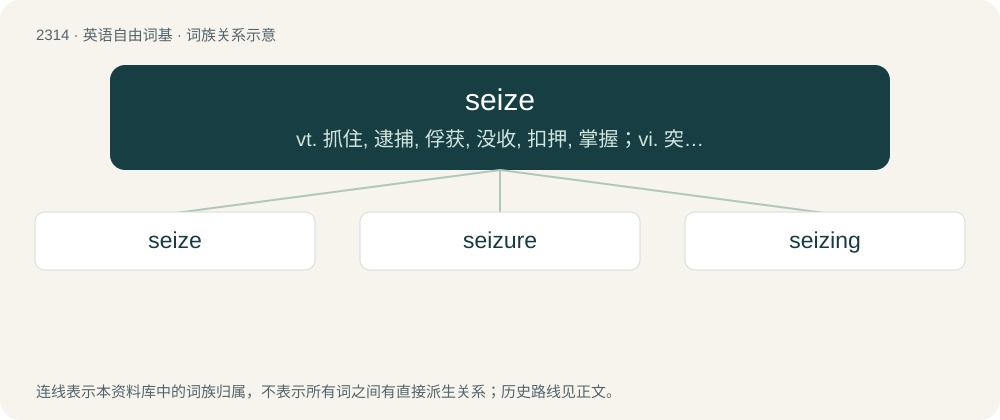

# 2412 · seize — vt. 抓住, 逮捕, 俘获, 没收, 扣押, 掌握；vi. 突然抓住, 利用

[总目录](../00_总目录_按常用程度.md)

**类型**：英语自由词基　｜　**来源语言**：见词源记录

## 核心含义与来源

- 核心含义：vt. 抓住, 逮捕, 俘获, 没收, 扣押, 掌握；vi. 突然抓住, 利用
- 英文含义：To deliberately take hold of; to grab or capture.
- 词形：seize

**来源记录 1**（动词；To deliberately take hold of; to grab or capture.）

Earlier seise, from Middle English seisen, sesen, saisen, from Old French seisir (“to take possession of; invest (person, court)”), from Early Medieval Latin sacīre (“to lay claim to, appropriate”) (8th century) in the phrase ad propriam sacire, from Old Low Frankish \*sakjan (“to sue, bring legal action”), from Proto-Germanic \*sakjaną, \*sakōną (compare Old English sacian (“to strive, brawl”)), from Proto-Germanic \*sakaną (compare Old Saxon sakan (“to accuse”), Old High German sahhan (“to bicker, quarrel, rebuke”), Old English sacan (“to quarrel, claim by law, accuse”). Cognate to sake and Latin sāgiō (“to perceive acutely”).

## 词族图

## 单词速览（常用到不常用）

| 单词 | 音标 | 释义 |
|---|---|---|
| [seize](#w-1) | /ˈsiːz/ | vt. 抓住, 逮捕, 俘获, 没收, 扣押, 掌握；vi. 突然抓住, 利用 |
| [seizure](#w-2) | 英 /ˈsiː.ʒə(ɹ)/；美 /ˈsi.ʒɚ/ | n. 捕获, 夺取, 占领, 捕获物, 没收, 充公；\[医\] 发作; 癫痫发作 |
| [seizing](#w-3) | 英 /ˈsizɪŋ/ | n. 抓, 夺, 捆绑 |

## 逐词详解

### 1. seize

**词性**：动词　｜　**音标**：/ˈsiːz/

**中文释义**：vt. 抓住, 逮捕, 俘获, 没收, 扣押, 掌握；vi. 突然抓住, 利用

**英文义项**：To deliberately take hold of; to grab or capture. / To take advantage of (an opportunity or circumstance).

**词源与演化**：

Earlier seise, from Middle English seisen, sesen, saisen, from Old French seisir (“to take possession of; invest (person, court)”), from Early Medieval Latin sacīre (“to lay claim to, appropriate”) (8th century) in the phrase ad propriam sacire, from Old Low Frankish \*sakjan (“to sue, bring legal action”), from Proto-Germanic \*sakjaną, \*sakōną (compare Old English sacian (“to strive, brawl”)), from Proto-Germanic \*sakaną (compare Old Saxon sakan (“to accuse”), Old High German sahhan (“to bicker, quarrel, rebuke”), Old English sacan (“to quarrel, claim by law, accuse”). Cognate to sake and Latin sāgiō (“to perceive acutely”).

**例句**：

> Rust caused the engine to seize, never to run again.

该用例对应义项：To bind or lock in position immovably; see also seize up.

### 2. seizure

**词性**：名词　｜　**音标**：英 /ˈsiː.ʒə(ɹ)/；美 /ˈsi.ʒɚ/

**中文释义**：n. 捕获, 夺取, 占领, 捕获物, 没收, 充公；\[医\] 发作; 癫痫发作

**英文义项**：The act of taking possession, as by force or right of law. / The state of being seized or of having been taken.

**构词拆分**：From seize + -ure.

**词源与演化**：

From seize + -ure.

**例句**：

> The seizure includes various belongings taken from his house and his office.

该用例对应义项：That which is seized, or taken possession of; a thing laid hold of, or possessed.

### 3. seizing

**词性**：名词　｜　**音标**：英 /ˈsizɪŋ/

**中文释义**：n. 抓, 夺, 捆绑

**英文义项**：The act of grabbing or taking possession. / Something seized.

**构词拆分**：From seize + -ing.

**词源与演化**：

From seize + -ing.

**例句**：

> The pirates buried their seizings and marked the map with an X.

该用例对应义项：Something seized.
