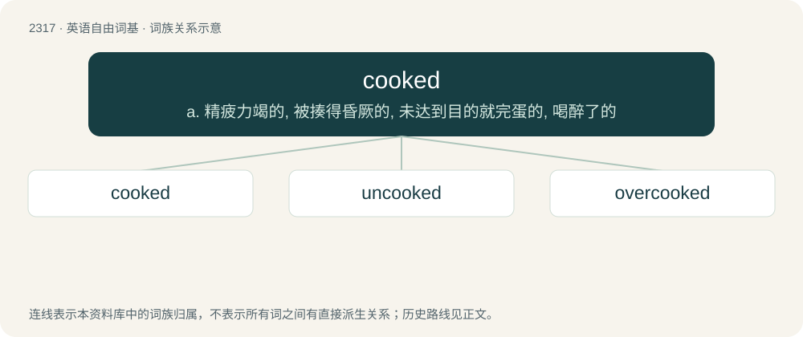

# 2415 · cooked — a. 精疲力竭的, 被揍得昏厥的, 未达到目的就完蛋的, 喝醉了的

[总目录](../00_总目录_按常用程度.md)

**类型**：英语自由词基　｜　**来源语言**：见词源记录

## 核心含义与来源

- 核心含义：a. 精疲力竭的, 被揍得昏厥的, 未达到目的就完蛋的, 喝醉了的
- 英文含义：Prepared by cooking.
- 词形：cooked

**来源记录 1**（形容词；Prepared by cooking.）

From the past tense of the verb cook.

## 词族图

## 单词速览（常用到不常用）

| 单词 | 音标 | 释义 |
|---|---|---|
| [cooked](#w-1) | /kʊkt/ | a. 精疲力竭的, 被揍得昏厥的, 未达到目的就完蛋的, 喝醉了的 |
| [uncooked](#w-2) | /.ʌnˈkukt/ | a. 未煮过的 |
| [overcooked](#w-3) | /ˌəʊ.vəɹˈkʊkt/ | a. 煮得过久的 |

## 逐词详解

### 1. cooked

**词性**：形容词　｜　**音标**：/kʊkt/

**中文释义**：a. 精疲力竭的, 被揍得昏厥的, 未达到目的就完蛋的, 喝醉了的

**英文义项**：Prepared by cooking. / Corrupted by conversion through a text format, requiring uncooking to be properly listenable.

**词源与演化**：

From the past tense of the verb cook.

**例句**：

> Don't bother talking to that guy—he's cooked from all the coke he used to do.

该用例对应义项：Brain-damaged from drug use.

### 2. uncooked

**词性**：形容词　｜　**音标**：/.ʌnˈkukt/

**中文释义**：a. 未煮过的

**英文义项**：Raw and not cooked, especially of something that should be, or is sometimes cooked.

**构词拆分**：un- + cooked

**词源与演化**：

From un- + cooked.

**例句**：

> Carefully fold in the grated Gruyère, the uncooked ham and the broccoli.

### 3. overcooked

**词性**：形容词　｜　**音标**：/ˌəʊ.vəɹˈkʊkt/

**中文释义**：a. 煮得过久的

**英文义项**：Made unpalatable or inedible by cooking for too long. / Done to excess.

**构词拆分**：over- + cooked

**词源与演化**：

From over- + cooked.

**例句**：

> His Elvis impersonation was embarrassingly overcooked.

该用例对应义项：Done to excess.
