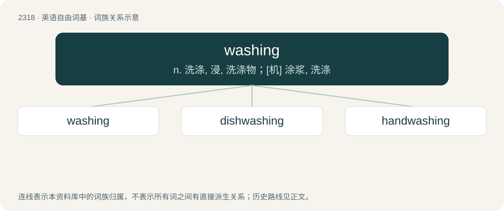

# 2416 · washing — n. 洗涤, 浸, 洗涤物；\[机\] 涂浆, 洗涤

[总目录](../00_总目录_按常用程度.md)

**类型**：英语自由词基　｜　**来源语言**：见词源记录

## 核心含义与来源

- 核心含义：n. 洗涤, 浸, 洗涤物；\[机\] 涂浆, 洗涤
- 英文含义：The action of the verb to wash.
- 词形：washing

**来源记录 1**（名词；The action of the verb to wash.）

Inherited from Middle English waschynge /wasshynge /weschynge, from Old English \*wæsċing /\*weasċing (attested in weasċingweġ), from Proto-West Germanic \*waskingu. By surface analysis, wash + -ing. Cognate with Saterland Frisian Waaskenge (“washing”), West Frisian wasking (“washing”), Dutch wassing (“washing”), German Waschung (“washing”).

## 词族图

## 单词速览（常用到不常用）

| 单词 | 音标 | 释义 |
|---|---|---|
| [washing](#w-1) | 英 /ˈwɒʃ.ɪŋ/；美 /ˈwɑʃ.ɪŋ/ | n. 洗涤, 浸, 洗涤物；\[机\] 涂浆, 洗涤 |
| [dishwashing](#w-2) | /ˈdɪʃwɒʃɪŋ/ | n. 洗碗；v. 洗碗（diahwash的现在分词） |
| [handwashing](#w-3) |  | (handwash 的现在分词) v. 手洗 |

## 逐词详解

### 1. washing

**词性**：名词　｜　**音标**：英 /ˈwɒʃ.ɪŋ/；美 /ˈwɑʃ.ɪŋ/

**中文释义**：n. 洗涤, 浸, 洗涤物；\[机\] 涂浆, 洗涤

**英文义项**：The action of the verb to wash. / Clothing, bedlinen or soft furnishings that have been, are currently being, or are to be washed; laundry.

**词源与演化**：

Inherited from Middle English waschynge /wasshynge /weschynge, from Old English \*wæsċing /\*weasċing (attested in weasċingweġ), from Proto-West Germanic \*waskingu. By surface analysis, wash + -ing. Cognate with Saterland Frisian Waaskenge (“washing”), West Frisian wasking (“washing”), Dutch wassing (“washing”), German Waschung (“washing”).

**例句**：

> The washings have a higher concentration of metal.

该用例对应义项：The residue after an ore, etc, has been washed.

### 2. dishwashing

**词性**：名词　｜　**音标**：/ˈdɪʃwɒʃɪŋ/

**中文释义**：n. 洗碗；v. 洗碗（diahwash的现在分词）

**英文义项**：The act of cleaning the dishware.

**构词拆分**：dish + washing

**词源与演化**：

From Middle English dihsse-wehssinge, dischwaschyng, equivalent to dish + washing.

**例句**：

> Let's have the one who loses at rock-paper-scissors do the dishwashing today!

### 3. handwashing

**词性**：名词

**中文释义**：(handwash 的现在分词) v. 手洗

**英文义项**：The washing of one's hands.

**构词拆分**：hand + washing

**词源与演化**：

From hand + washing.

**例句**：

> Handwashing (include the wrists and lower arms, health officials say) and disinfecting are key to preventing the virus from spreading.
