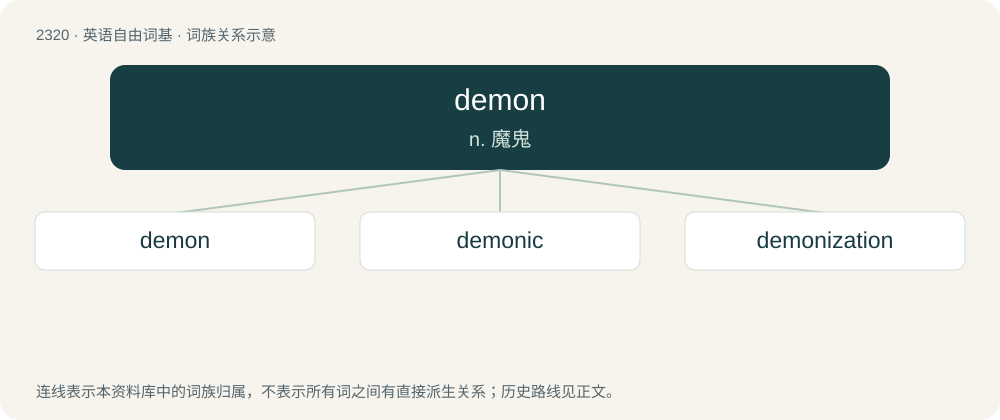

# 2418 · demon — n. 魔鬼

[总目录](../00_总目录_按常用程度.md)

**类型**：英语自由词基　｜　**来源语言**：见词源记录

## 核心含义与来源

- 核心含义：n. 魔鬼
- 英文含义：An evil being resident in or working for Hell; a devil.
- 词形：demon

**来源记录 1**（名词；An evil being resident in or working for Hell; a devil.）

From Middle English demon, a borrowing from Medieval Latin dēmōn, daemōn (“lar, familiar spirit, guardian spirit”), from Ancient Greek δαίμων (daímōn, “dispenser, god, protective spirit”). Displaced native Old English sċucca (“evil spirit”) and Old English þyrs (“ogre or monster”). Doublet of daimon.

## 词族图

## 单词速览（常用到不常用）

| 单词 | 音标 | 释义 |
|---|---|---|
| [demon](#w-1) | /ˈdiː.mən/ | n. 魔鬼 |
| [demonic](#w-2) | 英 /dɪˈmɒnɪk/ | a. 恶魔的, 有魔力的 |
| [demonization](#w-3) | /,diːmənaiˈzeiʃən, -niˈz-/ | n. 妖魔化 |

## 逐词详解

### 1. demon

**词性**：名词　｜　**音标**：/ˈdiː.mən/

**中文释义**：n. 魔鬼

**英文义项**：An evil being resident in or working for Hell; a devil. / A very wicked or malevolent person; also (in weakened sense) a mischievous person, especially a child.

**词源与演化**：

From Middle English demon, a borrowing from Medieval Latin dēmōn, daemōn (“lar, familiar spirit, guardian spirit”), from Ancient Greek δαίμων (daímōn, “dispenser, god, protective spirit”). Displaced native Old English sċucca (“evil spirit”) and Old English þyrs (“ogre or monster”). Doublet of daimon.

**例句**：

> The demon of stupidity haunts me whenever I open my mouth.

该用例对应义项：A source (especially personified) of great evil or wickedness; a destructive feeling or character flaw.

### 2. demonic

**词性**：形容词　｜　**音标**：英 /dɪˈmɒnɪk/

**中文释义**：a. 恶魔的, 有魔力的

**英文义项**：Pertaining to demons or evil spirits; demoniac. / Pertaining to daemons in ancient Greek thought; concerning supernatural ‘genius’.

**构词拆分**：demon + -ic

**词源与演化**：

From Latin daemonicus, from Ancient Greek δαιμονικός (daimonikós, “possessed by a demon, sent by a demon”), from δαίμων (daímōn), equivalent to demon + -ic. Doublet of daimonic.

**例句**：

> Once he had grasped the controls, he unleashed a demonic laugh that made his hostages shudder.

该用例对应义项：Pertaining to demons or evil spirits; demoniac.

### 3. demonization

**词性**：名词　｜　**音标**：/,diːmənaiˈzeiʃən, -niˈz-/

**中文释义**：n. 妖魔化

**英文义项**：The act of demonizing. / Something demonized.

**构词拆分**：demon + -ization

**词源与演化**：

From demon + -ization.

**例句**：

> Some people, when they want to make some money, start making videos about the demonization of Islam.
