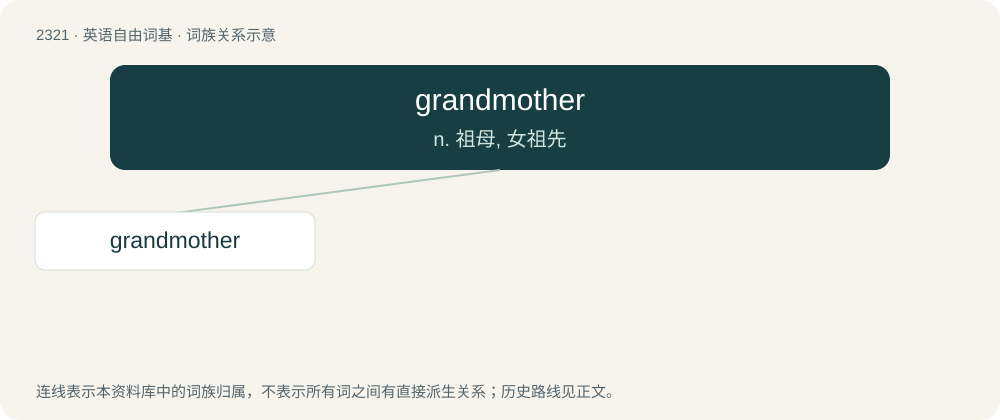

# 2419 · grandmother — n. 祖母, 女祖先

[总目录](../00_总目录_按常用程度.md)

**类型**：英语自由词基　｜　**来源语言**：见词源记录

## 核心含义与来源

- 核心含义：n. 祖母, 女祖先
- 英文含义：A mother of someone's parent.
- 词形：grandmother

**来源记录 1**（名词；A mother of someone's parent.）

From Middle English graundmodre, grauntmoder, granmoder; equivalent to grand- + mother. Compare French grand-mère. Superseded earlier eldmother, eldermother.

## 词族图

## 单词速览（常用到不常用）

| 单词 | 音标 | 释义 |
|---|---|---|
| [grandmother](#w-1) | 英 /ˈɡɹæn(d)ˌmʌðə(r)/；美 /ˈɡɹæn(d)ˌmʌðɚ/ | n. 祖母, 女祖先 |

## 逐词详解

### 1. grandmother

**词性**：名词　｜　**音标**：英 /ˈɡɹæn(d)ˌmʌðə(r)/；美 /ˈɡɹæn(d)ˌmʌðɚ/

**中文释义**：n. 祖母, 女祖先

**英文义项**：A mother of someone's parent. / A female ancestor or progenitor.

**构词拆分**：grand- + mother

**词源与演化**：

From Middle English graundmodre, grauntmoder, granmoder; equivalent to grand- + mother. Compare French grand-mère. Superseded earlier eldmother, eldermother.

**例句**：

> My grandmother's old watch has been lying in the drawer for years.
