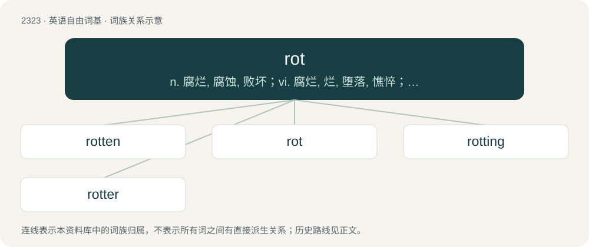

# 2420 · rot — n. 腐烂, 腐蚀, 败坏；vi. 腐烂, 烂, 堕落, 憔悴；vt. 使腐烂, 使腐朽, 使堕落

[总目录](../00_总目录_按常用程度.md)

**类型**：英语自由词基　｜　**来源语言**：见词源记录

## 核心含义与来源

- 核心含义：n. 腐烂, 腐蚀, 败坏；vi. 腐烂, 烂, 堕落, 憔悴；vt. 使腐烂, 使腐朽, 使堕落
- 英文含义：To suffer decomposition due to biological action, especially by fungi or bacteria.
- 词形：rot

**来源记录 1**（动词；To suffer decomposition due to biological action, especially by fungi or bacteria.）

Inherited from Middle English roten, rotten, from Old English rotian (“to rot, become corrupted, ulcerate, putrefy”), from Proto-West Germanic \*rotēn, from Proto-Germanic \*rutāną (“to rot”).

## 词族图

## 单词速览（常用到不常用）

| 单词 | 音标 | 释义 |
|---|---|---|
| [rotten](#w-1) | 英 /ˈɹɒtn̩/；美 /ˈɹɑtn̩/ | a. 腐烂的, 恶臭的, 堕落的, 风化的, 虚弱的；\[经\] 腐烂的, 堕落的 |
| [rot](#w-2) | 英 /ɹɒt/；美 /ɹɑt/ | n. 腐烂, 腐蚀, 败坏；vi. 腐烂, 烂, 堕落, 憔悴；vt. 使腐烂, 使腐朽, 使堕落 |
| [rotting](#w-3) | /ˈrɔtiŋ/ | vt. 深蚀刻；腐败, 腐坏之（rot的现在分词形式） |
| [rotter](#w-4) | /ˈrɒtə/ | n. 无赖 |

## 逐词详解

### 1. rotten

**词性**：形容词　｜　**音标**：英 /ˈɹɒtn̩/；美 /ˈɹɑtn̩/

**中文释义**：a. 腐烂的, 恶臭的, 堕落的, 风化的, 虚弱的；\[经\] 腐烂的, 堕落的

**英文义项**：Of perishable items, overridden with bacteria and other infectious agents. / In a state of decay.

**构词拆分**：By surface analysis, rot + -en (past participle)

**词源与演化**：

From Middle English roten, from Old Norse rotinn (“decayed, rotten”), past participle of an unrecorded verb related to Old Norse rotna (“to rot”) and Old English rotian (“to rot”), ultimately from Proto-Germanic \*rutāną (“to rot”). See rot. By surface analysis, rot + -en (past participle).

**例句**：

> If you leave a bin unattended for a few weeks, the rubbish inside will turn rotten.

该用例对应义项：Of perishable items, overridden with bacteria and other infectious agents.

### 2. rot

**词性**：动词　｜　**音标**：英 /ɹɒt/；美 /ɹɑt/

**中文释义**：n. 腐烂, 腐蚀, 败坏；vi. 腐烂, 烂, 堕落, 憔悴；vt. 使腐烂, 使腐朽, 使堕落

**英文义项**：To suffer decomposition due to biological action, especially by fungi or bacteria. / To decline in function or utility.

**词源与演化**：

Inherited from Middle English roten, rotten, from Old English rotian (“to rot, become corrupted, ulcerate, putrefy”), from Proto-West Germanic \*rotēn, from Proto-Germanic \*rutāną (“to rot”).

**例句**：

> Your brain will rot if you spend so much time on the computer, Tony!

该用例对应义项：To decline in function or utility.

### 3. rotting

**词性**：名词　｜　**音标**：/ˈrɔtiŋ/

**中文释义**：vt. 深蚀刻；腐败, 腐坏之（rot的现在分词形式）

**英文义项**：The process by which something rots. / Material that has rotted.

**构词拆分**：rot + -ing

**词源与演化**：

From Middle English rotynge (“rotting”), from Old English rotung; equivalent to rot + -ing. Conflated with Middle English rotende, present participle of roten (“to rot”), from Old English rotiende, present participle of rotian (“to rot”).

**例句**：

> The stench of rotting flesh overwhelmed us as we entered the room.

### 4. rotter

**词性**：名词　｜　**音标**：/ˈrɒtə/

**中文释义**：n. 无赖

**英文义项**：A despicable, worthless person; a scoundrel.

**构词拆分**：From rot + -er.

**词源与演化**：

From rot + -er.

**例句**：

> Only a rotter would do that.

该用例对应义项：a person who is deemed to be despicable or contemptible
