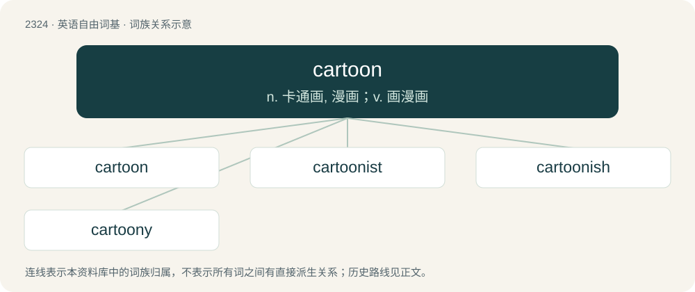

# 2423 · cartoon — n. 卡通画, 漫画；v. 画漫画

[总目录](../00_总目录_按常用程度.md)

**类型**：英语自由词基　｜　**来源语言**：见词源记录

## 核心含义与来源

- 核心含义：n. 卡通画, 漫画；v. 画漫画
- 英文含义：A humorous drawing, often with a caption, or a strip of such drawings.
- 词形：cartoon

**来源记录 1**（名词；A humorous drawing, often with a caption, or a strip of such drawings.）

In British English first, from French carton (“sketch, cardboard, card”), from Italian cartone (“cardboard, carton, box”), augmentative of carta (“paper”), from Latin carta (“papyrus, paper”), from Ancient Greek χάρτης (khártēs) (see there for further etymology). Doublet of carton and card.

## 词族图

## 单词速览（常用到不常用）

| 单词 | 音标 | 释义 |
|---|---|---|
| [cartoon](#w-1) | 英 /kɑːˈtuːn/；美 /kɑɹˈtun/ | n. 卡通画, 漫画；v. 画漫画 |
| [cartoonist](#w-2) | 美 /kɑɹˈtunɪst/ | n. 漫画家 |
| [cartoonish](#w-3) | /kɑːˈtuːnɪʃ/ | a. 动画片似的 |
| [cartoony](#w-4) | 美 /kɑɹˈtuni/ | 【英文】Having the style of a cartoon. |

## 逐词详解

### 1. cartoon

**词性**：名词　｜　**音标**：英 /kɑːˈtuːn/；美 /kɑɹˈtun/

**中文释义**：n. 卡通画, 漫画；v. 画漫画

**英文义项**：A humorous drawing, often with a caption, or a strip of such drawings. / A drawing satirising current public figures.

**词源与演化**：

In British English first, from French carton (“sketch, cardboard, card”), from Italian cartone (“cardboard, carton, box”), augmentative of carta (“paper”), from Latin carta (“papyrus, paper”), from Ancient Greek χάρτης (khártēs) (see there for further etymology). Doublet of carton and card.

**例句**：

> The newspaper published a political cartoon mocking the mayor.

该用例对应义项：A drawing satirising current public figures.

### 2. cartoonist

**词性**：名词　｜　**音标**：美 /kɑɹˈtunɪst/

**中文释义**：n. 漫画家

**英文义项**：One who creates a cartoon or strip cartoon. / One who both writes and illustrates comic books or graphic novels.

**构词拆分**：cartoon + -ist

**词源与演化**：

From cartoon + -ist.

**例句**：

> One day in 1906, a newspaper cartoonist named Tad Dorgan went to a baseball game.

### 3. cartoonish

**词性**：形容词　｜　**音标**：/kɑːˈtuːnɪʃ/

**中文释义**：a. 动画片似的

**英文义项**：Exaggerated or caricatured, in the manner of a cartoon.

**构词拆分**：cartoon + -ish

**词源与演化**：

From cartoon + -ish. Piecewise doublet of cartoonesque.

**例句**：

> She was grinning a big, cartoonish grin.

该用例对应义项：Exaggerated or caricatured, in the manner of a cartoon.

### 4. cartoony

**词性**：形容词　｜　**音标**：美 /kɑɹˈtuni/

**英文义项**：Having the style of a cartoon.

**构词拆分**：cartoon + -y

**词源与演化**：

From cartoon + -y.
