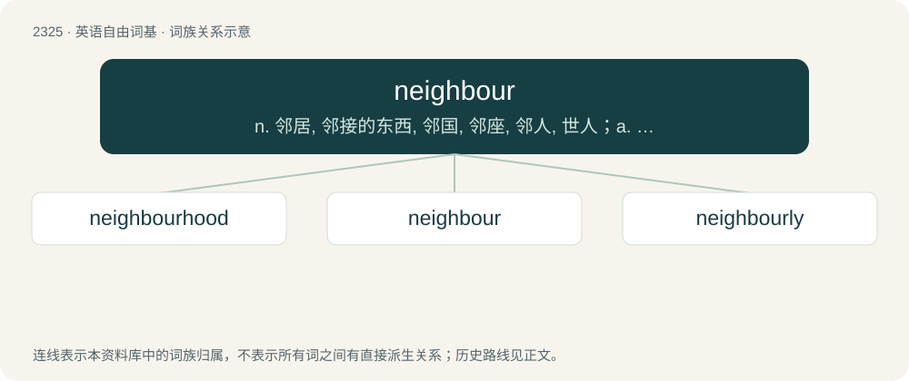

# 2425 · neighbour — n. 邻居, 邻接的东西, 邻国, 邻座, 邻人, 世人；a. 邻接的, 邻近的；vi.vt. 邻近, 与...结邻, 邻接

[总目录](../00_总目录_按常用程度.md)

**类型**：英语自由词基　｜　**来源语言**：见词源记录

## 核心含义与来源

- 核心含义：n. 邻居, 邻接的东西, 邻国, 邻座, 邻人, 世人；a. 邻接的, 邻近的；vi.vt. 邻近, 与...结邻, 邻接
- 英文含义：A person living on adjacent or nearby land; a person situated adjacently or nearby; anything (of the same type of thing as the subject) in an adjacent or nearby position.
- 词形：neighbour

**来源记录 1**（名词；A person living on adjacent or nearby land; a person situated adjacently or nearby; anything (of the same type of thing as the subject) in an adjacent or nearby position.）

From Middle English neighebour, neighbour, neyghebour, from Old English nēahġebūr (“neighbour”), from Proto-West Germanic \*nāhwagabūrō, from Proto-Germanic \*nēhwagabūrô (“neighbour”, literally “near-dweller”), from \*nēhwaz (“close, near”) + \*gabūrô (“dweller”). Equivalent to nigh (“near”) + bower (“farmer”). Cognates Cognate with Scots nebour, neebour, neibour (“neighbour”), Yola nipore, nypore (“neighbour”), North Frisian Naiber, naibüür, näiber (“neighbour”), Saterland Frisian Noaber (“neighbour”), Alemannic German Naachpuur, Nochbär (“neighbour”), Central Franconian Nohber (“neighbour”), Dutch nabuur (“neighbour”), Low German Naber, Nahwer (“neighbour”), German Nachbar (“neighbour”), Luxembourgish Noper (“neighbour”), Vilamovian nokwer, nökver, nökwer (“neighbour”), Danish, Norwegian Bokmål, Norwegian Nynorsk, and Swedish nabo (“neighbour”), Faroese nábúgvi (“neighbour”), Icelandic nábúi (“neighbour”), Manx naboo (“neighbour”), Scottish Gaelic nàbaidh (“neighbour”), Estonian naaber (“neighbour”), Finnish naapuri (“neighbour”). Eclipsed non-native Middle English prome (“neighbour”), borrowed from Old French proeme, proime, proisme (“neighbour”) (&lt;&lt; Latin proximus (“nearest, next”).

## 词族图

## 单词速览（常用到不常用）

| 单词 | 音标 | 释义 |
|---|---|---|
| [neighbourhood](#w-1) | 英 /ˈneɪbə.hʊd/ | n. 邻接, 周围, 附近一带, 邻近, 邻居关系, 地区, 街道, 街坊, 四邻；\[计\] 邻域 |
| [neighbour](#w-2) | 英 /ˈneɪbə/；美 /ˈneɪbɚ/ | n. 邻居, 邻接的东西, 邻国, 邻座, 邻人, 世人；a. 邻接的, 邻近的；vi.vt. 邻近, 与...结邻, 邻接 |
| [neighbourly](#w-3) | 美 /ˈneɪbɚˌli/ | a. 邻人似的, 友好的, 睦邻的 |

## 逐词详解

### 1. neighbourhood

**词性**：名词　｜　**音标**：英 /ˈneɪbə.hʊd/

**中文释义**：n. 邻接, 周围, 附近一带, 邻近, 邻居关系, 地区, 街道, 街坊, 四邻；\[计\] 邻域

**英文义项**：British standard spelling of neighborhood.

**构词拆分**：neighbour + -hood

**词源与演化**：

From neighbour + -hood.

**例句**：

> A large solar park was built in close neighbourhood to the village.

### 2. neighbour

**词性**：名词　｜　**音标**：英 /ˈneɪbə/；美 /ˈneɪbɚ/

**中文释义**：n. 邻居, 邻接的东西, 邻国, 邻座, 邻人, 世人；a. 邻接的, 邻近的；vi.vt. 邻近, 与...结邻, 邻接

**英文义项**：A person living on adjacent or nearby land; a person situated adjacently or nearby; anything (of the same type of thing as the subject) in an adjacent or nearby position. / One who is near in sympathy or confidence.

**构词拆分**：nigh (“near”) + bower (“farmer”)

**词源与演化**：

From Middle English neighebour, neighbour, neyghebour, from Old English nēahġebūr (“neighbour”), from Proto-West Germanic \*nāhwagabūrō, from Proto-Germanic \*nēhwagabūrô (“neighbour”, literally “near-dweller”), from \*nēhwaz (“close, near”) + \*gabūrô (“dweller”). Equivalent to nigh (“near”) + bower (“farmer”). Cognates Cognate with Scots nebour, neebour, neibour (“neighbour”), Yola nipore, nypore (“neighbour”), North Frisian Naiber, naibüür, näiber (“neighbour”), Saterland Frisian Noaber (“neighbour”), Alemannic German Naachpuur, Nochbär (“neighbour”), Central Franconian Nohber (“neighbour”), Dutch nabuur (“neighbour”), Low German Naber, Nahwer (“neighbour”), German Nachbar (“neighbour”), Luxembourgish Noper (“neighbour”), Vilamovian nokwer, nökver, nökwer (“neighbour”), Danish, Norwegian Bokmål, Norwegian Nynorsk, and Swedish nabo (“neighbour”), Faroese nábúgvi (“neighbour”), Icelandic nábúi (“neighbour”), Manx naboo (“neighbour”), Scottish Gaelic nàbaidh (“neighbour”), Estonian naaber (“neighbour”), Finnish naapuri (“neighbour”). Eclipsed non-native Middle English prome (“neighbour”), borrowed from Old French proeme, proime, proisme (“neighbour”) (&lt;&lt; Latin proximus (“nearest, next”).

**例句**：

> The flood fill algorithm fills an area with colour by starting at one pixel and recursively visiting its neighbours.

该用例对应义项：Anything located directly adjacent to something else.

### 3. neighbourly

**词性**：形容词　｜　**音标**：美 /ˈneɪbɚˌli/

**中文释义**：a. 邻人似的, 友好的, 睦邻的

**英文义项**：Showing the qualities of a friendly and helpful neighbour.

**构词拆分**：neighbour + -ly

**词源与演化**：

From neighbour + -ly.

**例句**：

> She's so neighbourly that she always holds a welcoming party for new residents.

该用例对应义项：Showing the qualities of a friendly and helpful neighbour.
