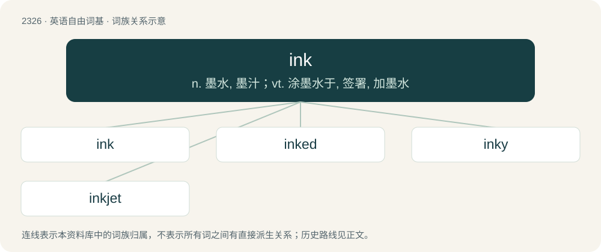

# 2426 · ink — n. 墨水, 墨汁；vt. 涂墨水于, 签署, 加墨水

[总目录](../00_总目录_按常用程度.md)

**类型**：英语自由词基　｜　**来源语言**：见词源记录

## 核心含义与来源

- 核心含义：n. 墨水, 墨汁；vt. 涂墨水于, 签署, 加墨水
- 英文含义：A pigment (or dye)-based fluid used for writing, printing etc.
- 词形：ink

**来源记录 1**（名词；A pigment (or dye)-based fluid used for writing, printing etc.）

From Middle English ynke, from Old French enque, from Latin encaustum (“purple ink used by Roman emperors to sign documents”), from Ancient Greek ἔγκαυστον (énkauston, “burned-in”), from ἐν (en, “in”) + καίω (kaíō, “burn”). In this sense, displaced native Old English blæc (“ink”, literally “black”). Sense four refers to the ink used in newspapers.

## 词族图

## 单词速览（常用到不常用）

| 单词 | 音标 | 释义 |
|---|---|---|
| [ink](#w-1) | /ˈɪŋk/ | n. 墨水, 墨汁；vt. 涂墨水于, 签署, 加墨水 |
| [inked](#w-2) |  | vt. 墨水涂染（ink的过去式） |
| [inky](#w-3) | /ˈɪŋki/ | a. 墨水的, 给墨水弄污的, 漆黑的 |
| [inkjet](#w-4) |  | n. 喷墨打印机；喷墨 |

## 逐词详解

### 1. ink

**词性**：名词　｜　**音标**：/ˈɪŋk/

**中文释义**：n. 墨水, 墨汁；vt. 涂墨水于, 签署, 加墨水

**英文义项**：A pigment (or dye)-based fluid used for writing, printing etc. / A particular type, color or container of this fluid.

**词源与演化**：

From Middle English ynke, from Old French enque, from Latin encaustum (“purple ink used by Roman emperors to sign documents”), from Ancient Greek ἔγκαυστον (énkauston, “burned-in”), from ἐν (en, “in”) + καίω (kaíō, “burn”). In this sense, displaced native Old English blæc (“ink”, literally “black”). Sense four refers to the ink used in newspapers.

**例句**：

> The TSA has been getting a lot of ink lately.

该用例对应义项：Publicity.

### 2. inked

**词性**：形容词

**中文释义**：vt. 墨水涂染（ink的过去式）

**英文义项**：Having a tattoo or tattoos.

**构词拆分**：ink + -ed

**词源与演化**：

From Middle English inked, ynkid (“written in ink”), equivalent to ink + -ed.

### 3. inky

**词性**：形容词　｜　**音标**：/ˈɪŋki/

**中文释义**：a. 墨水的, 给墨水弄污的, 漆黑的

**英文义项**：Synonym of black. / Containing or bearing ink, especially spattered or stained with ink.

**构词拆分**：ink + -y

**词源与演化**：

From ink + -y.

**例句**：

> Arroz negro tastes inky because it's made with squid ink.

### 4. inkjet

**词性**：名词

**中文释义**：n. 喷墨打印机；喷墨

**英文义项**：A device, particularly one used in the printing of documents, which propels tiny droplets of ink to the paper. / An inkjet printer.

**构词拆分**：ink + jet

**词源与演化**：

From ink + jet.

**例句**：

> Inkjets aren't as expensive as they used to be.

该用例对应义项：An inkjet printer.
